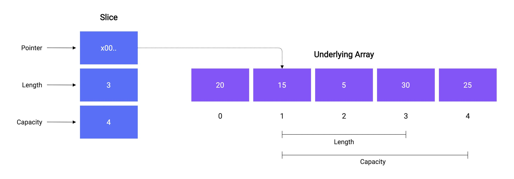

Слайс — это более гибкая **структура** данных, которая позволяет работать с последовательностью элементов и изменять её длину.

У слайса нет фиксированного размера.

```go
var varName []type // Nil slice

// Empty slice
varName := []type{}
varName := make([]type,0)
```

- `varName` - название переменной
- `type` - тип данных, хранящихся в слайсе

Можно сразу заполнить массив:

```go
numbers := []int{10, 20, 30}
```

<Callout title='' type=''>

```go
[3]int // массив
[]int  // слайс
```

</Callout>

<hr />

## Подробнее как устроен слайс

Слайс — это не сам массив. Это небольшая структура, которая ссылается на базовый массив (underlying array).

Внутри слайс содержит три вещи:

1. Pointer — указатель на базовый массив.
2. Length (len) — количество элементов, доступных в слайсе.
3. Capacity (cap) — ёмкость, то есть сколько элементов можно вместить от начала слайса до конца базового массива без его перераспределения.

```go
type slice struct {
    array unsafe.Pointer
    len   int
    cap   int
}
```



<details>
  <summary>Слайсы могут ссылаться на один массив</summary>

Text

```go
package main

import "fmt"

func main() {
    numbers := []int{10, 20, 30, 40, 50}

    slice1 := numbers[1:4]

    fmt.Println(slice1) // [20 30 40]

    slice1[0] = 999

    fmt.Println(numbers) // [10 999 30 40 50]
}
```

Почему изменился `numbers`?

Потому что `slice1` не создал новый массив. Он просто получил доступ к части существующего массива.

```
numbers:
[10] [20] [30] [40] [50]
      └─────────────┘
         slice1
```

</details>

<hr />

## Пустой слайс и `nil` слайс

В Go `nil`-слайс и пустой слайс функционально очень похожи, но отличаются своим внутренним состоянием и поведением в некоторых ситуациях.

```go
// Nil slice
var a []int

// Empty slice
b := []int{}
c := make([]int,0)
```

Слайс в Go содержит три поля:

```go
type slice struct {
    array unsafe.Pointer
    len   int
    cap   int
}
```

У nil-слайса:

```
array = nil
len   = 0
cap   = 0
```

У пустого слайса:

```
array = указатель на область памяти
len   = 0
cap   = 0
```

Самое важное различие — JSON encoding:

- `nil`: `null`
- Empty: `[]`

<hr />

## Передача слайса в функцию

### Изменение элементов слайса внутри функции

```go
func change(s []int) {
    s[0] = 100
}

func main() {
    s := []int{1, 2, 3}

    change(s)

    fmt.Println(s) // [100 2 3]
}
```

Копия структуры слайса и оригинал указывают на один и тот же базовый массив.

Поэтому изменение элемента через один слайс видно через другой.

<hr />

### Изменение длины слайса внутри функции

```go
func change(s []int) {
    s = append(s, 4)
}

func main() {
    s := []int{1, 2, 3}

    change(s)

    fmt.Println(s) // [1 2 3]
}
```

`append` возвращает новый заголовок слайса с обновлённой длиной.<br/>
Внутри функции изменяется копия структуры слайса, а не оригинальная структура в `main`.

<hr />

### Изменение элементов слайса внутри функции после изменения длины слайса внутри функции

```go
package main

import "fmt"

func change(s []int) {
    s = append(s, 4)
	s[0] = 100
}

func main() {
    s := []int{1, 2, 3}
	s1 := make([]int, 0, 5)
	s1 = append(s1, 1, 2, 3)

    change(s)
	change(s1)

    fmt.Println(s) // [1 2 3]
	fmt.Println(s1) // [100 2 3]
}
```

- Если `append` выделил новый базовый массив, изменения его элементов внутри функции не затронут исходный слайс.
- Если новый массив не выделялся, изменения общих элементов будут видны снаружи.

Могут быть ожидания у `s1` = `[100,2,3,4]`, но тогда нужно возвращать новый слайс.

<hr />

### Возврат слайса

Преимущества:

- Понятно, что функция возвращает изменённый слайс.
- Не нужно работать с указателями.
- Удобно использовать результат функции.
- Это распространённый идиоматичный подход в Go.

```go
func change(s []int) []int {
    s = append(s, 4)
    return s
}
```

```go
// В main:
s1 = change(s)
fmt.Println(s) // [100 2 3 4]
```

<hr />

#### production и память

```go
func getFirst10(huge []int) []int {
	return huge[:10]
}
```

Плюс: Очень быстро, нет аллокации и копирования. <br/>
Минус: Разделяется память с исходным массивом.

<Callout title='Важное пояснение с примером' type='warn'>

Ты загружаешь файл размером 100 MB, но сохраняешь только первые 10 байт

На первый взгляд, ты освободил 100 MB. Но это не так!

Новый слайс, продолжает ссылаться на underlying array размером 100 MB.

Это может привести к серьёзным проблемам на production:

- Увеличение потребления RAM.
- Более частые циклы Garbage Collector.
- Рост heap.
- OOM при высокой нагрузке.

</Callout>

- Новая память под элементы не выделяется.
- Возвращается новый slice header, который указывает на тот же underlying array.
- Изменения элементов через возвращённый slice затронут исходный массив.
- Исходный большой массив останется в памяти, пока на него есть ссылки.

```go
func getFirst10Safe(huge []int) []int {
	result := make([]int,10)
	copy(result, huge[:10])
	return result
}
```

или

```go
func getFirst10Safe(huge []int) []int {
    return append([]int(nil), huge[:10]...)
}
```

Плюс: Независимость данных и возможность освободить память исходного большого массива, если больше нет других ссылок. <br/>
Минус: Дополнительная аллокация и копирование.

- Выделяется новый underlying array на 10 элементов.
- Первые 10 элементов копируются.
- Возвращаемый slice не зависит от исходного массива.
- Изменения в одном slice не затрагивают другой.

<hr />

### Передавать указатель на слайс

Преимущества:

- Функция может напрямую изменить исходную структуру слайса.
- Не нужно возвращать слайс.

```go
func change(s *[]int) {
    *s = append(*s, 4)
    (*s)[0] = 100
}

func main() {
    s := []int{1, 2, 3}

    change(&s)

    fmt.Println(s) // [100 2 3 4]
}
```

<hr />

## Основные операции

### Создать слайс `make()`

```go
s := make([]type, length, capacity)
```

- `int` — тип элементов слайса.
- `length` — начальная длина слайса.
- `capacity` — начальная ёмкость слайса (необязательный параметр).

<hr />

### Взять часть

```go

```

### Получить длину `len()`

```go

```

### Получить ёмкость `cap()`

```go

```

<hr />

### Добавить элемент `append()`

```go
newSlice = append(slice,6)
```

- `newSlice` — слайс, в который записывается результат выполнения append.
- `slice` — исходный слайс, к которому добавляется новый элемент.
- `6` — элемент, добавляемый в конец `slice`.

Обычно используют так:

```go
s = append(s,6)
```

<hr />

### Удаление элемента/ов `append()`

В Go нет встроенной функции удаления элемента из слайса. <br/>
Обычно удаляют через `append()`, взяв всё что до удаляемого элемента и склеиваешь с тем что после.

```go
s := []int{1,2,3,4,5}
i := 2 // 3
s = append(s[:i], s[i+1:]...) // 1 2 4 5
```

- `s` - слайс
- `i` - индекс удаляемого элемента
- `append(s[:i], s[i+1:]...)` - до удаляемого элемета + после

<Callout title='' type='warn'>

В данном случае новый массив не создаётся.
Скорее всего, слайс продолжает ссылаться на тот же базовый массив.

`append` фактически перезаписывает элементы в существующем базовом массиве, если его `capacity` хватает.

</Callout>

<hr />

### Скопировать `copy()`

```go

```

<hr />

## Стратегия роста (Growth Strategy) - увелечение `capacity`

Стратегия роста (Growth Strategy) — это алгоритм, по которому Go увеличивает `capacity` слайса, когда при добавлении нового элемента (`append`) текущей ёмкости недостаточно.

<Callout title='' type='warn'>

если заранее известно количество элементов, лучше указывать `capacity`. Это позволяет сократить количество аллокаций и копирований, а значит, повысить производительность.

<details>
  <summary>Пример</summary>

Знаешь, если в слайсе будет 1000 элементов и ты не укажешь `capacity`, то `append` будет несколько раз перелокаций (перевыделять) базовый массив, пока слайс не вырастет до 1000 элементов.

Каждое перевыделение (перелокация) — это выделение нового массива и копирование в него существующих элементов.

Указал `capacity` сразу — 0 перевыделений.

</details>

</Callout>

В какие моменты Go выделяет массив большей ёмкости:

```go
package main

import "fmt"

func main() {
    s := make([]int, 0)

    for i := 0; i < 1281; i++ {
        oldCap := cap(s)
        s = append(s, i)

        if oldCap != cap(s) {
            fmt.Printf(
                "len=%d cap=%d mult=%.2f\n",
                len(s),
                cap(s),
				float64(cap(s))/float64(oldCap),
            )
        }
    }
}
```

<details>
  <summary>Пример</summary>

```go
s := make([]int, 0, 2)

s = append(s, 1, 2)
s = append(s, 3)

fmt.Println(len(s)) // 3
fmt.Println(cap(s)) // 4 (в данном случае)
```

Что произошло:

1. Создали слайс с `capacity` = `2`.
2. Добавили два элемента — ёмкость заполнена.
3. Добавили третий элемент — свободной ёмкости нет.
4. Go выделил новый базовый массив большей ёмкости и скопировал туда элементы.

</details>

### Как Go выбирает новую ёмкость?

Упрощённо:

- Для небольших слайсов ёмкость часто увеличивается примерно в 2 раза.
- Для больших слайсов рост становится более плавным.
- Также учитываются размер элементов и особенности аллокатора памяти.
