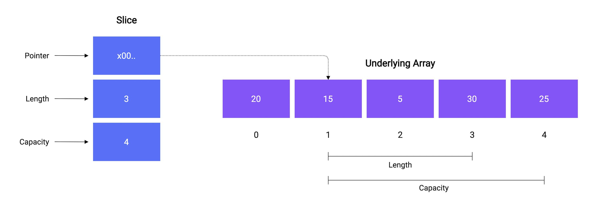

Слайс — это более гибкая **структура** данных, которая позволяет работать с последовательностью элементов и изменять её длину. Заголовок слайса в Go на 64-битной архитектуре занимает 24 байта(8 байт x 3 поля).

У слайса нет фиксированного размера.

```go
var varName []type // Nil slice

// Empty slice
varName := []type{} // С помощью shorthand syntax
varName := make([]type,0,5) // С помощью make
```

- `varName` - название переменной
- `type` - тип данных, хранящихся в слайсе

Можно сразу заполнить массив:

```go
numbers := []int{10, 20, 30}
```

<Callout title='' type=''>

```go
[3]int // массив
[]int  // слайс
```

</Callout>

<div className="hr-decor">✦</div>

## Подробнее как устроен слайс

Слайс — это не сам массив. Это небольшая структура, которая ссылается на базовый массив (underlying array).

Внутри слайс содержит три вещи:

1. Pointer — указатель на базовый массив.
2. Length (len) — количество элементов, доступных в слайсе.
3. Capacity (cap) — ёмкость, то есть сколько элементов можно вместить от начала слайса до конца базового массива без его перераспределения.

```go
type slice struct {
    array unsafe.Pointer
    len   int
    cap   int
}
```



<details>
  <summary>Слайсы могут ссылаться на один массив</summary>

Text

```go
package main

import "fmt"

func main() {
    numbers := []int{10, 20, 30, 40, 50}

    slice1 := numbers[1:4]

    fmt.Println(slice1) // [20 30 40]

    slice1[0] = 999

    fmt.Println(numbers) // [10 999 30 40 50]
}
```

Почему изменился `numbers`?

Потому что `slice1` не создал новый массив. Он просто получил доступ к части существующего массива.

```
numbers:
[10] [20] [30] [40] [50]
      └─────────────┘
         slice1
```

</details>

<div className="hr-decor">✦</div>

## Пустой слайс и `nil` слайс

В Go `nil`-слайс и пустой слайс функционально очень похожи, но отличаются своим внутренним состоянием и поведением в некоторых ситуациях.

```go
// Nil slice
var a []int

// Empty slice
b := []int{}
c := make([]int,0)
```

Слайс в Go содержит три поля:

```go
type slice struct {
    array unsafe.Pointer
    len   int
    cap   int
}
```

У nil-слайса:

```
array = nil
len   = 0
cap   = 0
```

У пустого слайса:

```
array = указатель на область памяти
len   = 0
cap   = 0
```

Самое важное различие — JSON encoding:

- `nil`: `null`
- Empty: `[]`

<div className="hr-decor">✦</div>

## Стратегия роста (Growth Strategy) - увелечение `capacity`

Стратегия роста (Growth Strategy) — это алгоритм, по которому Go увеличивает `capacity` слайса, когда при добавлении нового элемента (`append`) текущей ёмкости недостаточно.

<Callout title='' type='warn'>

если заранее известно количество элементов, лучше указывать `capacity`. Это позволяет сократить количество аллокаций и копирований, а значит, повысить производительность.

<details>
  <summary>Пример</summary>

Знаешь, если в слайсе будет 1000 элементов и ты не укажешь `capacity`, то `append` будет несколько раз перелокаций (перевыделять) базовый массив, пока слайс не вырастет до 1000 элементов.

Каждое перевыделение (перелокация) — это выделение нового массива и копирование в него существующих элементов.

Указал `capacity` сразу — 0 перевыделений.

</details>

</Callout>

В какие моменты Go выделяет массив большей ёмкости:

```go
package main

import "fmt"

func main() {
    s := make([]int, 0)

    for i := 0; i < 1281; i++ {
        oldCap := cap(s)
        s = append(s, i)

        if oldCap != cap(s) {
            fmt.Printf(
                "len=%d cap=%d mult=%.2f\n",
                len(s),
                cap(s),
				float64(cap(s))/float64(oldCap),
            )
        }
    }
}
```

<details>
  <summary>Пример</summary>

```go
s := make([]int, 0, 2)

s = append(s, 1, 2)
s = append(s, 3)

fmt.Println(len(s)) // 3
fmt.Println(cap(s)) // 4 (в данном случае)
```

Что произошло:

1. Создали слайс с `capacity` = `2`.
2. Добавили два элемента — ёмкость заполнена.
3. Добавили третий элемент — свободной ёмкости нет.
4. Go выделил новый базовый массив большей ёмкости и скопировал туда элементы.

</details>

### Как Go выбирает новую ёмкость?

Упрощённо:

- Для небольших слайсов ёмкость часто увеличивается примерно в 2 раза.
- Для больших слайсов рост становится более плавным.
- Также учитываются размер элементов и особенности аллокатора памяти.

<div className="hr-decor">✦</div>

## Основные операции

### Создать слайс `make()`

Способ с `make` дает нам возможность задать тип, длину и вместимость.

```go
s := make([]type, length, capacity)

s1 := make([]type, length)
// len = cap
```

- `int` — тип элементов слайса.
- `length` — начальная длина слайса.
- `capacity` — начальная ёмкость слайса (необязательный параметр).

- Если `capacity` не указан, он равен `length`,
- `length` не может быть больше `capacity` <br/>
- При `length > 0`, элементы заполнятся zero value

<hr />

### Создать слайс Shorthand-syntax

```go
s := []int{1, 2, 3}

// len = cap = кол-во элементов
```

<hr />

### Обращение к элементу по индексу

```go
fmt.Println("Read", slice[0]) // panic: index out of range
```

<Callout title='' type='warn'>

Если `len == 0` или попытаться обратиться за пределами `len` (хотя у слайса может быть свободная `cap`) будет: <br/>
`panic: index out of range`

</Callout>

<hr />

### Перезаписать элемент

```go
slice[0] = "Alice" //
```

<Callout title='' type='warn'>

Если `len == 0` или попытаться обратиться за пределами `len` (хотя у слайса может быть свободная `cap`) будет: <br/>
`panic: index out of range`

</Callout>

<hr />

### Получить длину `len()`

```go
len(slice)
```

<Callout title='' type='tip'>

В Go функция `len()` может вычисляться как на этапе компиляции, так и во время выполнения. Это зависит от того, над каким типом вызывается `len()` и известен ли компилятору размер.

</Callout>

<hr />

### Получить ёмкость `cap()`

```go
cap(slice)
```

<hr />

### Slicing

```go
slice[n:m]
```

Выбирает элементы с индекса `n` (включительно) до индекса `m` (не включительно, или как говорится исключительно).

```go
slice[:] // взять все элементы
```

- При отсутствии `n` - срез начинается с первого элемента (индекс `0`).
- При отсутствии `m` - срез продолжается до конца исходного массива или слайса (не включая индекс `len(slice)`, но включая последний существующий элемент).
- Если `m` выйдет за `len`, вывод будет zero value

```go
s := make([]int,0,5)
fmt.Println(s[:5])
```

<Callout title='' type='tip'>

Результат slicing — это новый слайс, но его элементы могут ссылаться на ту же область памяти, что и исходный массив или слайс.

```go
//         0  1  2  3  4
s := []int{1, 2, 3, 4, 5}
sub := s[1:3]

sub[0] = 100 // 2 -> 100

fmt.Println(s) // [1 100 3 4 5]
```

</Callout>

#### Ограничить ёмкость

```go
slice[n:m:max]
```

- max - размер `cap`

<details>
  <summary>Пример</summary>

```go
users := []string{"Bob", "Alice", "Kate"}
users1 := users[0:2]            // берем первые 2 элемента
fmt.Println("Len", len(users1)) // 2
fmt.Println("Cap", cap(users1)) // 3 <- ёмкость массива под капотом

users2 := users[0:2:2]          // <- ограничиваем ёмкость
fmt.Println("Len", len(users2)) // 2
fmt.Println("Cap", cap(users2)) // 2 <- ограничили ёмкость слайса (массив под капотом не изменился)
```

</details>

#### Создать слайс на основе массива

```go
arr := [5]int{1, 2, 3, 4, 5}
s := arr[:] // создать слайс на основе массива
```

<hr />

### Добавить элемент `append()`

```go
newSlice = append(slice,6)
```

- `newSlice` — слайс, в который записывается результат выполнения append.
- `slice` — исходный слайс, к которому добавляется новый элемент.
- `6` — элемент, добавляемый в конец `slice`.

Обычно используют так:

```go
s = append(s,6)
```

<hr />

### Удаление элемента/ов `append()`

В Go нет встроенной функции удаления элемента из слайса. <br/>
Обычно удаляют через `append()`, взяв всё что до удаляемого элемента и склеиваешь с тем что после.

```go
s := []int{1,2,3,4,5}
i := 2 // 3
s = append(s[:i], s[i+1:]...) // 1 2 4 5
```

- `s` - слайс
- `i` - индекс удаляемого элемента
- `append(s[:i], s[i+1:]...)` - до удаляемого элемета + после

<Callout title='' type='warn'>

В данном случае новый массив не создаётся.
Скорее всего, слайс продолжает ссылаться на тот же базовый массив.

`append` фактически перезаписывает элементы в существующем базовом массиве, если его `capacity` хватает.

</Callout>

<hr />

### Скопировать `copy()`

```go
copy(sliceCopy, sliceOriginal)
```

```go
s1 := []string{"D", "a", "n", "i", "i", "l"}
s2 := make([]string, len(s1), cap(s1))
copy(s2, s1)
```

<hr />

### Сброс (в zero value) `clear()`

```go
clear(slice)
```

<hr />

### Сравнение слайсов

В Go слайсы нельзя сравнивать между собой с помощью операторов `==` и `!=`.

Исключение — сравнение с `nil`.

```go
slice == nil
slice != nil
```

<details>
  <summary>Почему нельзя сравнивать слайсы?</summary>

Потому что слайс — это структура, содержащая:

- Указатель на базовый массив.
- Длину (`len`).
- Ёмкость (`cap`).

Go не определяет, что именно должно означать сравнение двух слайсов: сравнение указателей, длины, ёмкости или всех элементов.

</details>

#### Сравнить содержимое слайсов

Для этого можно использовать `slices.Equal` из стандартной библиотеки Go (начиная с Go 1.21).

```go
package main

import (
    "fmt"
    "slices"
)

func main() {
    a := []int{1, 2, 3}
    b := []int{1, 2, 3}

    fmt.Println(slices.Equal(a, b)) // true
}
```

<div className="hr-decor">✦</div>

## Передача слайса в функцию

### Изменение элементов слайса внутри функции

```go
func change(s []int) {
    s[0] = 100
}

func main() {
    s := []int{1, 2, 3}

    change(s)

    fmt.Println(s) // [100 2 3]
}
```

Копия структуры слайса и оригинал указывают на один и тот же базовый массив.

Поэтому изменение элемента через один слайс видно через другой.

<hr />

### Изменение длины (`capacity`) слайса внутри функции

```go
func change(s []int) {
    s = append(s, 4)
}

func main() {
    s := []int{1, 2, 3}

    change(s)

    fmt.Println(s) // [1 2 3]
}
```

`append` возвращает новый заголовок слайса с обновлённой длиной.<br/>
Внутри функции изменяется копия структуры слайса, а не оригинальная структура в `main`.

<hr />

#### Изменение элементов слайса внутри функции после изменения длины (`capacity`) слайса внутри функции

```go
package main

import "fmt"

func change(s []int) []int {
    s = append(s, 4)
    return s
}

func main() {
    s := []int{1, 2, 3}

    s = change(s)

    fmt.Println(s) // [1 2 3 4]
}
```

- Если `append` выделил новый базовый массив, изменения его элементов внутри функции не затронут исходный слайс.
- Если новый массив не выделялся, изменения общих элементов будут видны снаружи.

<hr />

### Возврат слайса

Преимущества:

- Понятно, что функция возвращает изменённый слайс.
- Не нужно работать с указателями.
- Удобно использовать результат функции.
- Это распространённый идиоматичный подход в Go.

```go
func change(s []int) []int {
    s = append(s, 4)
    return s
}
```

```go
// В main:
s1 = change(s)
fmt.Println(s) // [100 2 3 4]
```

<hr />

#### production и память

```go
func getFirst10(huge []int) []int {
	return huge[:10]
}
```

Плюс: Очень быстро, нет аллокации и копирования. <br/>
Минус: Разделяется память с исходным массивом.

<Callout title='Важное пояснение с примером' type='warn'>

Ты загружаешь файл размером 100 MB, но сохраняешь только первые 10 байт

На первый взгляд, ты освободил 100 MB. Но это не так!

Новый слайс, продолжает ссылаться на underlying array размером 100 MB.

Это может привести к серьёзным проблемам на production:

- Увеличение потребления RAM.
- Более частые циклы Garbage Collector.
- Рост heap.
- OOM при высокой нагрузке.

</Callout>

- Новая память под элементы не выделяется.
- Возвращается новый slice header, который указывает на тот же underlying array.
- Изменения элементов через возвращённый slice затронут исходный массив.
- Исходный большой массив останется в памяти, пока на него есть ссылки.

```go
func getFirst10Safe(huge []int) []int {
	result := make([]int,10)
	copy(result, huge[:10])
	return result
}
```

или

```go
func getFirst10Safe(huge []int) []int {
    return append([]int(nil), huge[:10]...)
}
```

Плюс: Независимость данных и возможность освободить память исходного большого массива, если больше нет других ссылок. <br/>
Минус: Дополнительная аллокация и копирование.

- Выделяется новый underlying array на 10 элементов.
- Первые 10 элементов копируются.
- Возвращаемый slice не зависит от исходного массива.
- Изменения в одном slice не затрагивают другой.

<hr />

### Передавать указатель на слайс

Преимущества:

- Функция может напрямую изменить исходную структуру слайса.
- Не нужно возвращать слайс.

```go
func change(s *[]int) {
    *s = append(*s, 4)
    (*s)[0] = 100
}

func main() {
    s := []int{1, 2, 3}

    change(&s)

    fmt.Println(s) // [100 2 3 4]
}
```

<div className="hr-decor">✦</div>

## Пример (файл)

Инициализация:

```go
package main

import (
	"fmt"
	"unsafe"
)

// На самом деле slice это структура:
type slice struct {
	array unsafe.Pointer
	len   int
	cap   int
}

func main() {
	// Неинициализированный слайс
	var nilSlice []string // nil

	fmt.Println("nilSlice == nil:", nilSlice == nil) // true
	fmt.Println("len", len(nilSlice))                // 0
	fmt.Println("cap", cap(nilSlice))                // 0

	// Инициализированный слайс
	var initSlice = []string{}

	fmt.Println("initSlice == nil:", initSlice == nil) // false
	fmt.Println("len", len(initSlice))                 // 0
	fmt.Println("cap", cap(initSlice))                 // 0

	// Если len == 0, нельзя обратиться к 1 элементу по индексу
	//fmt.Println("Read", initSlice[0]) // panic: index out of range

	// Записать тоже нельзя
	//initSlice[0] = "Alice" // panic: index out of range

	// Можно добавить элемент в конец слайса
	initSlice = append(initSlice, "Alice")

	fmt.Println("initSlice after append:", initSlice) // [Alice]
	fmt.Println("len", len(initSlice))                // 1
	fmt.Println("cap", cap(initSlice))                // 1

	// Теперь можем обратиться к 1 элементу по индексу
	fmt.Println("Read", initSlice[0])

	// И можем перезаписать
	initSlice[0] = "Bob"

	// Инициализированный через литерал слайс сразу с элементами
	var users = []string{"Bob", "Tom", "Alice"}
	_ = users

	// Создание слайса с помощью make
	var makeSlice = make([]string, 0, 5)
	fmt.Println("makeSlice == nil:", makeSlice == nil) // false
	fmt.Println("len", len(makeSlice))                 // 0
	fmt.Println("cap", cap(makeSlice))                 // 5
}
```

Доступ к элементам (перебор), добавить, сброс (zero value), cоздание, копирование

```go
package main

import (
	"fmt"
)

func main() {
	{ // Доступ             0       1        2
		users := []string{"Tom", "Alice", "Kate"}

		fmt.Println(len(users)) // 3
		fmt.Println(cap(users)) // 3

		// Доступ к 3 элементу
		kate := users[2]

		// Перезапись 3 элемента
		users[2] = kate

		// Перебор (есть риск выйти за границы)
		for i := 0; i < len(users); i++ {
			fmt.Println(users[i])
		}

		// Перебор (нет риска выйти за границы)
		for _, user := range users {
			fmt.Println(user)
		}

		//	Добавить элемент в конец слайса
		users = append(users, "Paul")

		// Clear - сброс значений слайса в zero value, длина и ёмкость остаются прежними
		clear(users)

		fmt.Println("After clear:", users) // ["", "", "", ""]

		// Создание слайса с указанием длины и ёмкости
		users2 := make([]string, 3)    // length 3, capacity 3
		users3 := make([]string, 0, 3) // length 0, capacity 3

		_, _ = users2, users3
	}

	{ // Копирование
		src := []string{"Tom", "Alice", "Kate"}
		dst := make([]string, len(src))

		copy(dst, src) // Копирование слайса

		fmt.Println("Copy", dst) // ["Tom", "Alice", "Kate"]
	}

	{ // Из строки можно скопировать в []byte, но не наоборот, т.к. строка неизменяемая
		users := []byte("Tom")

		copy(users, "Alice") // Копирование слайса

		fmt.Println("Copy string", string(users)) // "Ali"
	}
}
```

Слайсинг

```go
package main

import "fmt"

func main() {
	{ // Slicing            0       1       2       3      4      5	       6        7
		users := []string{"Bob", "Alice", "Kate", "Sam", "Tom", "Paul", "Mike", "Robert"}

		fmt.Println(users[:])   // ["Bob", "Alice", "Kate", "Sam", "Tom", "Paul", "Mike", "Robert"]
		fmt.Println(users[0:0]) // []
		fmt.Println(users[1:1]) // []
		fmt.Println(users[:1])  // ["Bob"]
		fmt.Println(users[0:1]) // ["Bob"]
		fmt.Println(users[1:2]) // ["Alice"]
		fmt.Println(users[2:4]) // ["Kate", "Sam"]
		fmt.Println(users[3:6]) // ["Sam", "Tom", "Paul
		fmt.Println(users[7:])  // ["Robert"]
		fmt.Println(users[7:8]) // ["Robert"]
		fmt.Println(users[8:8]) // []
		fmt.Println(users[9:])  // panic: slice bounds out of range
		fmt.Println(users[:9])  // panic: slice bounds out of range
	}

	{ // Slicing            0       1       2       3      4      5	       6        7
		users := []string{"Bob", "Alice", "Kate", "Sam", "Tom", "Paul", "Mike", "Robert"}

		users1 := users[2:6]
		users2 := users[:4]
		users3 := users[3:]
		users4 := users[:] // взять всё (так можно из массива сделать слайс)

		fmt.Println(users1) // ["Kate", "Sam", "Tom", "Paul"]
		fmt.Println(users2) // ["Bob", "Alice", "Kate", "Sam"]
		fmt.Println(users3) // ["Sam", "Tom", "Paul", "Mike", "Robert"]
		fmt.Println(users4) // ["Bob", "Alice", "Kate", "Sam", "Tom", "Paul", "Mike", "Robert"]
	}

	{ // А ещё можно ограничить ёмкость слайса
		users := []string{"Bob", "Alice", "Kate"}
		users1 := users[0:2]            // берем первые 2 элемента
		fmt.Println("Len", len(users1)) // 2
		fmt.Println("Cap", cap(users1)) // 3 <- ёмкость массива под капотом

		users2 := users[0:2:2]          // <- ограничиваем ёмкость
		fmt.Println("Len", len(users2)) // 2
		fmt.Println("Cap", cap(users2)) // 2 <- ограничили ёмкость слайса (массив под капотом не изменился)
	}

	{ // Удаление           0        1       2
		users := []string{"Tom", "Alice", "Kate"}

		// Удаление по индексу
		users = append(users[:1], users[2:]...)

		fmt.Println(users) // ["Tom", "Kate"]
	}
}
```

Передача слайса как аргумент и возврат в функции

```go
package main

import (
	"fmt"
)

func main() {
	var names = []string{"Tom", "Alice", "Kate"}

	// Рисовать: Передача слайса в функцию
	printer := func(s []string) {
		fmt.Println(s)
	}

	// Структура слайса копируется!
	printer(names)

	// Рисовать: Возврат из функции
	returner := func() []string {
		s := []string{"Tom", "Alice", "Kate"}
		return s
	}

	// Получили копию структуры (копию указателя на массив и копии len и cap)
	s := returner()
	_ = s
}
```

Append

```go
package main

import "fmt"

func main() {
	{ // Length и Capacity
		var users []string

		fmt.Println(len(users), cap(users)) // 0 0

		users = append(users, "Tom")
		fmt.Println(len(users), cap(users)) // 1 1

		users = append(users, "Tom")
		fmt.Println(len(users), cap(users)) // 2 2

		users = append(users, "Tom")
		fmt.Println(len(users), cap(users)) // 3 4

		users = append(users, "Tom")
		fmt.Println(len(users), cap(users)) // 4 4

		users = append(users, "Tom")
		fmt.Println(len(users), cap(users)) // 5 8 [8]string{"Tom", "Tom", "Tom", "Tom", "Tom", "", "", ""}
	}

	{ // Измеряем capacity
		var capacity int

		for range 40 {
			s := make([]int, capacity)
			s = append(s, 1)

			fmt.Println(capacity, "->", cap(s), fmt.Sprintf("%.2f", float32(cap(s))/float32(capacity)))

			capacity = cap(s)
		}
	}

	// Output
	// Рост capacity у слайса:
	// 0		->	 1
	// 1		->	 2		 2.00
	// 2		->	 4		 2.00
	// 4		->	 8		 2.00
	// 8		->	 16		 2.00
	// 16		->	 32		 2.00
	// 32		->	 64		 2.00
	// 64		->	 128	 2.00
	// 128		->	 256	 2.00
	// 256		->	 512	 2.00
	// 512		->	 848	 1.66
	// 848		->	 1280	 1.51
	// 1280		->	 1792	 1.40
	// 1792		->	 2560	 1.43
	// 2560		->	 3408	 1.33
	// 3408		->	 5120	 1.50
	// 5120		->	 7168	 1.40
	// 7168		->	 9216	 1.29
	// 9216		->	 12288	 1.33
	// 12288	->	 16384	 1.33
	// 16384	->	 21504	 1.31
	// 21504	->	 27648	 1.29
	// 27648	->	 34816	 1.26
	// 34816	->	 44032	 1.26
	// 44032	->	 55296	 1.26
	// 55296	->	 69632	 1.26
	// 69632	->	 88064	 1.26
	// 88064	->	 110592	 1.26
	// 110592	->	 139264	 1.26
	// 139264	->	 175104	 1.26
	// 175104	->	 219136	 1.25 // далее 1.25

	{ // Преаллокация через make (оптимизация для уменьшения аллокаций)
		// И длина и емкость будут 3.
		// Слайс будет проинициализирован 3 нулевыми значениями
		users := make([]string, 3)

		fmt.Println(len(users)) // 3
		fmt.Println(cap(users)) // 3

		users[0] = "Tom"
		users[1] = "Alice"
		users[2] = "Bob"

		// Длина будет 0, а емкость 3
		users2 := make([]string, 0, 3)

		fmt.Println(len(users)) // 0
		fmt.Println(cap(users)) // 3

		// Так обратиться уже нельзя, будет паника из-за выхода за границы слайса
		users[0] = "Tom"

		// Но можно добавлять элементы через append
		users2 = append(users2, "Tom")
		users2 = append(users2, "Alice")
		users2 = append(users2, "Bob")

		// Создание пустого слайса с преаллоцированым массивом на 1_000_000 элементов
		users3 := make([]string, 0, 1_000_000) // под капотом массив [1_000_000]string

		fmt.Println("users3: ", len(users3), cap(users3)) // 0 1_000_000

		// Теперь можем добавить 1_000_000 элементов без аллокаций
		for i := 0; i < 1_000_000; i++ {
			users3 = append(users3, "Tom")
		}

		fmt.Println("users3: ", len(users3), cap(users3)) // 1_000_000 1_000_000

		// При добавлении 1_000_001, произойдёт аллокация, новый массив будет больше примерно в 1.25 раз
		users3 = append(users3, "Tom")

		fmt.Println("users3: ", len(users3), cap(users3)) // 1_000_001 1_250_304

		_ = users3
	}
}
```

<div className="hr-decor">✦</div>

## Ссылки

- [О массивах и слайсах в Go](https://habr.com/ru/articles/739754/)
- [Владимир Балун | Ты не все знаешь о массивах и слайсах в Go](https://youtu.be/7ij3u-0YsJI)
