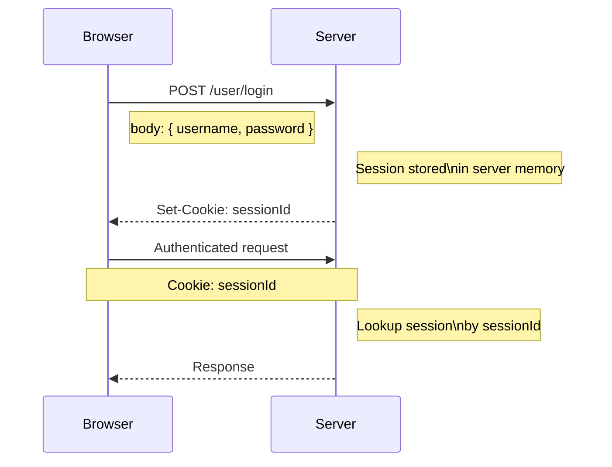
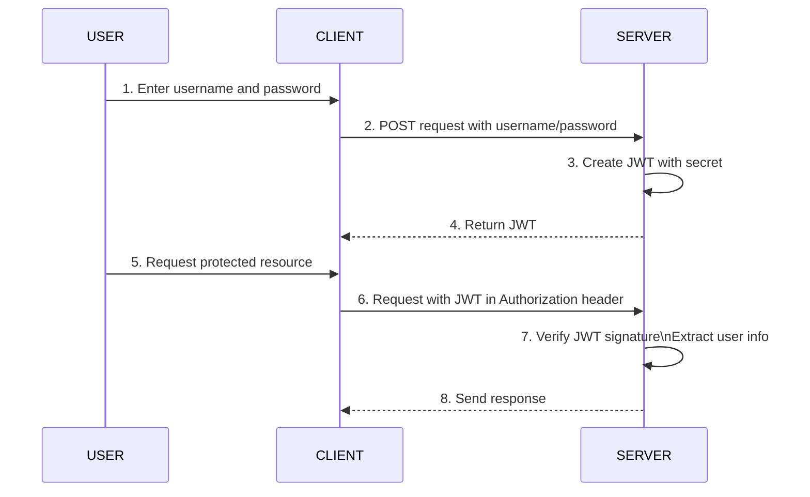
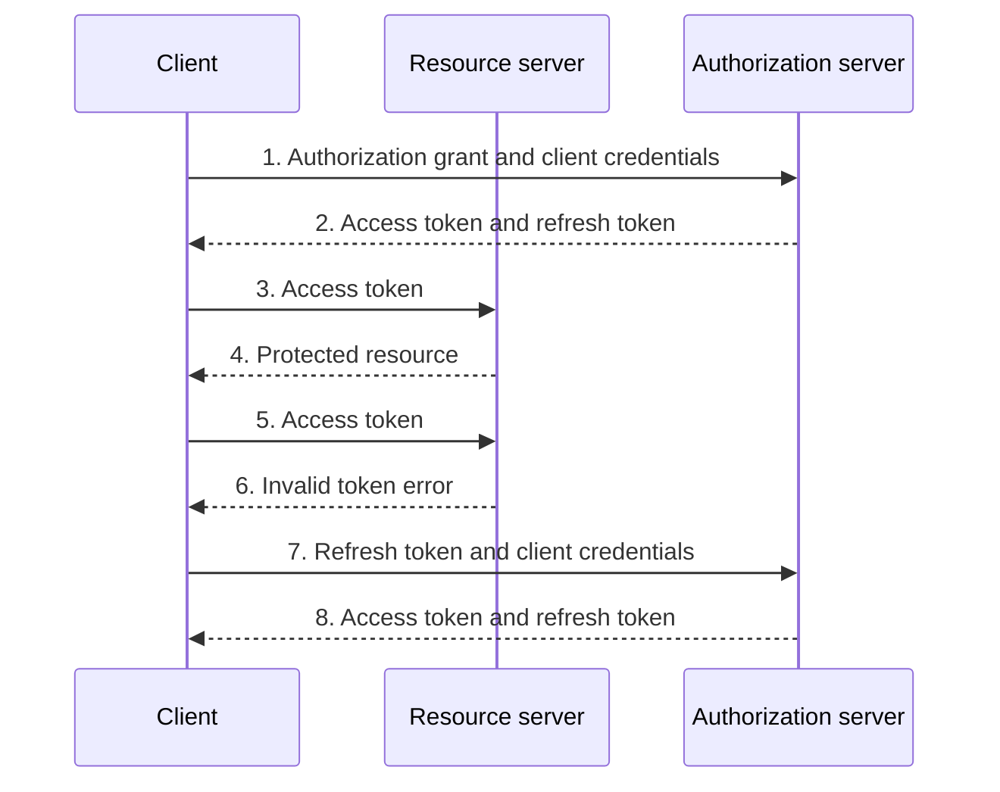

## Basic Authentication (Basic Auth)

— это простой способ аутентификации пользователя в протоколе HTTP, при котором клиент отправляет логин и пароль с каждым запросом.

```http
Authorization: Basic <Base64(username:password)>
```

```http
GET /profile HTTP/1.1
Host: example.com
Authorization: Basic YWxpY2U6MTIzNDU=
```

Basic Auth часто применяется для межсерверной аутентификации (service-to-service authentication), особенно:

- во внутренних API;
- в микросервисах внутри защищенной сети;
- для простых интеграций между двумя системами;
- для тестирования API.

### Как работает

1. Пользователь вводит логин и пароль.
2. Клиент объединяет их в строку:

```
username:password
```

3. Эта строка кодируется в Base64 (это не шифрование, а лишь способ представления данных).
4. Клиент отправляет HTTP-заголовок:

```http
Authorization: Basic YWxpY2U6MTIzNDU=
```

5. Сервер декодирует строку, проверяет логин и пароль и либо предоставляет доступ, либо возвращает ошибку 401 Unauthorized.

### Преимущества и недостатки

| Преимущества                                           | Недостатки                                                                                 |
| ------------------------------------------------------ | ------------------------------------------------------------------------------------------ |
| Очень прост в реализации.                              | Логин и пароль отправляются при каждом запросе.                                            |
| Поддерживается большинством HTTP-клиентов и браузеров. | Base64 — это не шифрование                                                                 |
| Подходит для тестирования API и внутренних сервисов.   | При компрометации данных злоумышленник получает реальные учетные данные пользователя.      |
| Часто применяется для межсерверной аутентификации      | Не поддерживает удобные механизмы выхода из системы или управления временем жизни доступа. |

<hr />

## Session Cookie

— это небольшой файл ([cookie](../cookie)), который браузер хранит только во время текущей сессии и автоматически удаляет после закрытия браузера (если не настроено иначе).

Важно понимать:

- Cookie хранит только идентификатор сессии (Session ID).
- Данные пользователя хранятся на сервере.

<details>
  <summary> Пример </summary>

    На сервере:

    ```
    sessionId = abc123

    Пользователь: Ivan
    Роль: ADMIN
    Время входа: 10:30
    ```

    В браузере:

    ```
    sessionId=abc123
    ```

</details>

### Как работает

1. Пользователь входит в систему (логин + пароль).
2. Сервер проверяет данные. (Пример: Идентификация по `username` + аутентификация по `password`).
3. Сервер создает _( объект сессии или запись о сессии )_ **сессию (Session)** и сохраняет ее у себя, например:

```json
{
  "sessionId": "abc123",
  "userId": 42,
  "username": "ivan",
  "role": "ADMIN",
  "createdAt": "2026-07-02T10:00:00Z",
  "expiresAt": "2026-07-02T12:00:00Z"
}
```

<details>
  <summary> Где может храниться сессия? </summary>

    1. В оперативной памяти (RAM)
    2. В базе данных
    3. В Redis
    4. В распределенных хранилищах

</details>

4. Сервер отправляет браузеру cookie:

```http
Set-Cookie: sessionId=abc123; HttpOnly; Secure
```

5. Браузер сохраняет этот cookie и автоматически отправляет его с каждым следующим запросом:

```http
Cookie: sessionId=abc123
```

6. Сервер по `sessionId` находит сессию и понимает, какой пользователь сделал запрос.



### Дополнительные меры защиты

В реальных системах IP и User-Agent: используют как "risk signals" <br/>
Современные защиты:

- HttpOnly + Secure cookies (защищают от кражи через JS (XSS))
- SameSite cookie (защищает от CSRF атак)
- Rotation session ID
- Device fingerprinting
- Anomaly detection

#### Привязка сессии к IP-адресу

Сервер запоминает IP пользователя при создании сессии

```
ip: 192.168.1.10
```

И сравнивает при каждом запросе.

:::warning[Минусы (очень важные)]

IP часто меняется:

1. мобильный интернет
2. VPN
3. Wi-Fi ↔ LTE переключение
4. корпоративные прокси

<hr />

NAT (много пользователей = один IP):

1. в офисах или у провайдера
2. сотни людей могут иметь один IP

:::

#### Привязка к User-Agent

Сервер запоминает браузер:

```
User-Agent: Chrome / Windows / 120.0
```

И сравнивает при каждом запросе.

:::warning[Минусы (очень важные)]

1. User-Agent легко подделать
2. User-Agent не уникален
3. Браузеры могут обновляться

:::

### Преимущества и недостатки

| Преимущества                                                                                                                                                                   | Недостатки                                                                                         |
| ------------------------------------------------------------------------------------------------------------------------------------------------------------------------------ | -------------------------------------------------------------------------------------------------- |
| **Безопаснее, чем хранить данные на клиенте** _<br/> В cookie хранится только sessionId, а не пароль или данные пользователя. Все важное хранится на сервере._                 | Проблема масштабирования (stateful)                                                                |
| **Можно легко управлять доступом** _<br/> Сервер может:<br />- завершить сессию (logout)<br />- принудительно разлогинить пользователя<br />- ограничить время жизни сессии_   | Нагрузка на серверное хранилище (+1 запрос к БД)                                                   |
| **Можно централизованно контролировать сессии** _<br/> Если сессии хранятся в Redis или БД: можно увидеть все активные сессии, можно отозвать доступ конкретному пользователю_ | Не очень удобно для API и микросервисов _<br/> (зависимы от сервиса авторизации, все идут к нему)_ |
| **Поддержка stateful логики** _<br/> Можно хранить: <br/> - роли пользователя <br/> - временные данные (например, шаги формы) <br/>_                                           | Зависимость от серверного состояния                                                                |
| **Удобно для веб-приложений** _<br/> Браузер автоматически отправляет cookie с каждым запросом, разработчику не нужно вручную добавлять токены._                               | Cookie уязвимы к атакам (если плохо настроены)                                                     |

<hr />

## JWT (JSON Web Token)

| [Онлайн-инструмент и справочный сайт](https://www.jwt.io/) |
| ---------------------------------------------------------- |

— это компактный стандарт токена, который используется в веб-приложениях для передачи информации о пользователе между клиентом и сервером в безопасном виде.

:::danger
JWT по умолчанию не шифрует данные.
:::

Он применяется в связке с тремя понятиями: идентификация, аутентификация и авторизация:

1. **Индетификация** <br/>
   JWT обычно содержит идентификатор
   ```json
   {
     "userId": 123,
     "email": "test@mail.com"
   }
   ```
2. **Аутентификация** <br/>
   JWT обычно выдают после логина
3. **Авторизация** <br/>
   Когда пользователь делает запрос - сервер расшифровывает токен - решает: разрешить или запретить действие

### Структура

```
xxxxx.yyyyy.zzzzz
```

Она состоит из трёх частей:

1. Header (заголовок) — тип токена и алгоритм подписи
2. Payload (данные / claims) — информация о пользователе
3. Signature (подпись) — защита от подделки
   Предположим, сервер знает секретный ключ: `mySuperSecretKey` <br/>
   Сервер берет строку: `Base64Url(Header) + "." + Base64Url(Payload)` (например abc.def) <br/>
   Вычисляет:
   ```
   HMAC_SHA256(
    "abc.def",
    "mySuperSecretKey"
   )
   ```
   Результат будет длинной последовательностью байтов. Ее тоже кодируют Base64URL. Получается третья часть JWT.

Пример данных в payload:

- userId
- роль (admin/user)
- срок действия (exp)

### Как работает

1. Пользователь вводит логин/пароль
2. Сервер проверяет их
3. Если всё верно — сервер выдаёт JWT
4. Клиент сохраняет токен (например, в localStorage или cookie)
5. Клиент отправляет JWT в заголовке:

```
Authorization: Bearer <token>
```

6. Сервер расшифровывает токен
7. Проверяет: роль пользователя, права доступа. Решает: разрешить или запретить действие



:::important
В шаге №7 мы не делаем лишнего запроса к БД и можем делать его на любом сервисе.
:::

### Преимущества и недостатки

| Преимущества                                                                                                                                        | Недостатки                                         |
| --------------------------------------------------------------------------------------------------------------------------------------------------- | -------------------------------------------------- |
| [Stateless](#http-stateless-без-сохранения-состояния) Не надо делать запрос к базе <br/> Проверка токена происходит без участия сервиса авторизации | Можно украсть (т.к. часто хранится в localStorage) |
| Пароль в безопасности. На клиенте хранится только токен                                                                                             | Нельзя отозвать (как в session)                    |
| Универсальность. Стандарт не завязан на язык или фреймворк.                                                                                         | -                                                  |

<hr />

## Access token + Refresh token

— это способ аутентификации в современных веб-приложениях и API. <br/>
Идея в том, чтобы разделить **краткоживущий токен** для доступа и **долгоживущий токен** для обновления.

**Access Token** — для доступа к защищенным ресурсам.

- живет недолго (5–30 минут);
- если его украдут, злоумышленник сможет пользоваться им только ограниченное время.

**Refresh Token** — для получения нового **Access Token**, когда старый истечет. <br/>
Refresh Token хранится в базе данных (наиболее распространенный вариант)

- живет долго;

### Как работает

1. Пользователь вводит логин/пароль
2. Сервер проверяет их
3. Если всё верно — сервер создаёт и выдаёт **access token**. Затем создаёт **refresh token**, сохраняет его (или, что безопаснее, его хэш) в базе данных. Отправляет сам токен клиенту в `HttpOnly` cookie.
4. Клиент сохраняет токены (например, **Access Token** — в памяти приложения, а **Refresh Token** — в `HttpOnly` cookie).
5. При обращении к защищенным ресурсам клиент отправляет **Access Token** в заголовке запроса::

```
Authorization: Bearer <access_token>
```

6. Сервер проверяет подпись и срок действия **Access Token**, затем извлекает из него данные (например, идентификатор пользователя и его роль).
7. Если срок действия **Access Token** истек, клиент отправляет **Refresh Token** на специальный эндпоинт для получения нового **Access Token**, после чего повторяет исходный запрос.
8. Проверяет: роль пользователя, права доступа. Решает: разрешить или запретить действие



### Ситуации для продумывания логики

Кейсы:

| Ситуация                                                        | Что делать                                                                                                                       |
| --------------------------------------------------------------- | -------------------------------------------------------------------------------------------------------------------------------- |
| **Access token отсутствует**                                    | Попытаться сделать `refresh`. Если успешно — получить новый access token и запросить `/me`. Если нет — разлогинить пользователя. |
| **Access token есть и валиден**                                 | Сразу вызвать `/me`. Если `200` — пользователь авторизован.                                                                      |
| **Access token истёк, refresh cookie валиден**                  | `/me` возвращает `401` → выполнить `refresh` → сохранить новый access token → повторить `/me`.                                   |
| **Access token недействителен** (подделан, отозван и т.п.)      | Аналогично `401` → попробовать `refresh`. Если refresh успешен — использовать новый token. Если нет — logout.                    |
| **Refresh token истёк**                                         | `refresh` возвращает `401/403` → очистить access token → перейти на экран логина.                                                |
| **Refresh вернул новый access token, но `/me` всё равно `401`** | Считать сессию неконсистентной → очистить токены → logout. Не пытаться обновлять бесконечно.                                     |
| **Ошибка сети**                                                 | Не разлогинивать пользователя. Показать ошибку/экран offline, дать возможность повторить запрос.                                 |
| **Сервер `500`**                                                | Не разлогинивать. Показать сообщение о временной ошибке сервера и предложить повторить позже.                                    |

### Преимущества и недостатки

| Преимущества                                                                                                                     | Недостатки |
| -------------------------------------------------------------------------------------------------------------------------------- | ---------- |
| Stateful за счет refresh_token, который находится на сервере                                                                     | -          |
| Если украдут access_token, то злоумышленник не успеет ничего сделать (ограниченное время)                                        | -          |
| Если украдут refresh_token, то достаточно изменить пароль и refresh_token обновится                                              | -          |
| Для доступа к данным мы можем использовать **resource server**, для его аутентификации и выдачу токенов **authorization server** | -          |
