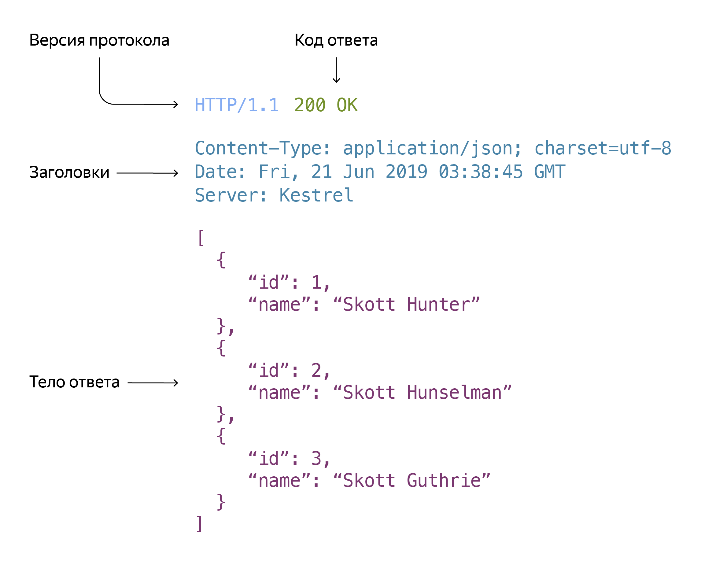

**HTTP (HyperText Transfer Protocol, «протокол передачи гипертекста»)** — это протокол прикладного уровня, по которому клиент и сервер обмениваются данными в интернете.

:::warning
Данные передаются без шифрования.
:::

Пример HTTP-запроса:

```http
GET /index.html HTTP/1.1
Host: example.com
User-Agent: Mozilla/5.0 (Windows NT 10.0; Win64; x64) AppleWebKit/537.36 (KHTML, like Gecko) Chrome/98.0.4758.82 Safari/537.36
Accept: text/html,application/xhtml+xml,application/xml;q=0.9,image/avif,image/webp,image/apng,*/*;q=0.8,application/signed-exchange;v=b3;q=0.9
Accept-Language: ru-RU,ru;q=0.9
Connection: close
```

<hr />

## HTTP-запрос/ответ (Request/Response)

HTTP-запрос состоит из трёх основных частей:

- [**Метод:**](./http-methods) определяет тип действия, которое клиент хочет выполнить на сервере. Например, GET, POST, PUT, DELETE.
- **Путь:** указывает на ресурс, к которому клиент хочет получить доступ. Например, /index.html, /images/logo.png.
- [**Заголовки:**](./http-headers) содержат дополнительную информацию о запросе, такую как тип содержимого, кодировка, авторизация и т. д.

И одного дополнительного с методами POST и PUT:

- **Тело:** содержит данные о ресурсах, которые веб-сервер должен создать или изменить.

<br /> <br />

HTTP-ответ состоит из трёх основных частей:

- [**Код ответа**](./http-status-codes)
- [**Заголовки:**](./http-headers) содержат дополнительную информацию о запросе, такую как тип содержимого, кодировка, авторизация и т. д.
- **Тело:**



<hr />

## HTTPS

— это HTTP поверх защищённого соединения (TLS/SSL). Данные шифруются, поэтому их сложнее перехватить или изменить.
