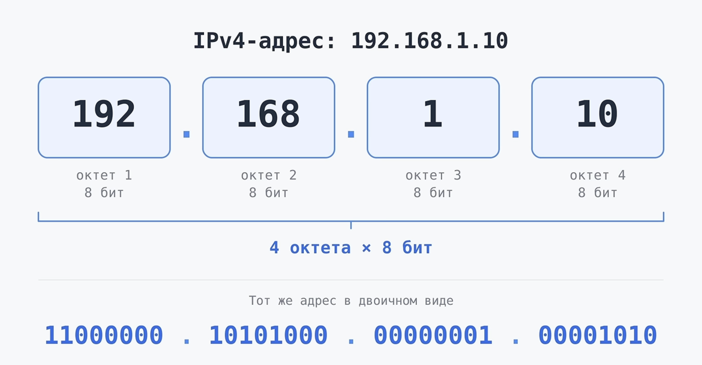
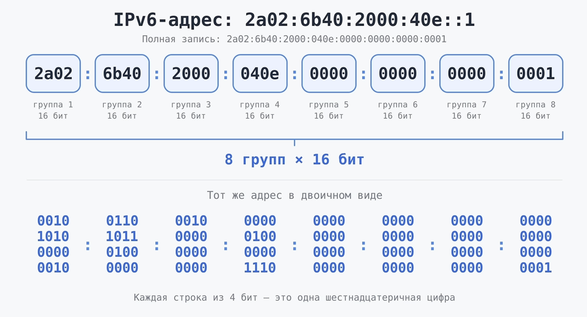

IP-адрес (Internet Protocol address) — это числовой адрес, который используется для идентификации сетевого интерфейса и доставки данных в компьютерных сетях.

  
Простая аналогия

Представим обычную почту

Допустим, ты хочешь отправить письмо другу. Чтобы письмо дошло до нужного человека, тебе нужен его адрес.

| Пример из жизни                 | Компьютерные сети |
| ------------------------------- | ----------------- |
| Дом друга, Улица, дом, квартира | IP-адрес          |

В компьютерных сетях похожую роль выполняет IP-адрес.

Есть две основные версии IP-адресов:

- IPv4 (`192.168.1.10`)
  - Четыре числа от 0 до 255, разделённые точками.
- IPv6 (`2001:db8::1`)
  - Более длинный адрес, записываемый шестнадцатеричными числами с двоеточиями.

## Октет

Октет — это группа из 8 бит. Также октет — это единица измерения данных.

<Callout>
  **Октет — это всегда 8 бит**, а вот слово «байт» исторически не всегда
  означало именно 8 бит. В современных компьютерах байт практически всегда равен
  8 битам, поэтому термины часто используют как синонимы.
</Callout>

Его можно встретить:

- IPv4 — адрес состоит из 4 октетов, всего 32 бита. Например, 192.168.1.10.
- IPv6 — адрес состоит из 128 бит. Его обычно записывают в виде восьми групп по 16 бит, то есть по 2 октета в каждой группе.
- MAC-адрес — обычно состоит из 6 октетов (48 бит). Например, A4:5E:60:12:34:56.
- Передача данных — термин «октет» обозначает 8 бит и может использоваться независимо от типа сети.

## IPv4

IPv4 (Internet Protocol version 4) — это четвёртая версия интернет-протокола, которая используется для идентификации устройств в сети с помощью IP-адресов.

**Адрес состоит из четырёх чисел от 0 до 255, разделённых точками.**

- Размер адреса: 32 бита
- Количество адресов: Около 4,3 млрд

## IPv6

## У каждого устройства свой IP?

- **Локальный IP-адрес** используется для связи внутри локальной сети, например домашней Wi-Fi-сети.
- **Публичный IP-адрес** используется для связи через интернет и может быть общим для нескольких устройств, например при использовании NAT на домашнем роутере.

Телефон, телевизор и ноутбук могут иметь разные локальные IP-адреса, но выходить в интернет через один публичный IPv4-адрес роутера.

