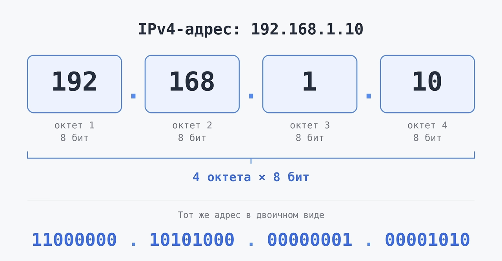

IPv4 (Internet Protocol version 4) — это протокол сетевого уровня, который отвечает за адресацию устройств и доставку пакетов от одного узла к другому через сети.

**Адрес состоит из четырёх чисел от 0 до 255, разделённых точками.**  

- Размер адреса: 32 бита
- Количество адресов: Около 4,3 млрд (232 = 4,294,967,296)

Каждый октет имеет 8 бит. Значение каждого октета может быть от 0 до 255.

## Почему от 0 до 255?

Потому что 8 бит позволяют представить 256 комбинаций: 28 = 256
