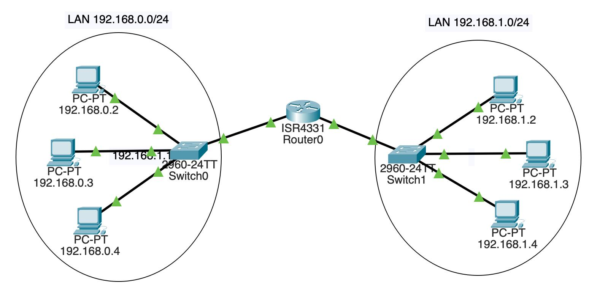

Подсеть (subnet) — это часть большой IP-сети, выделенная в отдельную логическую сеть. Подсети помогают разделять устройства на группы, организовывать обмен данными и эффективнее использовать IP-адреса.

Пример с офисом

Сеть в офисе

Представь, что в офисе есть 20 компьютеров. Все они подключены к одной сети и могут обмениваться данными.

У этой сети, например, адрес `192.168.1.0/24`.

Что означает эта запись?

- `192.168.1.0` — адрес сети.
- `/24` — длина маски подсети, то есть первые 24 бита IP-адреса относятся к сети.
- `192.168.1.1` — может быть адресом роутера.
- `192.168.1.10` — может быть адресом компьютера.
- `192.168.1.20` — может быть адресом другого компьютера.

В сети `/24` имеется 256 адресов, от `192.168.1.0` до `192.168.1.255`. В обычной IPv4-сети такого типа доступны 254 адреса для устройств: один адрес обозначает сеть, другой используется для широковещательной рассылки.

## Зачем нужны подсети?

- **Безопасность**: можно ограничить доступ гостей к компьютерам сотрудников.
- **Организация**: устройства разных отделов находятся в разных IP-сетях.
- **Управление трафиком**: можно контролировать обмен данными между сетями.
- **Удобство администрирования**: проще управлять адресами и правилами доступа.

<Callout>
  Важно: одного разделения на IP-подсети недостаточно для полной изоляции. Для
  управления связью между ними используют маршрутизацию, правила firewall и,
  часто, VLAN.
</Callout>
