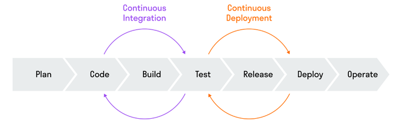

Continuous Integration / Continuous Deployment — это набор практик и инструментов, которые помогают разработчикам быстрее и безопаснее доставлять изменения в программное обеспечение.

- **CI (Continuous Integration)** — непрерывная интеграция.
- **CD (Continuous Delivery)** или **Continuous Deployment** — непрерывная доставка или непрерывное развертывание.

```
Разработчик
      │
      ▼
 Git Push
      │
      ▼
CI: сборка → тесты → проверки
      │
      ▼
CD: подготовка релиза
      │
      ▼
Ожидает подтверждения
      │
      ▼
Продакшен
```

## CI (Continuous Integration)

Идея CI заключается в том, что разработчики часто объединяют свой код с основной веткой проекта (например, несколько раз в день).

После каждого изменения автоматически запускаются:

- сборка проекта;
- проверка качества кода (линтеры);
- автоматические тесты;
- проверка на ошибки.

Если что-то сломалось, разработчик узнает об этом сразу.

<hr />

## CD (Continuous Delivery)

После успешного прохождения CI приложение автоматически готовится к выпуску.

Например:

- создается Docker-образ;
- публикуется новая версия;
- загружается на тестовый сервер.

**Последний шаг (выкатить на продакшен) обычно выполняется вручную.**

## Этапы CI/CD

1. **Plan — планирование.** На этом этапе планируют разработку и поставку приложения, определяют требования и задачи проекта, распределяют ресурсы команды и ставят цели.
2. **Code — написание кода.** Разработчики пишут код для каждой части программного продукта и создают его функционал, комментируют и документируют код, проводят ревью кода.
3. **Build — сборка.** Система контроля версий собирает программный продукт из написанного кода, используя средства автоматической сборки; создает исполняемые файлы или пакеты для установки приложения.
4. **Test — тестирование.** Тестировщики проверяют собранный продукт. Они проводят разные виды тестирования, в том числе автоматизированное.
5. **Release — релиз.** Команда создает установочные пакеты, подписывает их цифровыми сертификатами и отдает продукт на проверку заказчику или тестовой группе пользователей. Если в продукте находят ошибки, то его отправляют на доработку.
6. **Deploy — развертывание.** Программное обеспечение устанавливается на реальной или тестовой среде, чтобы заказчики и конечные пользователи могли пользоваться продуктом.
7. **Operate — эксплуатация.** Продукт используется. Разработчики проверяют работу продукта, оптимизируют его производительность, обрабатывают возникающие ошибки, анализируют пользовательский опыт и планируют доработки продукта и разработку нового функционала.

   

<hr />

## Pipeline (Пайплайн)

— последовательность выполнения этапов CI/CD.
