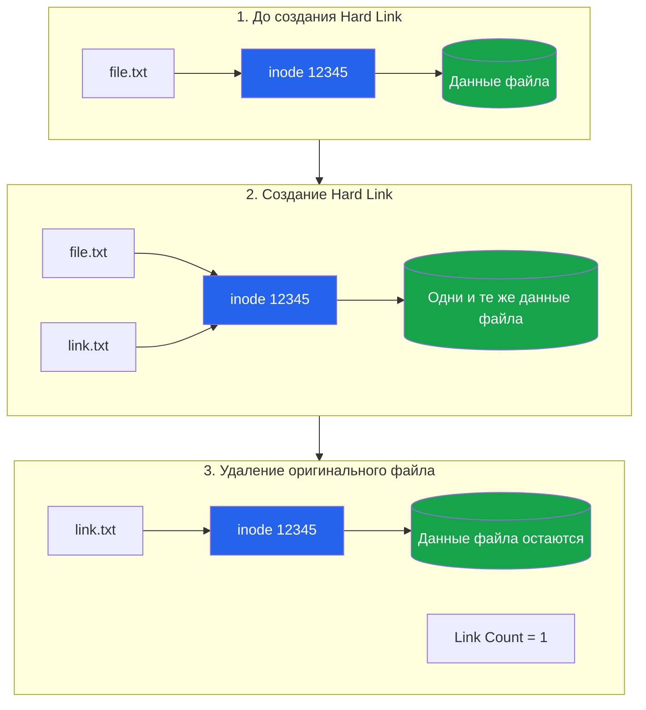
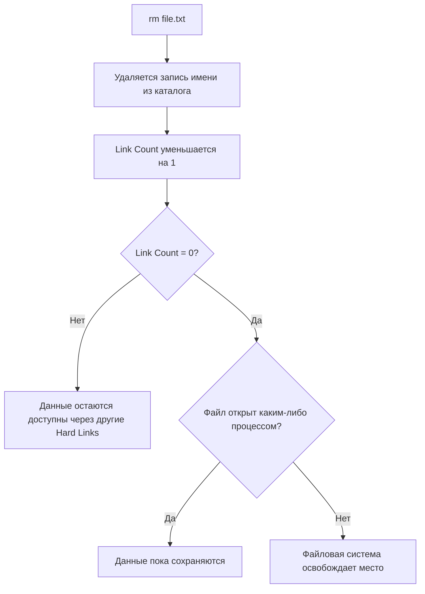

## Inode

Inode (index node) — это структура данных в файловой системе Linux, которая хранит метаданные файла или директории.

> Inode — это своего рода паспорт файла, в котором хранится информация о файле, но не его имя и не само содержимое.

Упрощённо файловая система устроена так:

1. Директория хранит соответствие имени файла и номера inode.
2. Inode хранит метаданные и информацию о расположении данных.
3. Данные файла находятся в блоках файловой системы.

### Хранит в себе

Для каждого файла в Linux существует inode, в котором содержится:

- Тип файла (обычный файл, директория, символическая ссылка и т. д.).
- Права доступа (rwx).
- Владелец (UID).
- Группа (GID).
- Размер файла.
- Время создания/изменения метаданных и содержимого (в зависимости от файловой системы).
- Количество жёстких ссылок (hard links).
- Адреса блоков диска, где находятся данные файла

Чего в inode нет:

- Имени файла.
- Самого содержимого файла.

<hr />

### Команды для работы с inode

| Команда              | Назначение                              |
| -------------------- | --------------------------------------- |
| `ls -i`              | Показать inode                          |
| `stat file`          | Информация об inode                     |
| `df -i`              | Использование inode в файловых системах |
| `find / -inum 12345` | Найти файлы по inode                    |
| `ls -li`             | Файлы с inode и количеством ссылок      |

#### Показать inode `ls -i`

```bash
ls -i <filename> # 12345 <filename>
```

Число `12345` — это номер inode.

#### Информация об inode `stat <filename>`

Более подробную информацию можно получить командой:

```bash
stat <filename>
```

```
File: hello.txt
Size: 0
Inode: 12345
Links: 1
Access: (0644/-rw-r--r--)
Uid: (1000/user)
Gid: (1000/user)
```

<hr />

## Hard link

Hard link (жёсткая ссылка) в Linux — это дополнительное имя для уже существующего файла. При этом оба имени указывают на один и тот же объект файловой системы — inode.

> Hard Link — это не копия файла, а дополнительное имя, ссылающееся на тот же inode.

1. Файл в Linux состоит из данных на диске (data blocks) и метаданных (inode).
2. Имя файла — это запись в каталоге, которая связывает имя с inode.
3. При создании hard link появляется ещё одна запись в каталоге, указывающая на тот же inode.
4. При удалении оригинального файла (rm) удаляется только соответствующая запись каталога, а не сами данные.
5. Счётчик жёстких ссылок (link count) уменьшается на единицу.
6. Когда счётчик становится равен нулю и файл больше не открыт ни одним процессом, файловая система может освободить занимаемые им блоки данных.

<Callout title='' type='tip'>

Даже если удалить все имена файла, его данные могут продолжать занимать место на диске, пока процесс держит файл открытым (`open file descriptor`).

Это одна из причин, почему в Linux иногда удаляешь большой лог-файл, а свободное место на диске не увеличивается.

</Callout>



<hr />

### Что происходит при удалении файла



<hr />

## Soft Link

Soft link (символическая ссылка, symlink) — это специальный файл в Linux, который содержит путь к другому файлу или директории.

> Soft link - это аналог ярлыка в Windows: ссылка указывает, где находится оригинальный файл.

```bash
ln -s <fileName> <linkName>
```

<details>
  <summary>Пример</summary>

Посмотрим файлы:

```bash
ls -li
```

Например:

```
12345 -rw-r--r-- 1 user user 12 file.txt
12346 lrwxrwxrwx 1 user user  8 softlink.txt -> file.txt
```

- `12345` — inode оригинального файла.
- `12346` — собственный inode символической ссылки.
- `l` в начале прав доступа означает symbolic link.
- `-> file.txt` показывает, куда ведёт ссылка.

Узнать путь, записанный в ссылке:

```bash
readlink <linkName>
```

</details>

### Если удалить оригинал - broken link

`<linkName>` останется, но станет битой ссылкой (broken link).<br/>
Будет ошибка: `No such file or directory`
