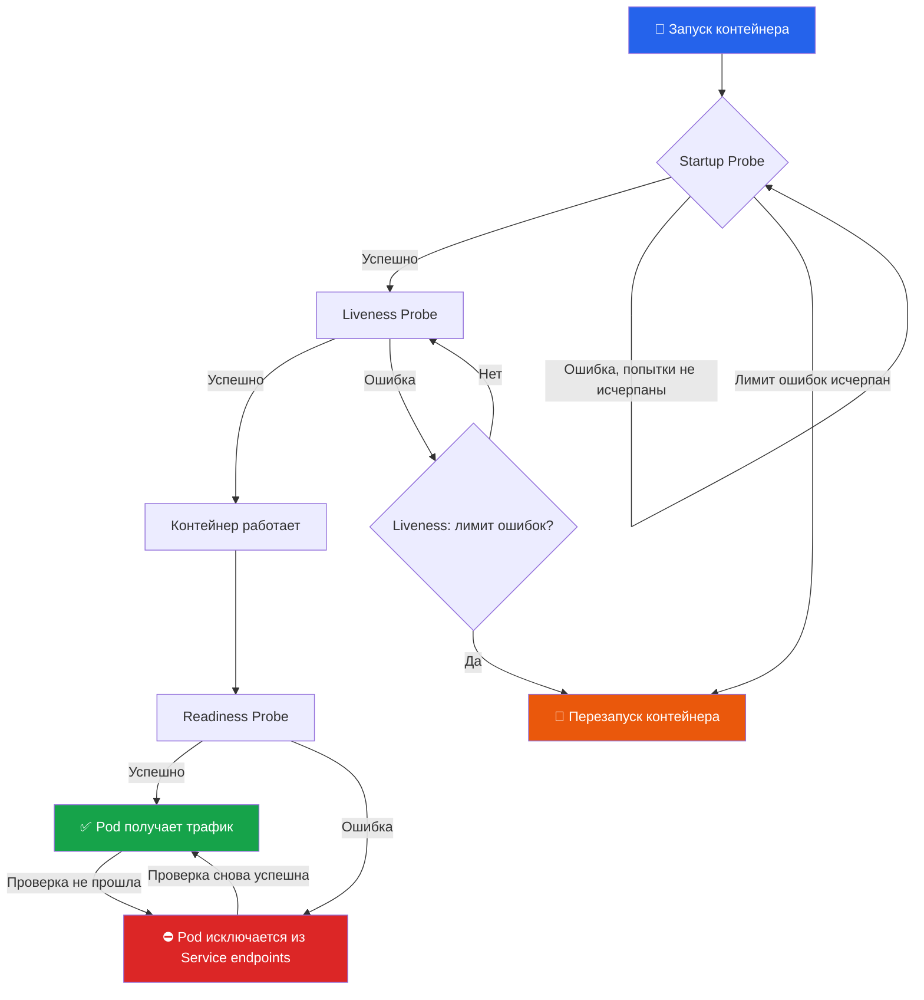

Probe в Kubernetes (K8s) — это механизм проверки состояния контейнера (health check), с помощью которого Kubernetes определяет, работает ли приложение правильно и готово ли оно обрабатывать запросы.

Probe выполняются kubelet'ом на узле, где запущен Pod.

В Kubernetes есть 3 основных типа Probe:

1. Liveness Probe — «Жив ли контейнер?»
   - перезапустить, если приложение зависло.
2. Readiness Probe — «Готов ли контейнер принимать трафик?»
   - не отправлять трафик, если приложение не готово.
3. Startup Probe — «Запустилось ли приложение?»
   - дать приложению время запуститься.

✦

## Способы проверки

Все три Probe поддерживают несколько способов проверки:

- `httpGet` — HTTP-запрос к endpoint приложения.
- `tcpSocket` — проверка доступности TCP-порта.
- `exec` — выполнение команды внутри контейнера.
- `grpc` — проверка через gRPC Health Checking Protocol.

✦

## Как работают Probe визуально

<Callout title='' type='tip'>

После успешного Startup Probe Kubernetes начинает выполнять Liveness и Readiness Probe. Они работают независимо друг от друга.

</Callout>
