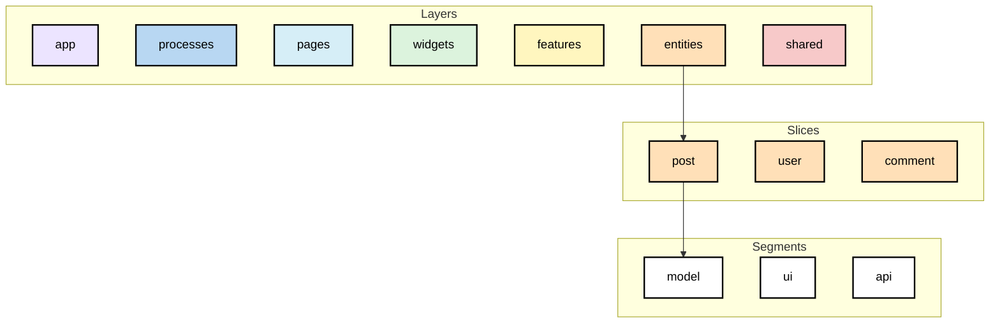
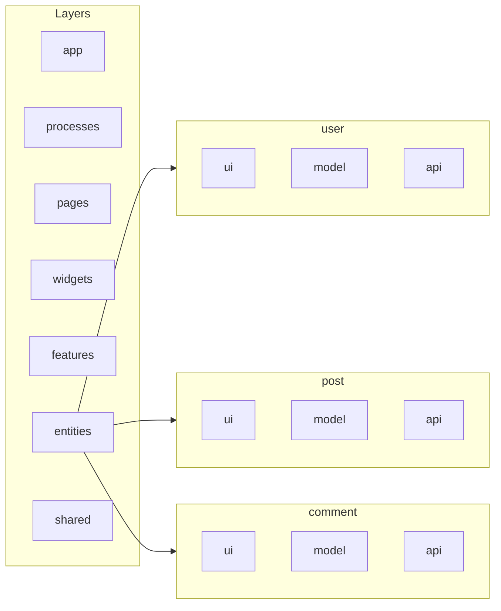

— это архитектурная методология для фронтенд-приложений, которая помогает организовать код по бизнес-логике, а не по типам файлов.
Она особенно хорошо подходит для средних и крупных проектов.

:::important
Главная идея FSD — разделить приложение на независимые части (features, entities, widgets и т.д.), чтобы код было проще поддерживать, тестировать и масштабировать.
:::

Состоит из слоев (layers), слайсов (slices) и сегментов (segments).





## Layers

— это уровень архитектуры, который определяет роль кода в приложении и от каких частей приложения ему разрешено зависеть.<br/>
Это папки, которые хранят код по определённому признаку (одинаковой ответственностью).

:::danger[Правило импортов между слоями]
Нижележащие слои не могут импортировать выше лежащие

Зависимости направлены только сверху вниз.

```
app
↓
pages
↓
widgets
↓
features
↓
entities
↓
shared
```

:::

### app

- Инициализация приложения.
- Провайдеры.
- Роутинг.
- Глобальные стили.
- Конфигурация.

### processes (устарел)

### pages

Сбор страницы из виджетов, фич и сущностей.

### widgets

Большие независимые блоки интерфейса.( Header, Sidebar, UserProfile, Comments )

### features

Завершенные пользовательские действия.

- Авторизация
- Лайк статьи
- Добавление в корзину
- Поиск

### entities

Бизнес-сущности приложения.

- User
- Article
- Product
- Comment

### shared

Переиспользуемый код без бизнес-логики.

- UI Kit
- API клиент
- Хуки
- Утилиты
- Константы

## Slices

— это структурная единица внутри слоя FSD, объединяющая весь код, относящийся к одной бизнес-сущности, пользовательской возможности или части приложения.

Слайс — это папка внутри слоя, в которой собран весь код, связанный с одной конкретной задачей или бизнес-объектом.

:::danger[Запрет кросс-импортов]

Слайсы одного слоя не должны зависеть друг от друга.

```
// ❌ Плохо
entities/article -> import { User } from "../user";
```

:::

:::danger[Public API]

Каждый слайс должен предоставлять единую точку входа — файл `index.ts`.

:::

```
features/ ← слой
└── AddToCart/ ← слайс

entities/ ← слой
└── User/ ← слайс
```

Здесь `AddToCart` и `User` — это слайсы, потому что каждый из них инкапсулирует всё, что относится к одной конкретной функции или сущности.

## Segments

— это структурная единица внутри слайса, объединяющая код по его техническому назначению

Сегмент — это папка внутри слайса, содержащая код одного типа ответственности.

```
AddToCart/
├── ui/
├── model/
├── api/
├── lib/
└── index.ts
```

- `ui` — сегмент пользовательского интерфейса;
- `model` — сегмент бизнес-логики и состояния;
- `api` — сегмент взаимодействия с сервером;
- `lib` — сегмент вспомогательных функций.
