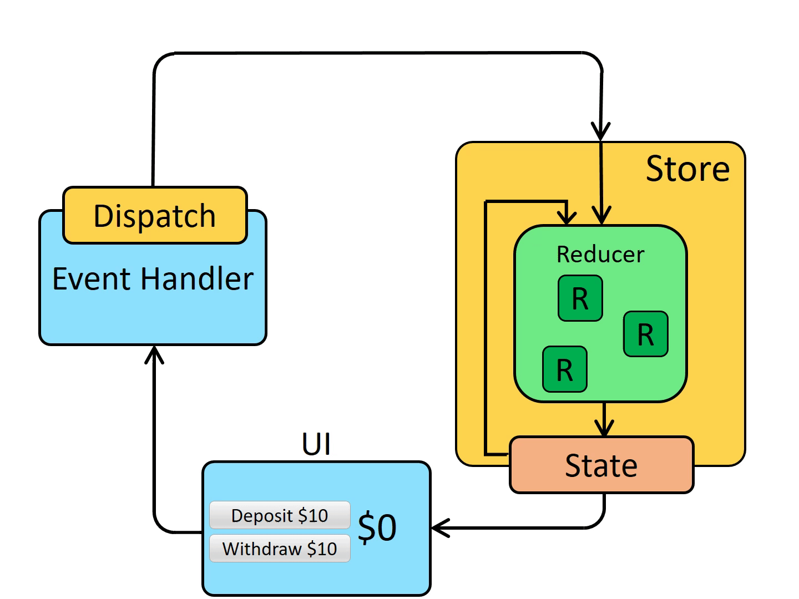
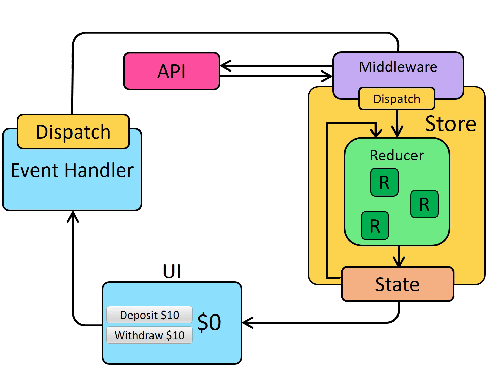

import { Tab, Tabs } from "fumadocs-ui/components/tabs";

| [Off. website](https://redux-toolkit.js.org/) | NPM > [Redux](https://www.npmjs.com/package/redux) & [React Redux](https://www.npmjs.com/package/react-redux) |
| --------------------------------------------- | ------------------------------------------------------------------------------------------------------------- |

Как всё работает вместе (поток данных):

1. UI вызывает `dispatch`(`action`)
2. `action` попадает в `middleware` (если есть)
3. затем в `reducer`
4. `reducer` создаёт новое состояние
5. `store` обновляется
6. UI перерисовывается

<Tabs items={["Без middleware", "С middleware"]}>
  <Tab value="without">
    
  </Tab>
  <Tab value="with">
    
  </Tab>
</Tabs>

## Установка

<Tabs items={["npm", "yarn", "pnpm"]}>
  <Tab value="npm">

    ```bash
    npm install @reduxjs/toolkit react-redux
    ```

  </Tab>
  <Tab value="yarn">

    ```bash
    yarn add @reduxjs/toolkit react-redux
    ```

  </Tab>
  <Tab value="pnpm">

    ```bash
    pnpm add @reduxjs/toolkit react-redux
    ```

  </Tab>
</Tabs>

## Создание

Для начала создаём [`Store`](/docs/frontend/frameworks/react/state-managers/redux-toolkit/store/) <br/>
Импортируем наш `store.ts`

```ts
import { store } from "./store";
```

<Tabs items={["Redux", "Redux Toolkit"]}>
  <Tab value="redux">
    <Tabs items={["Без payload", "С payload + immutable"]}>
      <Tab value="without">

        И через `getState()` обращаемся к полям (например `counter`), чтобы вывести параметр

        ```ts
        store.getState().counter;
        ```

        Через `dispatch()` мы отправляем `action` в наш `store`, навесим его на метод кнопки `onClick`

        ```ts
        store.dispatch({ type: "DECREMENT" } satisfies CounterAction);
        ```

        Теперь осталось отслеживать изменения, поэтому будем использовать hook `useEffect()`
        :::note
        `useEffect()` нужен чтобы интегрировать состояния React со внешними state manager'ами
        :::
        И передадим ему `store.subscribe()`, с `forceUpdate`

        ```ts
        const [, forceUpdate] = useReducer((x) => x + 1, 0);
        useEffect(() => {
          const unsubcribe = store.subscribe(() => {
            forceUpdate();
          });
          return unsubcribe;
        }, []);
        ```
      </Tab>
      <Tab value="with">
        Создаём отдельный компонент

        через `getState()` обращаемся к `counters[counterId]` и к `counter`, чтобы вывести параметр <br/>
        Через `dispatch()` мы отправляем `action` и `payload` в наш `store`, навесим его на метод кнопки `onClick`

        ```ts
        export function Counter({ counterId }: { counterId: CounterId }) {
          const [, forceUpdate] = useReducer((x) => x + 1, 0);
          useEffect(() => {
            const unsubcribe = store.subscribe(() => {
              forceUpdate();
            });
            return unsubcribe;
          }, []);

          return (
            <>
              <button
                type="button"
                className="counter"
                onClick={() =>
                  store.dispatch({
                    type: "INCREMENT",
                    payload: { counterId },
                  } satisfies CounterAction)
                }
              >
                Inc {store.getState().counters[counterId]?.counter}
              </button>
              <button
                type="button"
                className="counter"
                onClick={() =>
                  store.dispatch({
                    type: "DECREMENT",
                    payload: { counterId },
                  } satisfies CounterAction)
                }
              >
                Dec {store.getState().counters[counterId]?.counter}
              </button>
            </>
          );
        }
        ```

        И создадим пару `Counter`

        ```ts
        <Counter counterId="first" />
        <Counter counterId="second" />
        <Counter counterId="third" />
        ```

      </Tab>
    </Tabs>

  </Tab>
  <Tab value="rtx">
  </Tab>
</Tabs>

## Оптимизация Rerender

Главный принцип: селективные подписки

В связке с `Redux` обычно используется `React-Redux`. <br/>
`React-Redux` подписывает компонент не на весь `store`, а на конкретный кусок состояния, который он выбирает через `useSelector`

Создадим функцию `selectCounter`

```ts
const selectCounter = (state: AppState, counterId: CounterId) =>
  state.counters[counterId];
```

И в компонент переменную `counterState`

```ts
const counterState = selectCounter(store.getState(), counterId);
```

и заменем `getState()` на

```ts
{
  counterState?.counter;
}
```

В `useEffect()`

```ts
useEffect(() => {
  const unsubcribe = store.subscribe(() => {
    const currentState = selectCounter(store.getState(), counterId);
    const lastState = selectCounter(store.getState(), counterId);

    if (currentState !== lastState) forceUpdate();
  });
  return unsubcribe;
}, []);
```
