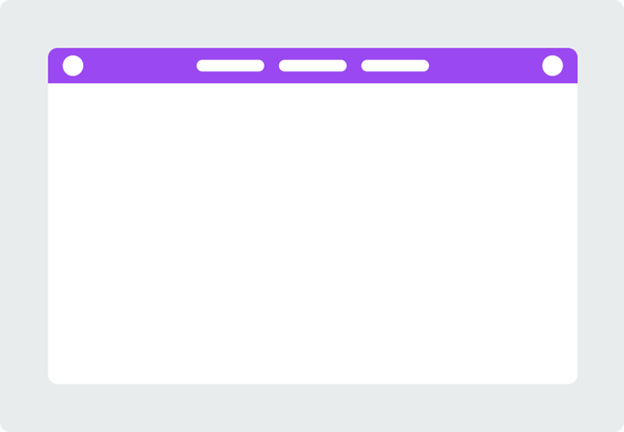
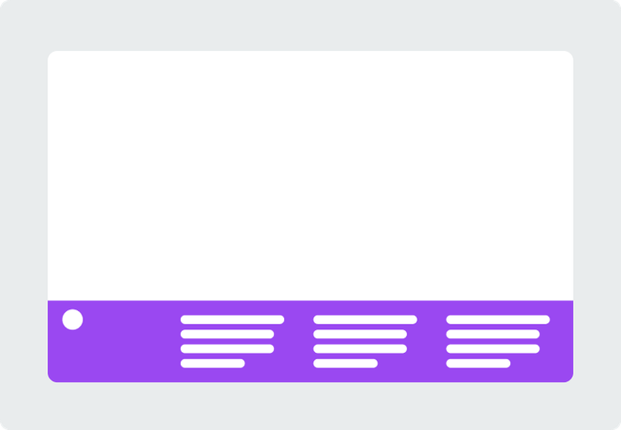
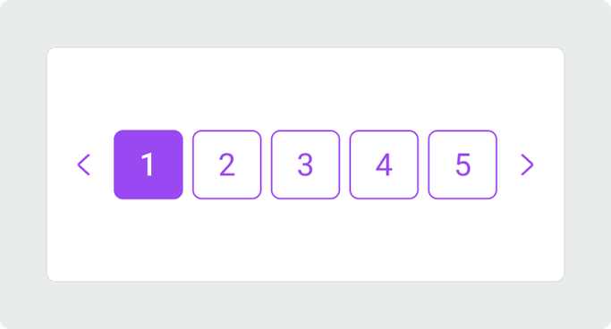
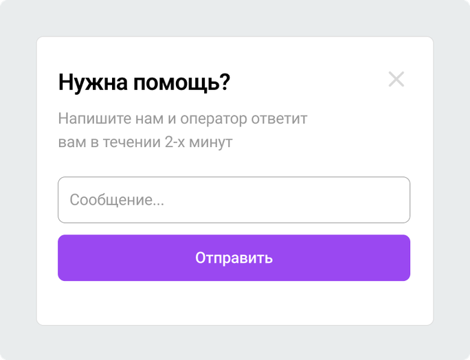
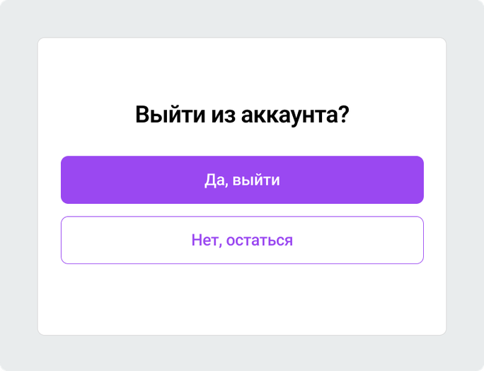

## Структура страницы

### Header

Header — это верхняя часть страницы или отдельного блока интерфейса.

Обычно в header находятся:

- логотип;
- название сайта/раздела;
- основная навигация;
- кнопки действий — «Войти», «Регистрация», «Корзина»;
- поиск;
- переключатели языка/темы и т. п.

### Footer

Footer — это нижняя часть страницы, обычно «подвал сайта».

В нём часто находятся:

- копирайт;
- ссылки на основные разделы;
- контакты;
- соцсети;
- политика конфиденциальности и пользовательское соглашение;
- логотип;
- способы оплаты или доставки;
- дополнительные навигационные ссылки.

### Sidebar

### Navigation

### Main Content

### Section

### Aside

## Навигация

### Breadcrumbs (Хлебные крошки)

Breadcrumbs — это навигационная цепочка, которая показывает, где пользователь находится в структуре сайта.

Используется, чтобы:

- показать путь от главной страницы до текущей;
- помочь быстро вернуться на уровень выше;
- дать пользователю понимание структуры сайта.

### Pagination

Pagination — это постраничная навигация, которая позволяет переключаться между страницами большого списка контента.

Используется для:

- списка товаров;
- результатов поиска;
- таблиц;
- списка статей;
- каталога;
- комментариев.

### Anchor

### Tabs

## Оверлеи и окна

### Popup

Pop-up — это всплывающее окно, которое появляется поверх текущего содержимого страницы.

Обычно используется для:

- форм авторизации/регистрации;
- подтверждения действия;
- уведомлений;
- подписки на рассылку;
- промокодов;
- просмотра дополнительной информации;
- предупреждений.

- Pop-up — более общее понятие: любое всплывающее содержимое.
- Modal — конкретный тип всплывающего окна, которое требует внимания/действия пользователя.

### Modal

Modal — это модальное окно, которое появляется поверх страницы и временно блокирует взаимодействие с остальным интерфейсом.

Обычно используется для:

- подтверждения действия: «Удалить файл?»;
- заполнения формы;
- авторизации;
- выбора настроек;
- просмотра важной информации;
- предупреждений.

- Pop-up — более общее понятие: любое всплывающее содержимое.
- Modal — конкретный тип всплывающего окна, которое требует внимания/действия пользователя.

## Элементы управления

### Input

### Select

### Checkbox

### Radio Button

### Range Slider

### Button

### Toggle Switch

## Интерактивные элементы

### Slider

### Аккордеон

## Состояния и обратная связь

### Loader / Spinner

### Skeleton

### Progress Bar

### Toast / Notification

## Подсказки и уведомления

### Tooltip
