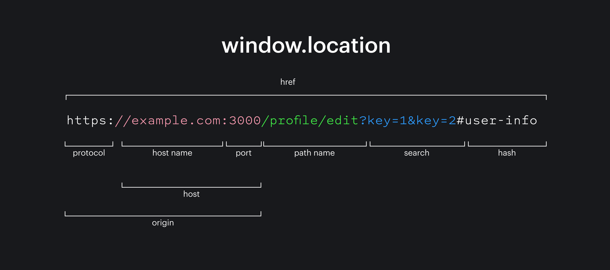

Объектная модель браузера (Browser Object Model, BOM) – это дополнительные объекты, предоставляемые браузером (окружением), чтобы работать со всем, кроме документа.

## Window API

> `window`

Объект `window` – основная «входная точка». <br/>
Работает с окном браузера.

Разницы между `localStorage` и `window.localStorage` по сути нет — это одно и то же, просто записано по-разному. <br/>
`localStorage` - сокращённая запись. Браузер автоматически ищет переменную в глобальной области (`window`), поэтому писать `window.` не обязательно.

Функции `alert/confirm/prompt` тоже являются частью BOM: они не относятся непосредственно к странице, но представляют собой методы объекта окна браузера для коммуникации с пользователем.

### `innerWidth` / `innerHeight`

— это свойства объекта `window`, которые возвращают **размер области просмотра (viewport) браузера**, то есть той части окна, в которой отображается веб-страница.
Другими словами, это ширина той части окна, в которой отображается веб-страница.

Возвращает ширину/высоу области просмотра (viewport) в пикселях.

```
┌──────────────────────────────┐
│       окно браузера          │  ← outerWidth
│ ┌──────────────────────────┐ │
│ │     viewport             │ │
│ │                          │ │
│ │     веб-страница         │ │ ← innerWidth
│ │                          │ │
│ └──────────────────────────┘ │
└──────────────────────────────┘
```

<hr />

### `outerWidth` / `outerHeight`

— это свойства объекта `window`, которые возвращают **полный размер окна браузера**, включая его внешние элементы.

В отличие от `innerWidth` и `innerHeight`, эти свойства учитывают не только область просмотра, но и внешние элементы окна браузера:

- рамки окна;
- заголовок окна;
- панели инструментов (в зависимости от браузера и ОС);
- область просмотра (viewport).

```
┌────────────────────────────────┐
│ Заголовок окна                 │
├────────────────────────────────┤
│ Панели браузера                │
├────────────────────────────────┤
│ ┌────────────────────────────┐ │
│ │         Viewport           │ │ ← innerWidth / innerHeight
│ │                            │ │
│ └────────────────────────────┘ │
└────────────────────────────────┘
↑                                ↑
 outerWidth / outerHeight
```

<hr />

### `scrollX` / `scrollY`

<hr />

### `devicePixelRatio`

— это свойство объекта `window`, которое возвращает отношение физических пикселей экрана к CSS-пикселям.

<hr />

## Location API

> `location`

Объект `location` позволяет получать информацию о текущем URL и менять его с помощью функций или обновления полей объекта.

```js
alert(location.href); // показывает текущий URL
if (confirm("Перейти на Wikipedia?")) {
  location.href = "https://wikipedia.org"; // перенаправляет браузер на другой URL
}
```

Внутри него есть полезные поля для того, чтобы искать нужную часть адреса.

- `href` содержит URL целиком, включая в себя полный адрес хоста, страницы и все query-параметры.
- `host` и `hostname` указывают имя хоста. Разница между ними в том, что `host` включает в себя порт. Если бы мы стучались не на google.com, а на google.com:8080, то `host` содержал бы значение www.google.com:8080, в то время как `hostname` остался бы тем же.
- `origin` включает в себя путь, начиная с `protocol` и заканчивая `port`.
- `pathname` указывает путь от корня адреса до текущей страницы.
- `port` содержит только номер порта. Если порт не указан, то значением свойства будет пустая строка ''.
- `protocol` содержит текущий протокол по которому открыта страница. Чаще всего там будет https и http.
- `search` указывает query-параметры, которые находятся в адресной строке, если они есть.
- `hash` указывает хеш (ID элемента после `#`) страницы. Его ещё называют якорем, потому что при переходе на страницу с хешем браузер найдёт элемент с ID, равным этому хешу, и прокрутит страницу к этому элементу.

Методы:

- `assign()` метод вызывает переход на страницу, переданную в аргументах. После перехода на страницу пользователь может вернуться на страницу, с которой произошёл переход, с помощью браузерной кнопки назад.
- `reload()` обновляет текущую страницу.
- `replace()` делает клиентский редирект, приведёт к мгновенному переходу по адрес.
  

<hr />

## Navigator API

> `navigator`

Объект `navigator` содержит информацию о браузере: название, версия, платформа, доступные плагины, доступ к буферу обмена и прочее. Это один из самых больших объектов в окружении. <br/>
С помощью этого объекта можно узнать, разрешён ли доступ к кукам, получить доступ к буферу обмена, геолокации, узнать, с какого браузера пользователь смотрит на страницу через `userAgent`.

> В июне 2021 появился более безопасный инструмент для определения браузера — User-Agent Client Hints.
> Его цель в том, чтобы позволить определять тип браузера, не оставив возможности для сбора данных о пользователях.

- `navigator.userAgent` -> информация о текущем браузере
- `navigator.platform` -> информация о платформе (может помочь в понимании того, в какой ОС открыт браузер – Windows/Linux/Mac и так далее).

Также с помощью `navigator` можно зарегистрировать Service Worker.

Чтобы проверить, есть ли в `navigator` необходимая вам фича, используйте in:

```
if ('bluetooth' in navigator) {
  // Есть доступ к Bluetooth API.
}

if ('serviceWorker' in navigator) {
  // Есть доступ к Service Worker API.
}
```

### mediaDevices

— это API браузера из стандарта WebRTC/Web Media, которое даёт веб-страницам доступ к мультимедийным устройствам пользователя: камерам, микрофонам, захвату экрана и потокам медиа.

Главная задача — работа с медиаустройствами и потоками (`MediaStream`).

С его помощью можно:

- получить доступ к камере
- получить доступ к микрофону
- показать список устройств
- захватить экран
- переключать камеры/микрофоны
- управлять видеопотоками для звонков и стриминга

#### enumerateDevices

Показывает доступные устройства.

```
const devices = await navigator.mediaDevices.enumerateDevices();
console.log(devices);
```

Возвращает массив `MediaDeviceInfo`

```
[
  {
    kind: "audioinput",
    label: "Microphone",
    deviceId: "123"
  },
  {
    kind: "videoinput",
    label: "HD Webcam",
    deviceId: "456"
  }
]
```

#### getDisplayMedia

#### getUserMedia

Получает поток с камеры/микрофона.

```
const stream = await navigator.mediaDevices.getUserMedia({
  video: true,
  audio: true
});

video.srcObject = stream;
```

Возвращает `MediaStream` (Внутри: видеотреки, аудиотреки)<br/>
Можно получить:

```
stream.getTracks()
stream.getVideoTracks()
stream.getAudioTracks()
```

<hr />

## Screen API

> `screen`

Объект `screen` содержит информацию об экране браузера.

`width` и `height` указывают ширину и высоту экрана в пикселях соответственно.

`avail*` метрики указывают, сколько ширины и высоты доступно — то есть ширину и высоту с учётом интерфейсных деталей браузера типа полос прокрутки.

`pixelDepth` указывает количество битов на один пиксель экрана.

<hr />

## History API

> `history`

`history` даёт доступ к истории браузера, которая ограничена текущей вкладкой. То есть с её помощью можно перейти на страницу назад, только если мы пришли с неё.

Чтобы перемещаться по истории назад и вперёд, можно использовать методы `back()` и `forward()`:

```
// Перешли на страницу назад
history.back()

// Перешли на страницу вперёд.
history.forward()
```

Для более точного управления историей рекомендуется использовать `pushState()` и `replaceState()`. Принимают три параметра:

- `state` — любые данные, которые связаны с переходом;
- `unused` — неиспользуемый параметр, который существует по историческим причинам;
- `url` (необязательный) — url адрес новой записи в истории.

```
// state — данные для новой записи в истории
const state = { user_id: 5 }

// unused — для совместимости рекомендуется передавать пустую строку:
const unused = ''

// url — url адрес который будет добавлен в адресную строку:
const url = '/another-page/'

history.pushState(state, unused, url)
```

<hr />

## Dialog API

> `alert()`, `confirm()`, `prompt()`

<hr />

## Timer API

> `setTimeout()`, `setInterval()`

<hr />
