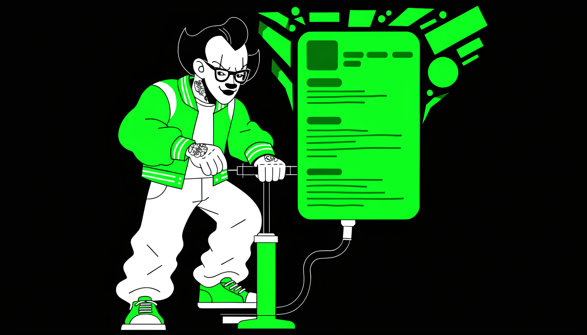
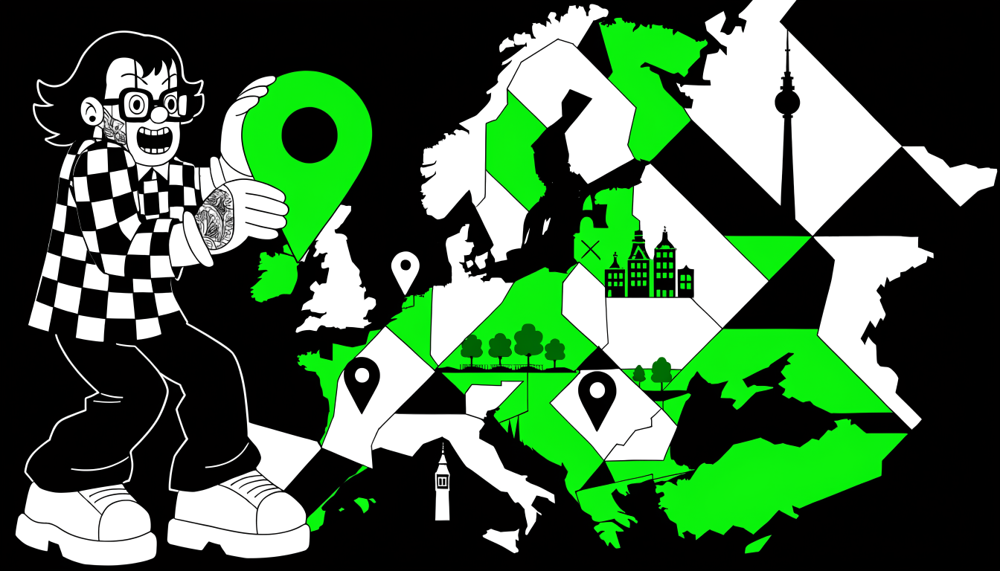

Если цель — работа за рубежом, мимо LinkedIn не пройти: для IT-специалистов это площадка номер один. Сначала профиль: грамотная настройка, видимость через SSI, выбор локации под удалённую работу и создание аккаунта из России. Затем тактика: стратегии поиска вакансий, генерация контента и выстраивание активности, которая цепляет рекрутеров и работодателей.

## Как использовать LinkedIn для поиска работы в IT

Вакансии с оплатой в долларах или евро удобнее всего искать на LinkedIn. Это американская платформа, которая совмещает job-борду и профессиональную соцсеть: работодатели публикуют предложения, специалисты откликаются, и все друг у друга на виду.

У LinkedIn три сильные стороны для IT-специалиста. Первая — качество вакансий: в отличие от местных площадок, фейковых объявлений здесь практически нет. Вторая — валютные предложения: удалённая работа с оплатой в долларах или евро тут не экзотика, а обычный сегмент рынка.

Третья — прямой контакт: с компаниями и рекрутерами можно связываться напрямую, а не бросать отклики в общий ящик и ждать у моря погоды.

Есть одно жёсткое ограничение: не заходите на LinkedIn без VPN. Один вход с российского адреса — и аккаунт могут заблокировать мгновенно, вместе со всеми накопленными контактами и перепиской. Используйте надёжные VPN-сервисы, а если не уверены, что настроили всё правильно, попросите помощи у знакомых за рубежом — безопасный доступ стоит этих хлопот.

Теперь про стратегию. Режим «откликнулся на вакансию и жду» — пассивный, и работает он хуже активного. Даже если на сайте интересующей компании сейчас нет открытых позиций, всё равно отправляйте туда резюме и контакты. Такой подход требует больше усилий, но действительно работает: когда подходящая позиция откроется, рекрутеру не придётся искать кандидатов с нуля — ваше резюме уже лежит у него под рукой, и с вами могут связаться первым.

И не замыкайтесь на одной платформе. Телеграм-каналы и чаты с вакансиями сейчас особенно актуальны для IT-специалистов: предложения там публикуются быстро, а конкуренция за них порой ниже, чем на больших бордах. Проверьте свои подписки — возможно, интересные предложения уже висят в ленте, пока вы читаете этот текст.

## LinkedIn: полное руководство по раскачке профиля для разработчиков

Раскачка LinkedIn начинается со скучного шага — заполнить профиль целиком. Работа и образование — это минимум: в дело идут и волонтёрский опыт, и сертификаты с курсами, и проекты с достижениями, и навыки с endorsements. Чем детальнее профиль, тем выше вероятность, что рекрутер зацепится за него в поиске.

Дальше — коннекшены. Начинайте с ближнего круга: однокурсники, коллеги, знакомые разработчики. Это база, от которой сеть растёт. Затем добавляйте активнее: разработчиков из вашего стека технологий, рекрутеров, которые специализируются на вашем направлении, людей из целевых компаний.

Не бойтесь стучаться к незнакомым — на LinkedIn это нормальная практика, никто не удивится заявке от человека из своей ниши.

Третий шаг — активность. Простого присутствия недостаточно: ставьте лайки постам по своей теме, пишите комментарии (даже короткие считаются), реагируйте на обновления коллег. Алгоритм за это поднимает видимость вашего профиля в лентах других пользователей — вас начинают замечать ещё до того, как вы что-то написали сами.

Самый сильный ход — собственные посты. Здесь работает принцип аутентичности. Не отдавайте генерацию контента нейросети целиком: идея поста должна исходить от вас. Пишите о том, что реально увидели на работе, о новой технологии или инструменте, которые впечатлили, о проблеме, которую решили, об опыте, который зацепил.

Нейросеть годится для обработки и улучшения текста, но корневая сущность, идея — ваша. Такой контент читается как живой человеческий голос и выделяется среди массы безликих постов, которые лента уже научилась пролистывать.

Последнее — про ожидания. Раскачка профиля для зарубежного рынка — не быстрый процесс. На российском рынке достаточно опубликовать резюме на HeadHunter, и рекрутеры массово пишут в личку. LinkedIn так не работает: результаты появляются постепенно, процесс разгоняется со временем и требует терпения и регулярной активности.

Мгновенных откликов не ждите — это марафон, а не спринт, и дистанцию выдерживает тот, кто продолжает заполнять, добавлять и писать, когда первые недели прошли в тишине.

## SSI (Social Selling Index) и прокачка профиля

SSI, он же Social Selling Index, — индекс активности профиля в LinkedIn, который влияет на видимость в поисковой выдаче рекрутеров. Чем выше SSI, тем чаще вас находят.

Почему нельзя просто разослать сообщение всем подряд и не мучиться? LinkedIn сознательно не даёт такой возможности — кнопки «отправить всем» нет. Даже Sales Navigator выдаёт списки и фильтры, но прямой спам не пропускает: платформа борется с абузом.

Сторонние сервисы для массовых рассылок через LinkedIn существуют, найти их можно через поисковик или ChatGPT, только LinkedIn строго банит за злоупотребление API. Реально потерять аккаунт, который вы долго фармили. Представьте тильт: набили 500+ коннектов, прокачали SSI — и вылетели за рассылку. Вся работа месяцев — в корзину.

Поэтому безопасный путь один: отправлять вручную. Добавьте в календарь таймслот — раз в день, два, три или хотя бы раз в неделю. Вечером, когда голова после работы уже не варит, зайдите в LinkedIn, раскидайте 10–15 заявок, кому-то напишите в личку, кому-то ответьте — и всё, идите отдыхать.

Это продуктивный способ: системность и дисциплина дают больше, чем разовые порывы или попытки обмануть систему.

Прокачанный профиль окупается — есть личный опыт Антона Назарова. Самая высокооплачиваемая его работа, Autodesk с **$9100 в месяц**, пришла именно через LinkedIn. Рекрутер написал сам: «Вижу хороший профиль, давай созвонимся». Дальше он провёл подготовку — прогнал английский, научил правильно отвечать на вопросы — и начал предлагать кандидата своим клиентам. Autodesk оказался вторым или третьим из них.

Картина складывается такая. SSI влияет на то, как часто вы всплываете в поиске. Массовые рассылки — короткая дорога к бану, ручная работа плюс регулярность — длинная, но она доводит до результата. А когда профиль прокачан, усилия вообще перестают быть нужны: рекрутеры сами находят вас и пишут первыми.

## Выбор локации в LinkedIn для ВУ

Город, указанный в профиле LinkedIn, напрямую определяет, как часто ваше резюме попадает в поисковую выдачу рекрутеров. Для поиска удалённой работы это один из главных параметров настройки — и выбирать его стоит по статистике откликов, а не по месту, где вы сидите с ноутбуком.

Есть локации, которые стабильно дают больше откликов и предложений. Берлин — крупная европейская столица, центр криптоиндустрии и множества европейских tech-компаний. Лондон — традиционно сильный финтех и IT-хаб. Варшава — активно растущий восточноевропейский рынок.

Амстердам — один из главных технологических центров Европы. Стоит рассмотреть также Швейцарию и Дубай, хотя вакансий там несколько меньше, чем в четвёрке лидеров.

Города вне Евросоюза работают заметно хуже: Тбилиси, Белград, Черногория. Найти работу с такой локацией в профиле можно, но конверсия будет **в разы ниже**. Причина простая: рекрутер крупной европейской компании с офисом в Берлине вряд ли станет целенаправленно искать кандидатов в Тбилиси, когда под рукой большой пул специалистов в основных tech-хабах.

Он вбивает в поиск привычные города — и ваш профиль с Белградом в эту выдачу просто не попадает.

Все рекомендации по локациям — статистика, а не догма, и проверяются только практикой: поставили город, пару месяцев следите за откликами, делаете выводы. Логика выбора при этом простая. Нужен город, где развит IT-рынок, где много компаний с удалённым форматом работы и где рекрутеры активно ищут кандидатов. По этим трём критериям и стоит сверять любой вариант, который вы примеряете на профиль.

Если физически вы находитесь не в выбранной локации — это нормально, речь про удалённую работу. У указанного города одна задача: повышать вероятность, что ваш профиль попадёт в релевантные поисковые запросы работодателей. Всё остальное — детали, которые решаются уже на этапе переговоров.

## Создание и прогрев LinkedIn-аккаунта из России

Создать аккаунт LinkedIn из России в 2024 году — отдельная задача. Платформа может заблокировать новый профиль и потребовать верификацию документов, а восстановление через поддержку тянется неделями, иногда месяцами. При этом даже российский паспорт может пройти верификацию, несмотря на зарубежную локацию в профиле: поддержка иногда закрывает глаза на несоответствие, особенно если объяснить ситуацию логично.

Рабочая схема — прогрев. Первые несколько месяцев держите в профиле Россию: это снижает риск блокировки и упрощает последующую разблокировку по российскому паспорту. Старые аккаунты с историей активности LinkedIn блокирует реже — алгоритмы им больше доверяют.

С VPN на этом этапе всё звучит странно, но работает: используйте VPN с российским IP-адресом — LinkedIn доступен через российские VPN, пока в профиле указана Россия. После смены страны переходите на VPN той страны, которую указали: Германия, Австрия, Чехия, Польша. Частой смены IP-адресов и устройств избегайте — LinkedIn ценит стабильность.

То же с техникой: заходите в аккаунт с одного и того же браузера и ноутбука. Комбинировать два устройства можно (например, MacBook + iPhone), но не тасуйте их постоянно. Один опытный специалист живёт именно по этой схеме и без проблем меняет VPN между европейскими странами.

Самые осторожные заводят отдельную виртуальную машину на Windows Server и работают только через неё — максимальная защита от блокировок.

### Смена локации на зарубежную

После нескольких месяцев прогрева меняйте страну на целевую и дайте LinkedIn время: алгоритмы обновляют базы медленно, рекрутеры со старой страны могут писать ещё месяц. По выбору страны расклад такой. Кипр — много русскоязычных компаний, хороший старт для менее опытных специалистов.

Восточная Европа (Польша, Чехия) — меньше требований на собеседованиях и ниже зарплаты (**€5–7k для сеньоров**), зато проще попасть через аутсорс-компании. Германия — универсальный вариант с хорошей конверсией для middle/senior разработчиков; можно пробовать Данию, Норвегию, Испанию.

Великобритания — 90% вакансий требуют гибрид (хотя бы раз в месяц в офис), так что много предложений уйдёт мимо. Меняйте страну раз в полтора-два месяца и отслеживайте конверсию откликов.

Про SSI и активность: прямой связи между Social Selling Index и количеством предложений от рекрутеров нет. Специалисты с низким рейтингом, но хорошо описанным опытом получают отклики без постов и лайков. Достаточно базовой активности — периодически заходить в аккаунт. Писать посты и комментировать не обязательно, если профиль грамотно оформлен.

Остаётся соблазн купить готовый аккаунт. Гарантий это не даёт: при полной переписке опыта под себя риск блокировки сохраняется. Надёжнее вырастить свой профиль.

## Стратегия указания локации и B2B-контракт

Рекрутер сидит в Берлине — крупнейшем европейском криптохабе — и ищет разработчика. Кандидатов он смотрит там же, где находится сам: люди ищут специалистов в своей локации, а не в Грузии или Черногории. Поэтому честно указанный в профиле Тбилиси или Белград резко сужает воронку откликов от европейских компаний — вас перестают находить ещё до того, как открыли резюме.

Самый эффективный подход — указать в профиле целевую локацию, например Берлин. На скрининге говорите, что находитесь в этом городе или активно готовите переезд; вариант «уже там» работает лучше. Да, могут спросить про вид из окна или название ближайшей шаурмячной — такие прецеденты были.

Дальше проходите все этапы собеседований: это в любом случае ценная практика. И только на финальной стадии, при оформлении документов, предлагаете B2B-контракт и поясняете реальную ситуацию с локацией.

С удалёнкой есть нюанс: remote в Европе не значит «откуда угодно». В Германии remote — это работа внутри страны, и легальное разрешение на работу никто не отменял. Это не как у нас.

Теперь статистика. Услышав про B2B вместо трудового договора, около 70% компаний откажут. Но 30% согласятся — кто-то сразу, кто-то после испытательного срока, иногда с возможностью спонсорства визы. Арифметика всё равно в вашу пользу: расширенная воронка на входе — Берлин вместо Тбилиси — даёт суммарно больше офферов даже с учётом отсева на финале. Сразу писать реальную локацию вне Европы — наименее конверсионный вариант из всех.

ВНЖ в ЕС тоже не решает всё: формально он даёт право работать в любой стране Евросоюза, но некоторые компании требуют именно локальное разрешение на работу в конкретной стране — проблемы возникают даже у его обладателей.

## Поиск вакансий через LinkedIn

Открыть профиль, подать несколько заявок и ждать оффер — так LinkedIn не работает. Поиск работы за рубежом — игра в долгую: выигрывает тот, кто методично выстраивает сеть, а не ждёт мгновенных результатов.

### Как наращивать сеть

LinkedIn может блокировать аккаунты, особенно российские, поэтому действуйте аккуратно. Регистрируйтесь и работайте с платформой через VPN. Не добавляйте людей массово: лучше **5 контактов в день в течение недели, чем 50 за раз.**

Первые 100–200 контактов берите из своего окружения — друзья, коллеги, даже родственники из телефонной книжки. Дальше цельтесь минимум в **500+ контактов**: после этого порога LinkedIn перестаёт показывать точное число, и сеть выглядит солидной.

Состав сети нужен сбалансированный — и разработчики, и decision-makers: CTO, CEO, HRD плюс обычные инженеры из целевой локации. Есть лайфхак: сначала добавьте нескольких C-level людей с большой сетью. Когда они примут запрос, вы окажетесь на один уровень ближе ко всем их связям — и остальные начнут принимать ваши запросы охотнее, видя общие контакты с влиятельными людьми.

Локацию выбирайте одну и набирайте контакты целенаправленно из неё: так строится сеть в нужном регионе и растёт видимость для местных работодателей.

### Скрининг: проговаривайте всё

Скрининг выглядит простым этапом, и русскоязычные кандидаты его регулярно недооценивают. Зарубежные рекрутёры работают по чек-листу: если в вакансии перечислены Go, NATS, Amazon EC2 и Lambda, упомянуть нужно каждую технологию, прямо и чётко.

Даже когда из контекста очевидно, что вы с ней работали, переспросят в лоб. Скажем, у вас в резюме 5 лет PostgreSQL, а в вакансии MySQL — рекрутёр спросит: «А сколько именно лет работы с MySQL?» Объяснение, что системы похожи, он может не понять и продолжит уточнять.

Облачные технологии — Amazon, Google Cloud, Azure — мало упомянуть, опыт с ними нужно активно продавать. Подучите терминологию, чтобы говорить о них уверенно: это бывает решающим фактором.

Английский на слух — отдельная история. Тяжелее всего понимать англичан и валлийцев с их акцентами, легче всего — немцев с их чётким произношением. В крайнем случае выручат субтитры в Google Meet: читайте с экрана то, что говорит собеседник.

В русскоязычных компаниях с валютной удалёнкой скрининг часто идёт на русском с небольшим англоязычным блоком для проверки языка — или наоборот, весь скрининг на английском, а техническая часть на русском. Международные финансовые компании, например на Кипре, могут требовать полностью английский формат общения, даже если все участники русскоязычные.

Быстрого результата не ждите: работают методичное выстраивание сети, подготовка к специфике зарубежных интервью и терпение.

## Генерация контента для LinkedIn: посты и активность

В списке откликов вы по умолчанию «кандидат номер 20» — один из десятков специалистов с похожим стеком и похожим опытом. Активность в LinkedIn нужна ровно затем, чтобы из этого списка выпасть. Держится она на двух вещах: личном бренде и живом общении. Профиль-анкета не запоминается, человек с уникальной историей — запоминается.

Чем наполнять профиль и посты? Делитесь хобби и интересами в IT, статьями и публикациями, которые вас вдохновляют, проектами, над которыми сейчас работаете. Рассказывайте об увлечениях вне работы. Показывайте точки пересечения с вашей аудиторией и создавайте дружественную атмосферу в коммуникации — из таких деталей складывается образ живого человека, а не строчки в списке кандидатов.

Главный принцип engagement звучит несерьёзно, но работает: будьте пирожком. То есть человеком, с которым приятно поговорить и к которому хочется вернуться. Искренне интересуйтесь собеседниками, спрашивайте их об их занятиях и увлечениях, делитесь личными историями, которые оседают в памяти.

Стройте реальные человеческие связи, а не коллекцию формальных контактов: формальная связь умирает после первого сообщения, живая превращается в разговор.

Скажу честно: эта часть плохо поддаётся структурированным лайфхакам. Универсальной формулы успеха нет — придётся быть интересным человеком и уметь устанавливать контакт. Единственный практичный ход — искать общие темы. Возможно, вы оба увлекаетесь настольными играми, пишете книги или следите за одними и теми же трендами в индустрии. Такие совпадения превращают формальное знакомство в настоящие отношения.

Дальше работает простая закономерность: чем больше вы делитесь реальным опытом и показываете себя как личность, а не как набор навыков, тем чаще получаете лайки и комментарии. Люди охотнее взаимодействуют с теми, кто кажется им близким и понятным. Так и растёт видимость, ради которой вся эта активность затевается.

## Как писать посты в LinkedIn: человеческий подход vs нейросети

Посты, написанные нейросетью от начала до конца, видно сразу: шаблонные конструкции, гладкие фразы — и глаз читателя скользит мимо, не зацепившись. Тем не менее многие сейчас идут именно этим простым путём: загоняют тему в нейронку, получают готовый текст и публикуют.

Для LinkedIn на зарубежном рынке это не самый эффективный подход. Настоящий контент рождается из вашего реального опыта, а нейросеть — только инструмент финальной обработки.

Переломный момент наступает, когда вы начинаете писать про собственную практику и наблюдения. Материала для этого больше, чем кажется. Расскажите про библиотеку, которую используете на работе, — и почему выбрали именно её. Опишите интересный подход или паттерн, который недавно применили.

Разберите реальную задачу из практики и решение, к которому пришли. В посте должны быть ваш импакт, ваши мысли и идеи — то, что вы сами увидели и попробовали. Этого нейросеть за вас не сгенерирует: вашего опыта у неё нет.

Отказываться от нейросетей при этом незачем — просто отведите им правильную роль: редактура и доведение текста до идеала. Если английский у вас неидеален, схема простая: напишите пост сами, как умеете, а потом прогоните через нейронку, чтобы улучшить формулировки и исправить ошибки.

Так вы получите грамотный английский текст, в котором по-прежнему слышно вас. Порядок именно такой, а не наоборот: сначала ваш черновик из практики, потом машинная полировка.

Основа поста — всегда что-то своё, человеческое. Именно это создаёт настоящую ценность и выделяет вас среди других разработчиков на платформе: шаблонных сгенерированных текстов там хватает и без вас, а ваш опыт и взгляд на него — только ваши.
