У найма в IT есть тёмная сторона: манипуляции, давление, токсичные практики HR. Будем учиться защищаться — распознавать вопросы-ловушки, выстраивать границы, использовать психологию переговоров в свою пользу. Заодно посмотрим, что творится по ту сторону стола: воронка отбора, фейковые вакансии, тестовые задания.

## Карта этапов отбора: от скрининга до финала

Прежде чем разбирать собеседования по частям, полезно увидеть весь путь целиком. Отбор в 2026 году — это конвейер из пяти этапов, и на каждом отсеивают по-своему. Кандидаты проваливаются не потому, что слабы, а потому что готовятся к одному этапу, а спотыкаются на другом.

Первый этап — машинный. Резюме просеивает ATS или ИИ по ключевым словам и формальным критериям: стек, годы опыта, локация. Живой человек вас ещё не видел. Здесь решают не таланты, а совпадение текста резюме с текстом вакансии.

Второй — скрининг с рекрутером или HR. Короткий звонок, где проверяют адекватность, мотивацию и зарплатные ожидания, а заодно рассказывают о компании. Технической глубины тут нет, но именно здесь отваливаются те, кто ведёт себя высокомерно или не сходится по деньгам и формату.

Третий — техническая проверка: лайвкодинг, задачи, иногда системный дизайн. Оценивает не рекрутер, а тот, кто разбирается в предмете. Это самый содержательный фильтр, и готовиться к нему нужно отдельно от всего остального.

Четвёртый — финал с нанимающим менеджером и командой. Хард-скиллы уже подтверждены, теперь смотрят на culture fit: сработаетесь ли вы, как рассуждаете, как ведёте себя под неудобными вопросами. На этом этапе выигрывает не самый сильный технически, а самый понятный и приятный в работе.

Пятый — оффер и проверки: референсы, background check, документы. Формально вы уже выбраны, но сорваться можно и здесь — на несовпадении ожиданий по деньгам или всплывших деталях.

Держите эту карту в голове, читая следующие главы. Конверсия падает от этапа к этапу, поэтому и стратегия у каждого своя: резюме затачивают под машину, скрининг проходят адекватностью, техэтап — подготовкой, финал — умением понравиться.

Универсального «хорошего кандидата» не существует — есть кандидат, готовый к конкретному фильтру, который перед ним прямо сейчас.

## Волки на рынке труда: фейковые резюме и over-employ

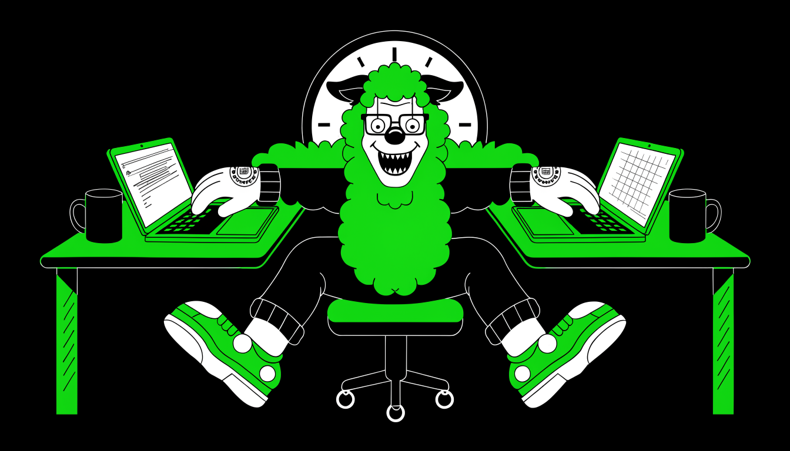

Волки появляются на любом перегретом рынке — люди, которые зарабатывают не навыками, а наглостью. В IT их звёздный час случился в ковид: спрос на разработчиков взлетел, нанимали любой ценой, и массовый найм парализовал отбор — адекватных HR не хватало, тесты и проверки не успевали за объёмом, резюме перестали валидировать. Брали почти не глядя.

Работали волки в двух жанрах. Первый — фейковые резюме. Врали в них всегда, но раньше ложь хоть иногда ловили, а теперь контролировать её стало некому. Любой мог написать:

> «4 года работал у ИП Пупкина-Залупкина разработчиком, хочу сразу на позицию сеньора»

— и человека брали. Разбираться, существует ли «ИП Пупкина-Залупкина», некому и некогда, а отказать страшно: айтишников же дефицит, уйдёт к конкуренту.

Второй жанр — over-employ: человек тихо работает на две-три компании сразу. Удалёнка сделала это технически простым, парализованный контроль — безопасным. Пока в одной компании ты «в глубокой проработке задачи», в другой у тебя закрывается спринт.

Помогала и среда: внутри раздутых штатов результат никто не мерил. В крупных банках — в том же Альфа-Банке — известны случаи, когда отдел из **500 разработчиков за два года не выдал ни одного рыночного продукта**: большая часть вообще не писала код, занималась бессмысленными внутренними исследованиями и изредка пушила в GitHub одну-две строчки.

Пятьсот человек фактически не работали, но их держали — «могут понадобиться». В такой среде можно годами числиться сеньором, так им и не став.

Потом рынок остыл, и маятник качнулся обратно. Не из-за волков вы сталкиваетесь на собеседованиях сейчас: многоэтапные отборы, лайвкодинг вместо разговора «за жизнь», прогон через службу безопасности, звонки бывшим работодателям, испытательный срок как полноценный экзамен. Компании обожглись, но гораздо важней, что нет экономики для найма как раньше.

Честному кандидату это наследство оставило две вещи. Неприятную: фильтры, построенные против мошенников, проходить теперь вам — долго и с презумпцией вины. Полезную: проверяемость стала козырем. Реальные компании в резюме, живой код на GitHub, люди, готовые за вас поручиться, грейд, который подтверждается на лайвкодинге, — это отличает вас от волка быстрее любых слов. И не завышайте грейд «на всякий случай»: сейчас это ловят на первом же техническом этапе.

Это в идеале. Фактически качество найма не повысилось, а мучений для всех стало больше.

## ЧСВ в профессии HR: власть без компетенций

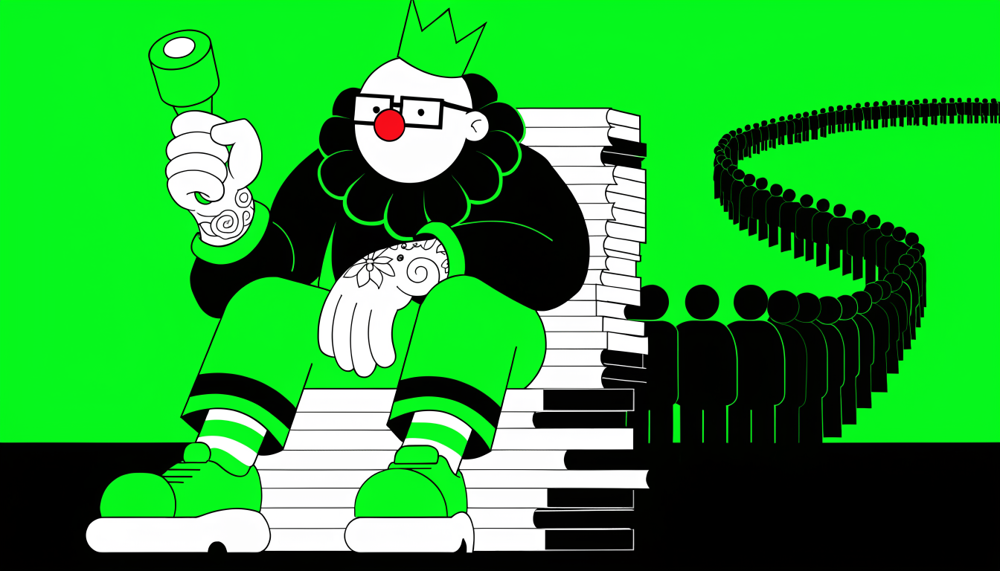

Рассказать о компании по заготовленному сценарию и провести первичный скрининг — вот и вся работа HR на входе в воронку найма. Набор простых операций, с которым справится даже школьник. Тем удивительнее, сколько самомнения демонстрируют иные представители этой профессии при таких скромных реальных компетенциях.

В адекватных компаниях роль эйчара честно формальная. Он озвучивает информацию о зарплате и графике работы, соединяет кандидата с профильным специалистом — техлидом или руководителем отдела — и организует сам процесс собеседования.

Оценивать компетенции — не его дело: этим занимается тот, кто разбирается в специфике должности, и именно он определяет, подходит кандидат или нет.

Вместо этого на скрининге всплывают классические «Кем вы видите себя через 5 лет?» и «Почему именно синий цвет?». Никому эти ответы не нужны. В найме важны три вещи: конкретные задачи, которые предстоит решать, реальный уровень компетенций кандидата и деньги — зарплатные ожидания с одной стороны, предложение компании с другой.

В этой логичной цепочке эйчару места нет: он оказывается лишним звеном, которое скорее тормозит процесс, чем помогает, — не добавляет информации ни одной из сторон, зато растягивает путь до человека, принимающего решение.

Хуже, когда к лишнему звену прилагается раздутое эго. Некоторые HR ведут себя так, словно от них зависит судьба компании: выдвигают абсурдные требования вроде обязательного сопроводительного письма, отсеивают кандидатов по формальным критериям, не имеющим отношения к профессионализму.

А сами при этом могут отвечать на обращения неделями или вовсе игнорировать соискателей. От кандидата ждут подготовки и расторопности — себе прощают всё.

Откуда это берётся, понятно: эйчар стоит первым фильтром и решает, чьё резюме уйдёт дальше, а чьё отправится в корзину. Власть есть, а компетенций, которые должны бы её уравновешивать, нет. Так и выглядит работа многих представителей профессии — власть без компетенций.

По хорошему, первый кто приходит в компанию после собственника - это HR. Он должен развернуть полноценный Human Resource и собрать команду мечты. Так красиво написано в западных книгах по бизнесу и толково рассказывают на тренингах.

Но работает это только в растущей экономике и в высокомаржинальной сфере. Как только наступает кризис рынка или продукта, все нюансы начинает всплывать наружу и оказывается, что роль зачастую бесполезная а часто вредительская.

## Зачем нужны HR: формальность или барьер?

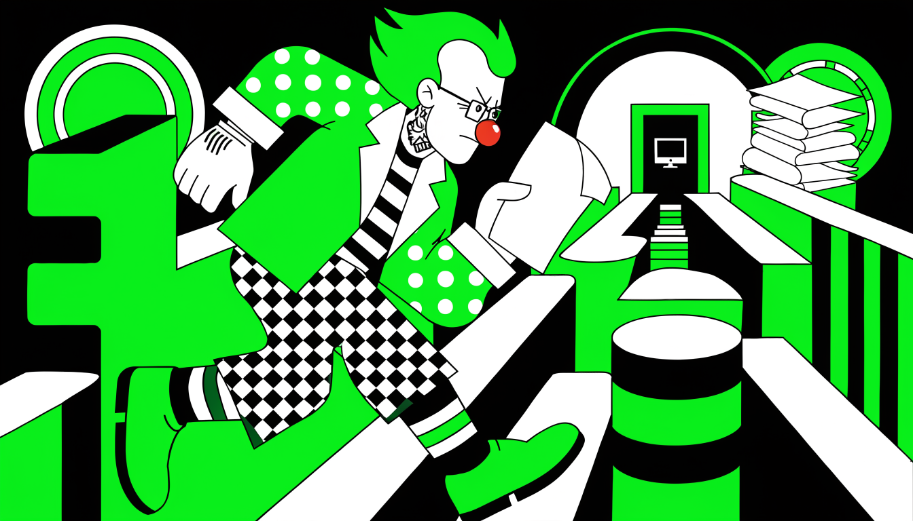

У эйчаров есть любимая претензия к кандидатам: не приложил сопроводительное письмо. Но когда человек рассылает резюме на десятки вакансий, индивидуальное письмо к каждой — пустая трата времени, тем более что эти письма зачастую никто не читает.

Та же история со звонками: при массовом поиске соискатель физически не может помнить детали каждой компании, в которую откликнулся. Требование с ходу вспомнить название компании выглядит абсурдно — HR получает за свою работу деньги, а дополнительных усилий ждут от кандидата, причём на этапе, который его реальную квалификацию никак не проверяет.

Так эйчар из формальности превращается в барьер. Вместо оценки профессиональных навыков — формальные этапы, не имеющие отношения к работе, и до собеседования с техническим руководителем, который только и может оценить кандидата, ещё надо дожить. Соискатель проходит проверки, которые ничего не говорят о том, справится ли он с задачами.

Практика подсказывает обходной путь: лучшие предложения о работе приходят через знакомых, а не через стандартные каналы вроде hh.ru. Рекомендация от действующего сотрудника автоматически пропускает большую часть бюрократии — стороны сразу переходят к разговору по существу, о профессиональных навыках и условиях. Время экономят оба, а обсуждается то, что действительно важно для работы.

Отдельная песня — абстрактные ценности. Некоторые HR рассказывают, что ищут людей, которым помимо денег нужны «самореализация», «престиж», «автономия». На практике большинство работает ради заработка — и это нормально и честно. Противоречия тут нет: все перечисленные мотиваторы напрямую связаны с зарплатой, ведь хорошая оплата сама по себе создаёт желание беречь должность и выкладываться.

Разговоры про «мы семья» и «развитие» без соответствующей компенсации — способ заплатить меньше. Если работодатель делает упор на нематериальные ценности вместо адекватной оплаты, это повод насторожиться.

## Дискриминация на собеседованиях: гендер и субъективизм

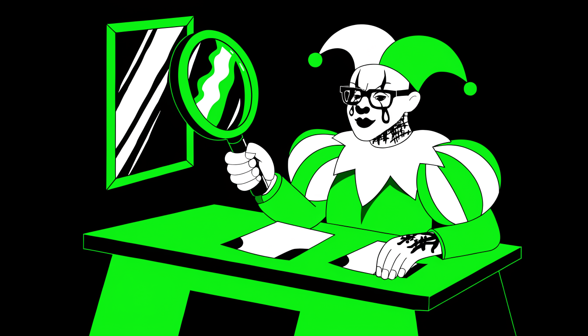

**«Если будет выбор между мужчиной и женщиной, я выберу женщину. Даже если навыки у мужчины выше — выберу женщину, потому что с ней легче в коммуникации»** — это не пересказ, а открытое заявление HR-специалиста. Таких решений на рынке труда всё больше: нанимают не по компетенциям кандидата, а по личным предпочтениям.

Подход противоречит самой сути подбора персонала. Задача эйчара — найти специалиста для решения бизнес-задач, а не собрать себе комфортное окружение для неформального общения. Когда критерием становится не квалификация, а субъективная «лёгкость в общении», проигрывают все: компания получает не лучшего специалиста, а соискатель — отказ, никак не связанный с его навыками.

За таким подходом обычно стоит раздутое ЧСВ. Некоторые HR начинают ощущать власть просто потому, что именно они решают, кого пропустить дальше на собеседование, а кому отказать на первом этапе. Отсюда вопросы в духе «Правильно ли я понимаю, что вы не удосужились прочитать про компанию?» — хотя рассказать о работодателе входит в обязанности самого HR.

Отсюда же упрёки в неподготовленности, когда кандидат резонно ждёт информацию от представителя компании, а не заучивает её наизусть заранее. При этом функционал большинства эйчаров на первичном отборе сводится к базовым операциям: просмотр резюме, рассказ о компании по готовому скрипту, организация встреч.

Высокой квалификации такие задачи не требуют, но положение удобно использовать для самоутверждения за счёт соискателей.

Есть и юридическая сторона. **Трудовой кодекс РФ запрещает дискриминацию при приёме на работу**: выбор кандидата по признаку пола, возраста, национальности или другим критериям, не связанным с деловыми качествами, — прямое нарушение закона.

Когда HR открыто заявляет о предпочтении одного пола другому при равных или даже меньших компетенциях, это уже не непрофессионализм, а противозаконная практика. Вы вправе требовать объективной оценки своих навыков и уважительного отношения — а не становиться заложником личных симпатий или антипатий рекрутера.

Завышенное ЧСВ и дискриминация растут из одного корня — из низкой профессиональной культуры. Разница в том, что на хамство можно только пожаловаться, а дискриминацию — оспорить по закону.

## Зуммеры и HR: стереотипы и двойные стандарты

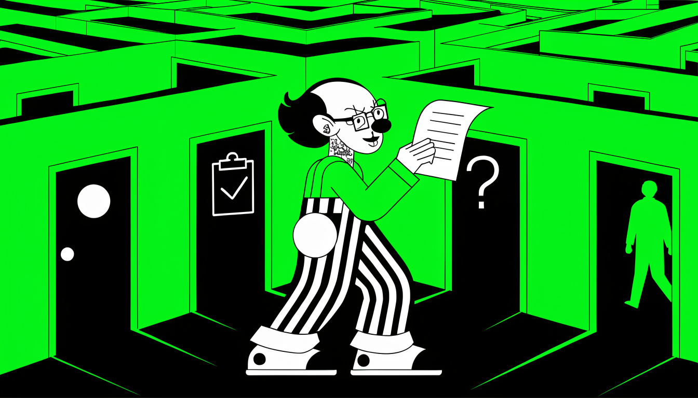

Кандидат не пришёл на собеседование и не предупредил об отмене — дежурный повод для жалоб HR, особенно на молодых специалистов. А теперь обратная ситуация: рекрутер после интервью просто исчезает и не даёт никакой обратной связи. Человек готовился, прошёл встречу, ждёт хоть какого-то ответа — и не получает даже отказа.

Таких случаев не меньше, и это вызывает справедливое недоумение. Двойной стандарт в чистом виде: от кандидатов требуют уважения ко времени компании, но время самих соискателей не стоит ничего.

Вторая болевая точка — многоступенчатый процесс отбора. Прежде чем попасть к человеку, который действительно разбирается в специфике работы, кандидат общается с автоматизированными системами, потом проходит интервью с HR-специалистом — и только затем добирается до непосредственного руководителя или профильного специалиста.

Формально каждый этап можно объяснить, но вместе они складываются в полосу препятствий. При этом на первых этапах часто не раскрывают главного о вакансии: условий работы, реальной зарплаты, графика. Соискатель тратит время вслепую, не зная, стоит ли игра свеч.

Раздражают и абстрактные вопросы. Вместо конкретики о навыках и опыте — расплывчатое «расскажите о себе» или гипотетические ситуации, не имеющие прямого отношения к работе. Скажем, на позицию бэкенд-разработчика могут спросить: «Если по дороге на работу у вас украдут телефон и деньги, а на работе важное совещание — куда вы пойдёте?» Профессиональные компетенции такой вопрос не оценивает, зато отнимает время и создаёт ощущение несерьёзности всего процесса.

Из этих деталей складывается цельная картина: рекрутеры требуют от кандидатов уважения и профессионализма, но сами демонстрируют те же качества далеко не всегда — молчат после собеседований, скрывают важную информацию о вакансии и задают вопросы, далёкие от реальных задач позиции. Претензии к зумерам на этом фоне выглядят тем, чем и являются, — удобным стереотипом, которым прикрывают слабые места собственного процесса найма.

## Как меняется отношение HR к редким специалистам

По тому, как с вами разговаривает HR, можно довольно точно определить, насколько дефицитны ваши навыки. Личная симпатия тут ни при чём — работает закон спроса и предложения, и по тону переписки легко понять, на какой стороне этого уравнения вы находитесь.

Когда на позицию стоит очередь из соискателей, HR-отделы выстраивают сложные многоступенчатые процессы отбора. Кандидата ждут несколько этапов собеседований, долгие ожидания ответа, тестовые задания и проверки — и всё это под формальное, а нередко и высокомерное отношение.

Система настроена в одну сторону: соискатель обязан доказывать свою ценность и терпеливо продираться через барьеры. Хотите работу — играйте по правилам, таких, как вы, за дверью ещё десяток.

С редкими востребованными специалистами та же машина ведёт себя ровно наоборот. Если ваши навыки и экспертиза действительно уникальны и нужны рынку, HR-менеджеры сами активно ищут контакт, формальности внезапно упрощаются, высокомерие сменяется доброжелательностью и готовностью идти навстречу.

Компании начинают конкурировать между собой за возможность пригласить вас на собеседование — то самое, к которому вчера пришлось бы пробиваться неделями. Баланс сил смещается: уже не вы доказываете свою ценность, а работодатель старается вас заинтересовать.

Противоречия здесь нет: и конвейерное высокомерие, и внезапная любезность — реакция одной и той же системы на дефицит. Пока за вашей спиной стоит очередь взаимозаменяемых кандидатов, у HR нет причин церемониться. Как только замену вам приходится искать месяцами, церемониться начинают с вами.

Отсюда практический вывод: развитие редких востребованных навыков — один из способов изменить своё положение на рынке труда. Чем уже специализация и чем выше экспертиза в дефицитной области, тем больше рычагов влияния появляется у специалиста при поиске работы: можно выбирать между компаниями, торговаться об условиях и не тратить нервы на унизительные фильтры массового отбора. Стрелочка поворачивается в вашу сторону — вместе со всей доброжелательностью HR.

## Шизовопросы на собеседованиях: угадай, что хочет HR

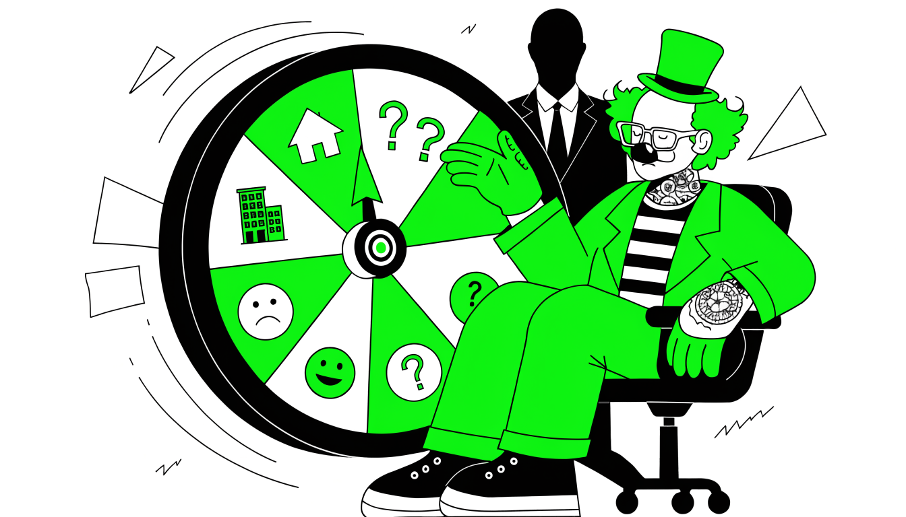

Путь до человека, который может внятно рассказать о будущей работе, превратился в квест. Сначала соискатель общается с нейросетью на платформе HeadHunter, затем проходит беседу с HR-специалистом — и только после этого, если повезёт, его допускают до разговора с тем, кто действительно знает, чем предстоит заниматься.

Причём беседа с HR редко похожа на обсуждение вакансии. Вместо конкретики кандидата засыпают странными вопросами: «Если по дороге на работу у вас украдут телефон и деньги, а на работе важное совещание — куда вы пойдёте, домой или на работу?» Из той же серии — задачки про «два стула» и личные вопросы, не имеющие отношения к профессии.

Попытки вернуть разговор к самой позиции игнорируются: HR настаивает, чтобы кандидат ответил на всё. Такое собеседование может занять около часа. В финале обещают вернуться с фидбеком — и связь прерывается навсегда. Какой ответ считался правильным и что вообще проверяли, так и остаётся загадкой.

До живого общения ещё надо дожить: часть кандидатов срезает автоматика. На HeadHunter работодателям доступна функция авторазбора резюме — она отсеивает соискателей по формальным критериям: возраст, пол (что прямо противоречит законодательству), годы опыта.

Если HR-специалист не хочет вручную просматривать отклики, резюме просто не дойдёт до нужного человека, каким бы сильным оно ни было. В IT-сфере, куда сегодня стремится множество людей, по таким формальным признакам — возрасту или опыту работы — могут отсеиваться **до 90% соискателей**.

В сумме получается парадокс: чтобы получить работу и опыт, нужно сначала доказать, что опыт у тебя уже есть, пройдя через все барьеры отбора. Угадать, чего хочет HR, невозможно. Единственное утешение — знать заранее: час шизовопросов и тишина вместо обещанного фидбека говорят не о вас, а о том, как устроена эта система.

## Противоречивые требования HR: как бы ты ни ответил — плохо

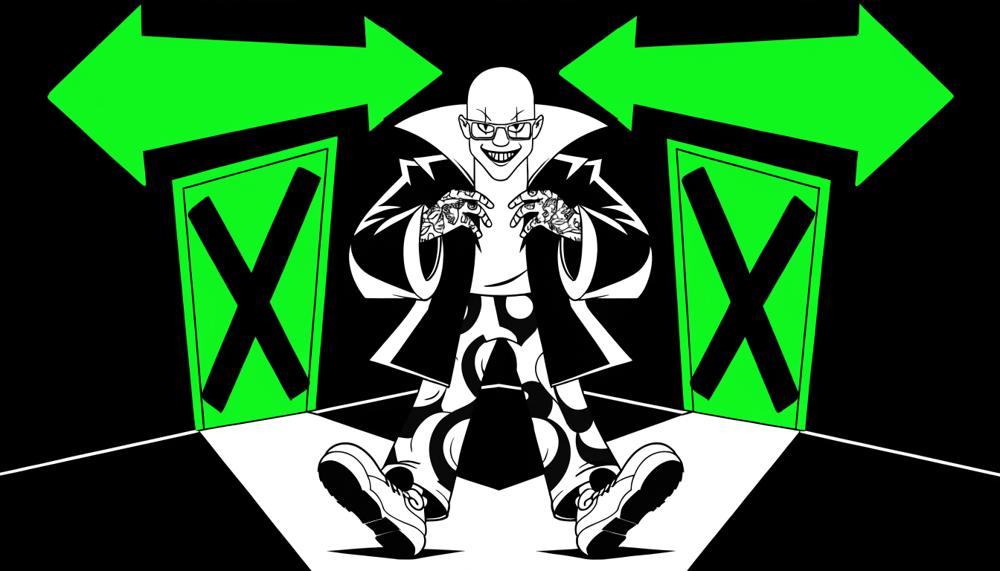

Испуганный кандидат — плохо. Уверенный — тоже плохо. Есть собеседования, на которых проигрышным оказывается любой ответ: HR предъявляет взаимоисключающие требования, и угадать «правильное» поведение невозможно в принципе.

Рекрутеры критикуют кандидатов с двух противоположных сторон. Тот, кто нервничает, выглядит испуганным и не производит впечатления «боевой единицы», которая сможет реализовать нужный функционал. Тот, кто держится уверенно, самим поведением даёт понять: HR-специалист — лишь препятствие на пути к желаемому офферу.

Это тоже оценивается негативно. Замкнутый круг: нужно поймать неуловимый баланс между робостью и напором, причём каждый рекрутер понимает этот баланс по-своему. Шкалу вам никто не покажет — о промахе вы узнаете по отказу.

Та же двойственность зашита в классический вопрос «Расскажите о ваших слабых сторонах». Сами HR-специалисты объясняют, что проверяют три качества: адекватность, способность учиться и открытость к честному конструктивному диалогу. Звучит разумно.

Но на практике этот вопрос — вместе с «продайте мне ручку» и «почему мы должны выбрать именно вас» — многие считают устаревшим шаблоном из американских книг нулевых годов. Карго-культ: слепое копирование западных практик без адаптации к реальности.

Ловушка сидит в самой конструкции вопроса. Искренний рассказ о реальных слабостях может сыграть против кандидата. Попытка выдать «правильный», отрепетированный ответ выглядит неестественно — и тоже считывается. Вдобавок у рекрутеров есть три типа ответов, которые они сами называют красными флагами: два из них — полное отрицание слабостей и фейковая слабость, когда достоинство наряжают в недостаток; подробный разбор всех трёх — в следующей статье.

В итоге требование к кандидату звучит как дзенский коан: признай слабости, но не покажись слабым; будь искренним, но не слишком откровенным; будь уверенным, но знай своё место. Как ни ответишь — всегда найдётся, к чему придраться.

## Вопросы-ловушки: слабые стороны и карго-культ американских методик

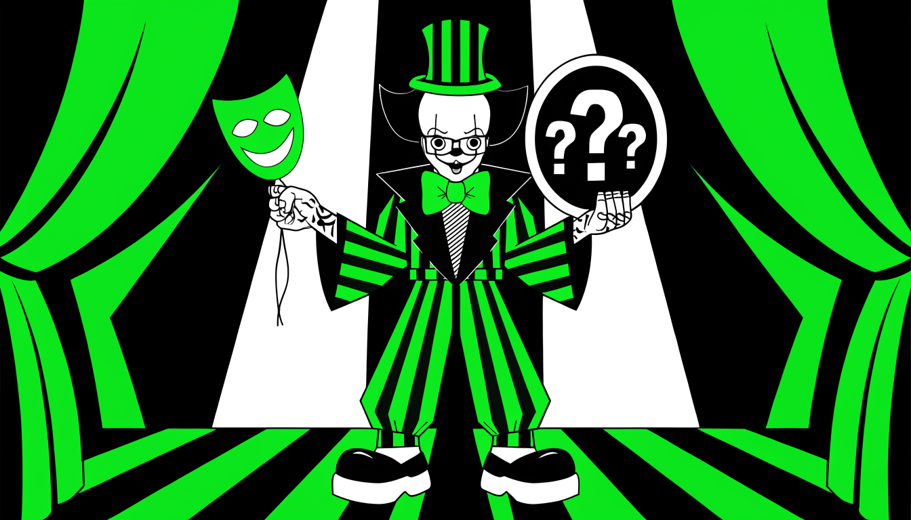

Вопрос «Назовите ваши слабые стороны» приехал в российский найм прямиком из западных книг по найму нулевых годов. Это карго-культ в чистом виде: методику перенесли механически, в наших реалиях она не работает и лишь заставляет кандидатов выдавливать из себя неискренние ответы.

Если вы всё же попали на такой вопрос, у рекрутеров есть три типа ответов, которые машут красным флагом, — их стоит избегать.

Первый — отрицание слабостей. «У меня нет слабых сторон» — это либо ложь, либо полное отсутствие способности к рефлексии; для команды оба варианта одинаково плохи. Второй — фейковая слабость. «Я перфекционист» — штамп с нулевой оригинальностью и нулевой честностью, реального самоанализа за ним нет.

Третий — критичная для роли слабость: назвать качество, без которого вы просто не сможете выполнять эту работу, — тоже провальная стратегия.

Замысел у вопроса внятный: проверяющий хочет понять, способны ли вы признать, что не идеальны, учитесь ли на своих ошибках и есть ли у вас навык рефлексии. Проблема в формате — он настолько избитый и искусственный, что получить искренний ответ почти невозможно: обе стороны разыгрывают заученный спектакль.

Сколько нормальных кандидатов отсеяли из-за подобных формальных вопросов, остаётся только гадать.

У HR-процессов есть и совсем тёмная сторона — фейковые вакансии и имитация бурной деятельности. Некоторые HR создают липовые позиции и проводят собеседования только ради того, чтобы отчитаться о количестве проведённых интервью; сами вакансии при этом годами не закрываются.

Развод получается двойной: компания впустую тратит деньги, соискатели теряют время и нервы.

Так рынок труда и превратился в настоящий ад для тех, кто ищет работу: с одной стороны — ритуальные вопросы, на которые нет честного ответа, с другой — интервью, за которыми не стоит никакой работы. Если вы ни разу не сталкивались с этим процессом, считайте себя счастливчиком.

## Вопросы с подвохом на собеседовании и как на них отвечать

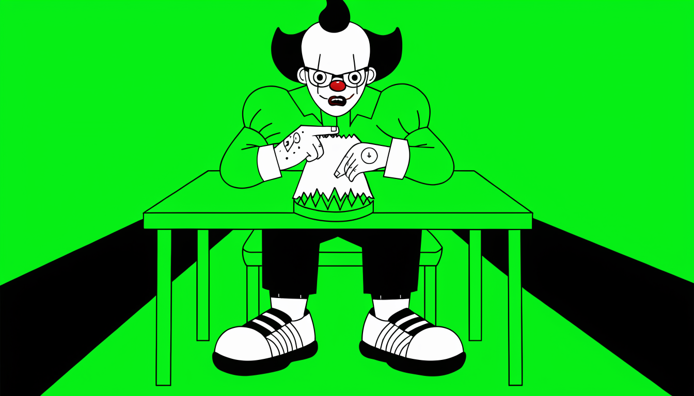

Не каждый неудобный вопрос на собеседовании — манипуляция. Часть из них только выглядит подвохом, а проверяет вполне конкретные вещи: осознанность и адекватность кандидата. Разберём три типичные группы таких вопросов и отдельный сюжет с документами.

«Почему именно наша компания?» — тест не на красноречие, а на подготовку. Работодатель хочет увидеть, что вы изучили компанию перед собеседованием, понимаете специфику должности и выбрали это место осознанно, а не откликнулись веером на всё подряд.

Выдумывать красивые речи не нужно — достаточно показать, что вы действительно разобрались в деятельности компании и требованиях позиции.

«Расскажите о своих плюсах и минусах» — вопрос, к которому стоит подготовиться заранее, чтобы ответить конструктивно и чётко. Типичная ошибка — сказать что-то вроде «мой главный минус — что у меня нет минусов»: выглядит странно и выдаёт отсутствие самокритичности.

Спрашивают это, чтобы понять, умеете ли вы объективно рассуждать о себе, насколько адекватна ваша самооценка и способны ли вы анализировать себя всесторонне.

Вопросы о личной жизни — семейное положение, дети, кредиты, увлечения, планы на декрет — воспринимаются болезненно, но это не нарушение границ. Работодатель хочет понять контекст вашей жизни и оценить, насколько успешным будет сотрудничество с учётом ваших обстоятельств.

Сопротивляться и заявлять, что это не касается работы, не стоит: желание получить полную картину о кандидате — нормальное.

### Документы и 152-ФЗ: как не выстрелить себе в ногу

Когда HR просит электронную трудовую книжку или другие документы, худший вариант ответа — жёсткая позиция со ссылкой на 152-ФЗ о персональных данных. Формально такой кандидат прав: трудовая содержит персональные данные, и на их обработку требуется согласие. На практике после такого ответа вас просто исключат из отбора.

Провальный диалог выглядит так:

Кандидат: «Не имеете права, 152-ФЗ, согласие на обработку…»

- HR: «Окей, вы правы»
- Кандидат: «Я прав, берите меня на работу!»
- HR: «Простите, вакансия уже занята»
- Причина проста: вы демонстрируете недоговороспособность, оперируете формальностями и выглядите неадекватным. Никто не хочет быть «лохом», который согласился на ультиматум, поэтому единственный логичный выход для работодателя — отказаться от такого кандидата.

Ваша задача — найти промежуточный ответ, который не отдаёт HR всё и сразу, но устраивает его настолько, что отправлять вас подальше ему не захочется.

Все перечисленные вопросы проверяют одно и то же: осознанность, самокритичность и готовность к открытому диалогу. Честные и продуманные ответы производят ровно то впечатление, которое нужно.

## Границы на собеседовании: закон и адекватность

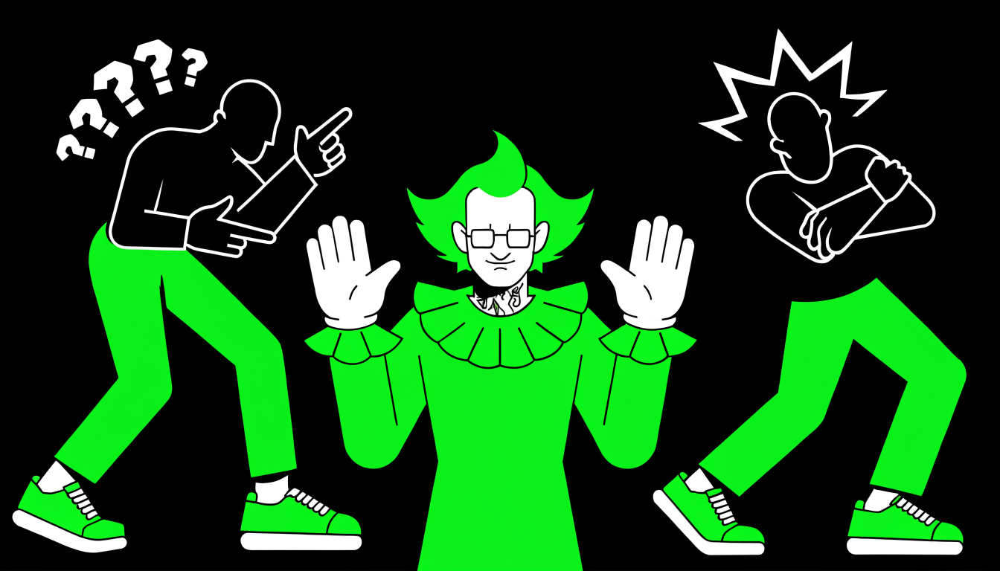

Рекрутер на интервью спрашивает: «Когда планируете заводить детей?» Такое случается сплошь и рядом — особенно в кризис, когда работодатели пользуются напряжённым рынком труда и позволяют себе лишнее. Разберёмся, где граница проходит по закону и как её держать, не похоронив оффер.

Статьи **3 и 64 Трудового кодекса РФ** запрещают дискриминацию по признакам, не связанным с деловыми качествами и профессиональными компетенциями. Работодатель не вправе лезть в личную жизнь, если она не касается рабочих обязанностей. Типичные незаконные вопросы:

- Когда вы планируете заводить детей?
- Своя у вас квартира или снимаете жильё?
- Какая у вас прописка?
- Вопросы о семейном положении, не связанные с работой.

Отвечать на них вы не обязаны. Рабочая формулировка — спокойная и вежливая: «Этот вопрос не касается моих профессиональных компетенций. Давайте вернёмся к обсуждению рабочих задач». Если после этого продолжают давить — красный флаг: токсичная атмосфера, заметная уже на собеседовании, после трудоустройства никуда не денется. От такого сотрудничества разумнее отказаться сразу.

Есть и обратная крайность. Кандидата спрашивают: «Есть ли у вас дети? Как относитесь к переработкам, если иногда возникает такая необходимость?» — а он взрывается: «А какое это вообще имеет отношение к работе? Это моё личное дело!

Зачем лезть в моё семейное положение? Я не собираюсь перерабатывать, я чётко соблюдаю границы личного и рабочего времени!» Для работодателя такая категоричность — тот же красный флаг, только с вашей стороны. Сегодня на первом плане soft skills: можно быть высококлассным профессионалом, но если с вами невозможно договориться, а в нестандартной ситуации на вас нельзя положиться, компания возьмёт менее опытного, но более адекватного кандидата — его проще доучить, чем работать с жёстким и негибким.

Работу «без сучка, без задоринки» сейчас не гарантирует ни одна компания: авралы, внеплановые задачи и нестабильность — данность, и ищут того, кто готов гибко взаимодействовать и быть опорой в проблемной ситуации.

Сколько свободы можно себе позволить, зависит от рынка. Дефицитную профессию — токаря, фрезеровщика — возьмут в любом случае. Если же специалистов вашего профиля избыток (это легко проверить на HeadHunter), адекватность и готовность к диалогу становятся главным преимуществом, а слишком резкое отстаивание границ может стоить оффера.

Собеседование — переговоры равных партнёров, а не допрос. Знание своих прав защищает от давления и сразу отсеивает проблемных работодателей, а спокойный тон сохраняет впечатление о вас. Твёрдо по содержанию, мягко по форме.

## Три фатальные ошибки на собеседовании

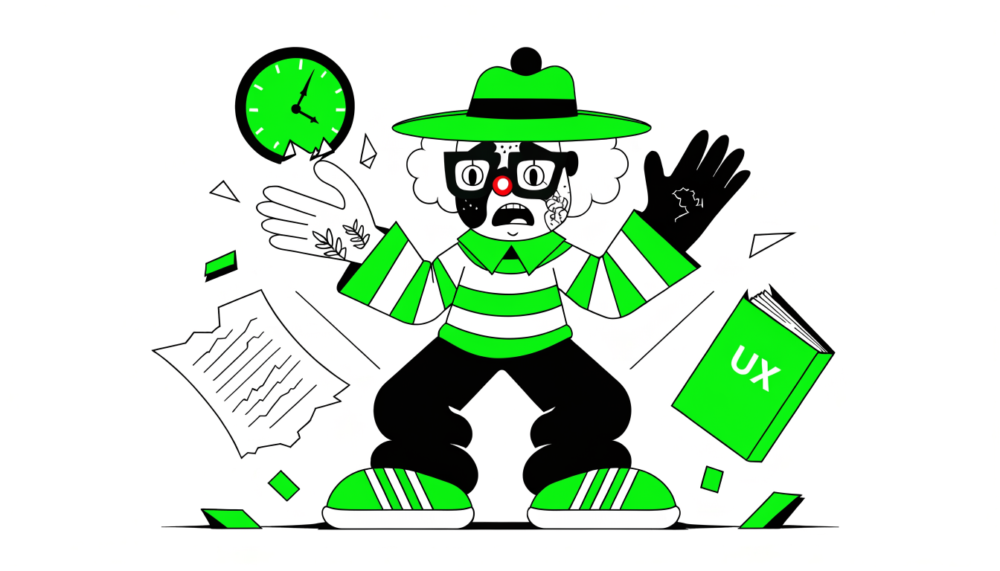

Опоздать можно даже на онлайн-встречу: не загрузилось приложение, отвалился интернет. Форс-мажоры случаются у всех, и работодатель смотрит не на сам сбой, а на вашу реакцию: предупредили заранее — рабочая ситуация, молча не явились вовремя — первая фатальная ошибка: непунктуальность оставляет стойкое негативное впечатление.

Когда на позицию претендуют несколько равных по компетенциям кандидатов, пунктуальность становится решающим фактором: выберут того, кто пришёл вовремя и показал уважение к чужому времени. Поэтому готовьте всё заранее — проверьте связь, приложения, маршрут, — а если что-то пошло не так, сразу пишите рекрутеру, не дожидаясь, пока он сам начнёт вас искать.

Вторая ошибка — несоблюдение договорённостей. Классика: пообещали после собеседования прислать дополнительные материалы — и не прислали или прислали с опозданием. Если понимаете, что сразу не успеете, договоритесь о реалистичном сроке: «Могу отправить сегодня до 15:00, вас устроит?» — и затем строго выполните обещанное.

Для руководителя это прямой показатель дисциплины и ответственности: если вы срываете мелкую договорённость ещё до оффера, что будет с дедлайнами в работе? На такого человека сложно положиться, и никакие технические навыки этого не компенсируют.

Третья ошибка — прийти, не изучив компанию. Вас спрашивают: «Почему именно мы? Что знаете о нашей компании?» — а в ответ звучит: «Не изучал особо, а чем вы занимаетесь?» Авторитет рушится на месте: такое поведение читается как незаинтересованность и неуважение к работодателю.

Минимальная подготовка — сайт компании, её продукты, миссия, недавние новости — **займёт 15–20 минут**, но покажет мотивацию и серьёзность намерений. Дешёвая инвестиция с заметной отдачей.

Общий знаменатель у всех трёх промахов один: они говорят о вас как о человеке, а не как о специалисте. Идеальное резюме доводит до собеседования, но опоздание, невыполненное обещание и незнание компании перечёркивают его за один час разговора. Все три ошибки лечатся элементарно — и именно поэтому работодатель их не прощает.

## Честность про массовые увольнения на собеседовании

Когда компания проводит массовое сокращение или закрывает позиции, увольняют не конкретного человека, а роль или ставку. Практика настолько распространённая, что переживать по этому поводу не стоит, а скрывать факт лейоффа на собеседовании — тем более.

Честность здесь — правильная стратегия, особенно на международном рынке, где сокращения давно стали частью нормального рабочего процесса.

Попытка придумать другую причину ухода только усложняет ситуацию. Опытный рекрутер или нанимающий менеджер всё равно почувствует недосказанность и начнёт копать глубже. Хуже того — у него сложится впечатление, что вы что-то скрываете или пытаетесь обмануть.

И вот это уже реальный повод для отказа, в отличие от самого сокращения, которое давно никого не смущает.

Решает не факт лейоффа, а то, как вы о нём говорите. Качественный ответ собирается из трёх частей. Сначала расскажите, чему научились за время работы в компании и с какими результатами вы её покинули — так разговор сразу уходит от причин увольнения к вашей пользе.

Дальше покажите отсутствие негатива: никакой обиды на прошлого работодателя, спокойное и профессиональное отношение к случившемуся. И закончите планами на будущее: чем вы сейчас занимаетесь в поиске, что изучаете дополнительно, какие книги читаете, куда хотите двигаться дальше.

Такая подача показывает, что вы не выгорели, сохраняете мотивацию и хорошо относитесь к предыдущему месту работы. Это куда выигрышнее, чем оставлять впечатление, будто вы ушли, потому что «все вокруг были не правы, а вы — д'Артаньян».

Обиженный кандидат, поливающий бывшего работодателя, заставляет рекрутера примерить ту же роль на свою компанию.

Если сокращение касалось известной компании или было публичным, скрывать вообще нечего: информация и так на слуху, и рекрутер, скорее всего, читал о нём в новостях. Спокойно объясните ситуацию и переведите фокус на то, что вы готовы предложить новому работодателю.

## Как отвечать HR на запрос электронной трудовой

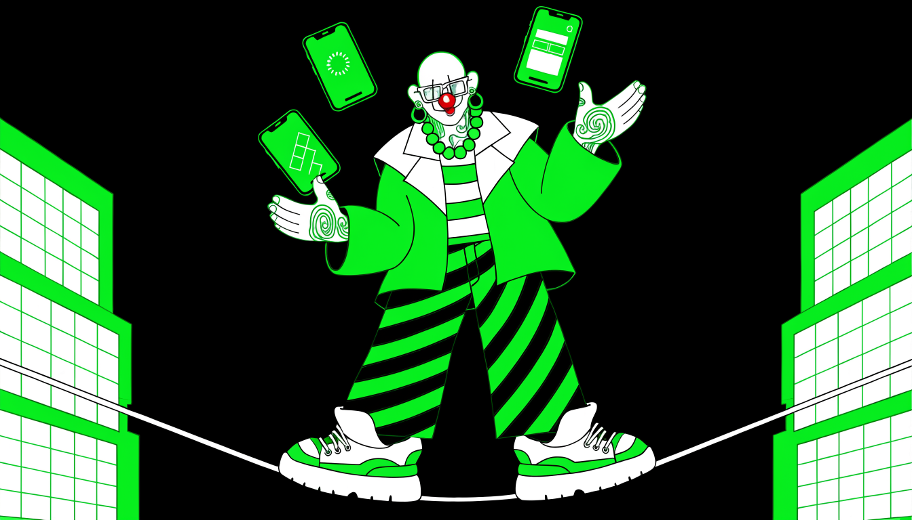

Запрос электронной трудовой книжки — момент истины для тех, кто приукрасил опыт в резюме. Многие кандидаты, получив такое сообщение, теряются и отвечают одним из двух проигрышных способов.

Ужасный вариант — жёсткая позиция: «Вы не имеете права запрашивать, это нарушение 152-ФЗ о персональных данных. Не хотите штрафов?» Формально вы правы, это персональные данные. Но цель переговоров — получить работу, а не показаться самым умным.

HR воспринимает такой ответ как ультиматум, вы выглядите конфликтным и недоговороспособным, и самый адекватный ход для работодателя — отказать. Вы встали в позицию, из которой нет выхода без потери лица, и вакансия «внезапно закроется».

Средний вариант — раннее оправдание: «Слушайте, меня странно оформили, это не отразилось в трудовой». Конфликта нет, пространство для переговоров остаётся — уже лучше. Но вы раскалываетесь слишком рано: вас ещё не поймали, а вы уже оправдываетесь.

Вас просто попросили документ, а вы объясняете несоответствия, которых никто пока не заметил, — играете за противника и демонстрируете неуверенность.

### Идеальный ответ

«На Госуслугах какой-то баг. Записался в МФЦ, ближайшая запись — на следующий месяц. Давайте пока двинемся дальше по собеседованию». Работает это по четырём причинам. Реалистично: баги на Госуслугах действительно бывают. Показывает готовность к сотрудничеству: вы не отказываетесь, а объясняете техническую задержку.

Перехватывает инициативу: вы сами предлагаете двигаться дальше по процессу. И выигрывает время — самый ценный ресурс в этой партии.

### Зачем тянуть время

За месяц вы пройдёте технические интервью, докажете компетентность на практике и станете желанным кандидатом. К моменту, когда трудовая понадобится для оформления, компания уже инвестирует в вас время — и если несоответствие всплывёт, его можно объяснить: «Не знаю, работодатель где-то схитрил с оформлением».

С большой вероятностью на формальность закроют глаза: электронную трудовую и так смотрят поверхностно.

Отсюда принцип: не оправдывайтесь раньше времени. Не создавайте конфликта, оставляйте пространство для переговоров, переключайте фокус на свою компетентность и тяните время, пока не закрепитесь как ценный кандидат. Хороший ответ не даёт HR то, что он просит, но полностью его устраивает — и отказывать вам HR не хочет.

## Психология переговоров с HR: не встать в жёсткую позицию

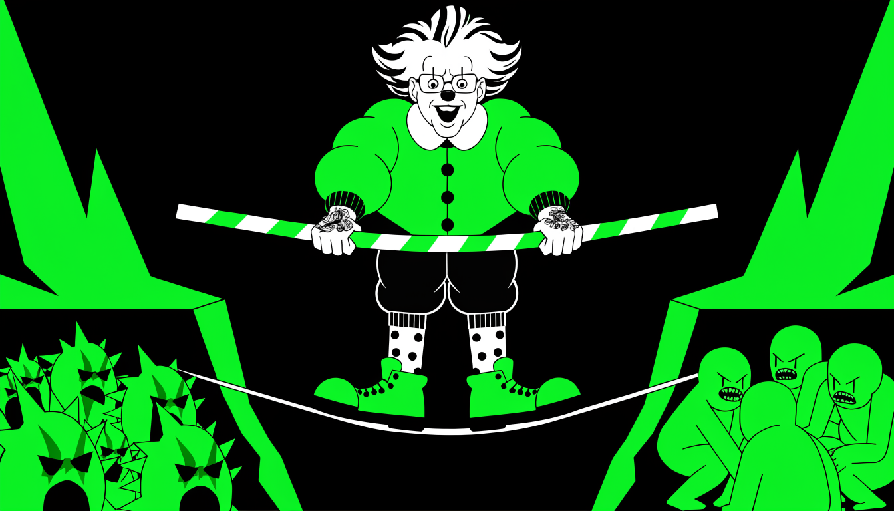

Получив неудобный вопрос от HR, кандидаты обычно бросаются в одну из двух крайностей — агрессию или подхалимаж. Проигрывают обе. Правильный ответ не демонстрирует превосходство и не стелется перед собеседником: он даёт HR адекватный выход из ситуации без потери лица.

Задача не в том, чтобы выглядеть «охренительно важным» или «охренительно крутым», не в том, чтобы послать собеседника («пошли нахер, не имеете права»), и уж точно не в том, чтобы лизать жопу работодателю. Задача — поставить HR в ситуацию, где согласиться с вами и дать работу будет самым адекватным решением. Хороший ответ находится посередине: он скользкий, вёрткий, мудрый и хитрый.

Смотрите, что происходит, если отвечать жёстко на каждый вопрос. Самый адекватный ход для HR — ход назад: «Хорошо, не имеете права, идём нахер, пообщайтесь с другим работодателем». А сейчас рынок работодателя, не работника — других вариантов у вас немного.

Кандидаты чаще всего «режутся» на трёх вопросах. Первый: «Пришлите, пожалуйста, электронную трудовую» — больная тема для тех, кто накрутил опыт и не хочет показывать реальную историю занятости. Второй: «На следующий этап собеседования — лайфкод-сессия, как вы на это смотрите?» — проверка реальных навыков на практике.

Третий: «В вашем резюме есть проект, похожий на наш. Можете дать контакты коллег, чтобы мы обсудили с ними вашу работу?» — верификация через рекомендации. Каждый из этих вопросов ставит приукрасившего резюме кандидата перед выбором: раскрыться, соврать в лоб или найти третий путь.

Стратегия во всех трёх случаях одна — не давать HR то, что он просит напрямую. Если у вас чистая трудовая и действительно 10 лет опыта, как указано в резюме, — никаких проблем, присылайте. Но если где-то лукавили, приврали, приукрасили — нужна другая тактика.

Тактик накрутки опыта, к слову, не одна — их около 10, и объединяет их общий принцип: не вставать в жёсткую позицию, а искать вариант, при котором HR сам заинтересован закрыть глаза или принять вашу версию.

## Три проблемных вопроса HR при накрутке опыта

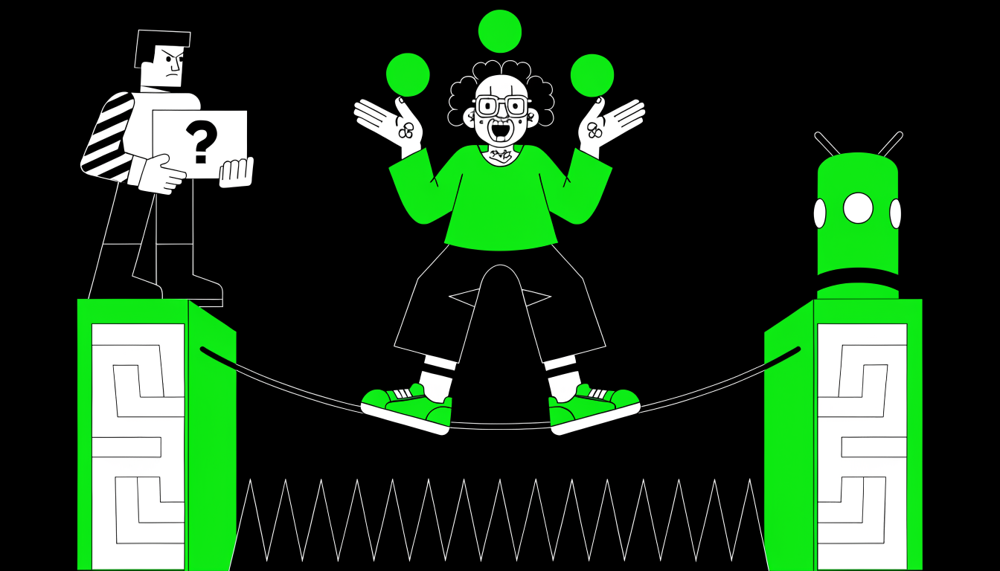

Кандидат с приукрашенным резюме чаще всего сыплется на трёх вопросах HR:

1. «Пришлите электронную трудовую».
2. «Лайфкод-сессия на следующем этапе — как вы к этому относитесь?»
3. «Дайте контакты коллег для обсуждения вашей работы на указанном проекте».

Каждый из них устроен как ловушка: прямой честный ответ раскроет несоответствие, прямой отказ сорвёт переговоры. Отсюда задача — ответить так, чтобы не дать того, что просят, но при этом полностью устроить работодателя и не получить отказ.

Сразу оговорка: с чистой трудовой и реальными 10 годами опыта проблемы нет — отправляйте спокойно. Разговор дальше для тех, кто где-то слукавил, приврал или приукрасил. Тактик накрутки опыта, к слову, существует около 10, и прямое враньё — лишь одна из них.

Хороший ответ на проблемный вопрос живёт посередине: он скользкий, вёрткий, мудрый и хитрый. Это не значит лизать жопу работодателю, но и не значит идти на конфронтацию — обе крайности одинаково надёжно хоронят переговоры.

Разберём на первом вопросе — запросе электронной трудовой. Блогеры массово советуют отвечать: «Не имеете права запрашивать по закону о персональных данных, не хотите же вы штрафов». Формально всё так: 152-ФЗ действительно относит трудовую к персональным данным, на обработку которых требуется согласие.

Только юридическая правота здесь не выигрывает. Рынок сейчас благоприятствует работодателям, и спорить с кандидатом о тонкостях закона никто не станет — HR просто пообщается с другим претендентом, а вы останетесь с правотой вместо оффера.

Рабочий ответ решает три задачи одновременно: не даёт того, что просят, полностью устраивает HR и не провоцирует отказ. Баланс между защитой своих интересов и доброжелательными отношениями с работодателем — в этом и есть всё искусство ответов на проблемные вопросы.

## Средний ответ: оправдание про странное оформление

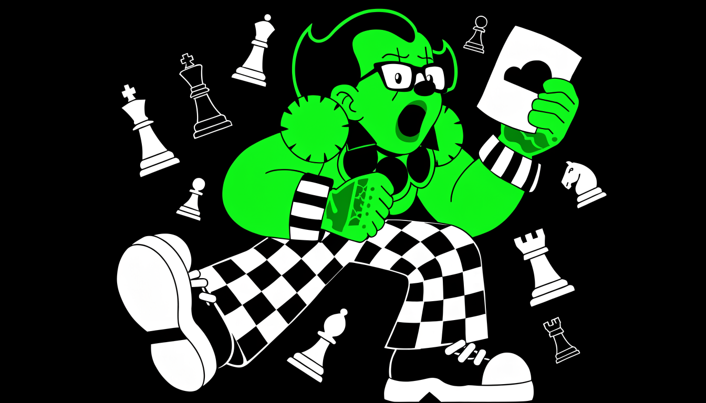

«Меня как-то странно оформили, это не отразилось в трудовой» — так и тянет ответить, когда запрашивают электронную трудовую книжку, а в ней не всё гладко. Ответ кажется промежуточным и безопасным. На деле в нём зашита серьёзная ошибка.

Сначала о том, что в этом варианте работает. Вы не встаёте в жёсткую оборону в духе «я самый умный, а вокруг дураки», даёте понять, что готовы к диалогу, и оставляете собеседнику пространство для переговоров — разговор может продолжиться конструктивно. Уже неплохо.

Теперь о провале: вы раскалываетесь раньше времени. Вас ещё не спросили, почему стаж в резюме не совпадает с электронной трудовой. Никто не ловит вас на противоречии — у вас просто запросили документ, без всякого подтекста. А вы уже играете за собеседника: додумываете его следующий ход, приписываете ему подозрения и начинаете оправдываться, хотя повода никто не давал.

В шахматах новичков специально отучают додумывать ходы за соперника. На собеседовании то же самое: не отвечайте на вопросы, которых не было. Предугадывая их и объясняясь заранее, вы признаёте проблему, которую собеседник, возможно, и не заметил бы, выглядите неуверенно и виновато, теряете позицию силы.

Никто не хочет оказаться «лохом» или «дураком», особенно когда вам бросают ультиматум или играют на противопоставление. Согласившись с чужой «пикой» и пойдя на поводу, вы часто оказываетесь в проигрышной роли.

Держите в голове аксиому: трудовая книжка на самом деле никому не нужна. Её запрашивают формально, потому что «так принято». Ваша игра — и документ прислать, и лишних вопросов не вызвать, и чувствовать себя при этом комфортно.

Оправдания — слабая позиция, а оправдания заранее — слабая вдвойне. Дождитесь конкретного вопроса, например про несовпадение стажа, и только тогда давайте чёткий, спокойный ответ по делу.

## Идеальный ответ: баг на Госуслугах и запись в МФЦ

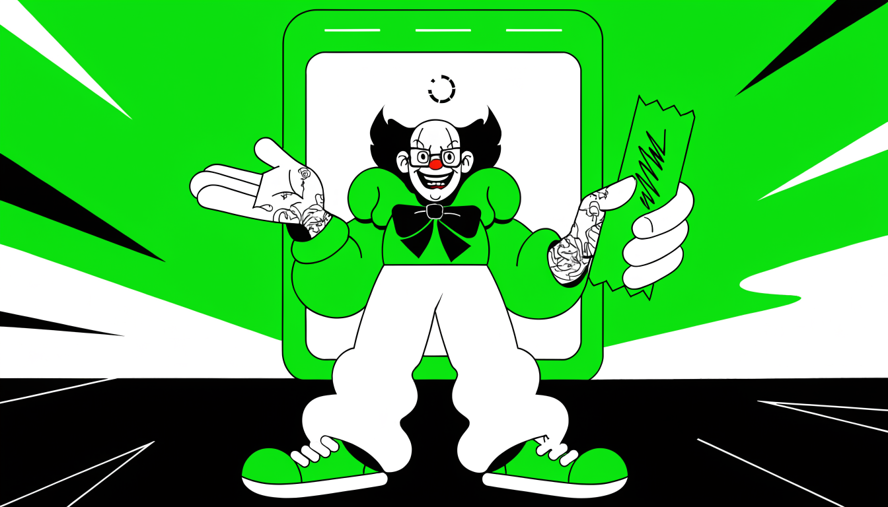

Трудовая книжка никому не нужна — её запрашивают формально, потому что «так положено», а реальное решение о найме принимают по компетенциям, не по штампам. Из этой аксиомы растёт вся тактика на случай, когда с трудовой у вас «сложности»: неполные записи, расхождения или электронная вовсе не оформлена.

Главная ошибка здесь — сразу оправдываться и колоться, честными признаниями руша собственную переговорную позицию.

Плохой ответ звучит так:

> «Понимаете, там были договоры ГПХ, работодатель не всё оформил, я не виноват…»

Вы раскололись: сами сообщили, что трудовая проблемная, и отдали инициативу. Теперь HR знает ваше слабое место — можно надавить, а можно и отказать.

Хороший ответ:

> «На Госуслугах какой-то баг. Записался в МФЦ — ближайшая запись на следующий месяц. Давайте пока двинемся дальше.»

Здесь одновременно срабатывает несколько механизмов. Мягкость и согласие: вы не отказываетесь, вы готовы выполнить требование — просто пока технически не можете. Внешние обстоятельства: баг на Госуслугах и очередь в МФЦ реалистичны и от вас не зависят.

Перевод фокуса: «давайте двинемся дальше» — это предложение продолжать процесс найма, тесты, встречи с лидом, стажировку, пока трудовая «в процессе». И главный механизм — время. К моменту, когда вы пройдёте все этапы и покажете компетенции, вопрос трудовой книжки превратится в минимальную формальность: оформить сотрудника при желании можно и без неё.

Почему не колоться до последнего? Если HR позже обнаружит расхождения — «что-то не совпадает», — вот тогда и наступает момент для объяснения:

> «Да, не знаю. У меня были бумажные договоры, наверное, работодатель где-то схитрил, не оформил. Мне жаль, что так получилось, но я ни в чём не виноват.»

К этому моменту вы уже полностью готовый кандидат: прошли собеседования, показали экспертизу. Одна неидеальная трудовая не перевесит реальную ценность, которую работодатель успел разглядеть.

Стратегия целиком: не оправдываться, а мягко тянуть время, переводя разговор на компетентность и готовность работать. К финальной стадии найма проблема рассосётся сама.

## Как отказаться от лайвкодинга и контактов коллег

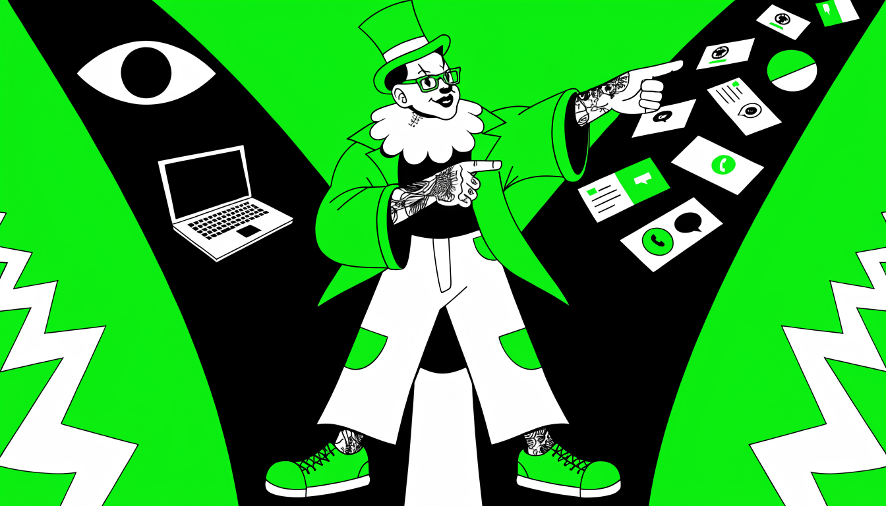

Лайвкодинг под взглядом интервьюера и выдача контактов бывших коллег — два требования работодателей, которые регулярно ставят кандидата в неловкое положение. Оба можно отклонить вежливо и без потери оффера, если понимать, на чём строить отказ.

Фундамент у обоих отказов общий — стратегия постепенного сближения с работодателем: стажировка, прямое общение с лидом команды, демонстрация компетентности до формального оформления. Такой путь обходит формальные барьеры вроде проблем с электронной трудовой и переводит разговор на главное — вашу способность выполнять работу.

Неудобные шаги при этом пропускаются, а работодатель видит реальную ценность, а не результаты искусственных проверок. Кандидату, который уже закрепился в компании как готовый специалист, финальные формальности прощают куда легче. Поэтому каждый отказ стоит подавать как шаг к настоящей проверке делом.

Теперь по требованиям. Лайвкодинг некомфортен по своей природе: писать код под наблюдением — стресс, и на реальную работу, где никто не стоит над душой, эта ситуация похожа мало. Отказ собирается из трёх частей: объяснить, почему формат вам не подходит, сделать это корректно и сразу предложить альтернативу — способ, которым работодатель всё равно увидит ваш код и ход мысли.

Разница принципиальная: отказ без альтернативы выглядит как увиливание, отказ с альтернативой — как позиция.

С контактами бывших коллег для сбора рекомендаций у отказа есть и законные основания. Чужие контакты — персональные данные третьих лиц, и раздавать их без согласия владельцев вы не обязаны. Люди с прошлых мест работы не подписывались участвовать в вашем трудоустройстве, и защита их конфиденциальности — достаточная причина отказать.

Задача сводится к формулировкам: облечь отказ в слова, которые прикроют коллег и не испортят впечатление о вас.

Конкретные формулировки отказа и рабочие альтернативы для обоих случаев разобраны в следующих статьях.

## Soft skills важнее hard skills: адекватность и гибкость

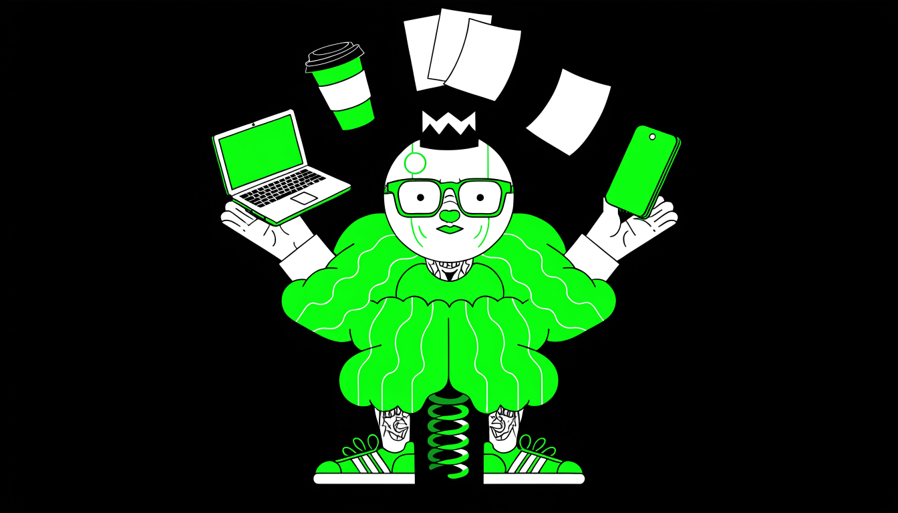

Выбирая между опытным профессионалом, с которым сложно договориться, и менее квалифицированным, но адекватным и готовым к коммуникации человеком, работодатель, скорее всего, возьмёт второго. Логика простая: недостающие навыки можно подтянуть обучением, а способность к нормальному взаимодействию — базовое требование, и тренингами она не ставится.

Именно поэтому на современном рынке труда работодатели всё чаще ценят soft skills выше узкопрофессиональных компетенций.

С высококлассным, но негибким специалистом бывает попросту невозможно работать. Кандидат, который не готов адекватно реагировать на рабочие ситуации, отвечает с наездом или выстраивает жёсткие границы там, где требуется гибкость, получает серьёзный минус ещё на собеседовании: по этим реакциям работодатель прикидывает, каким человек окажется в настоящем рабочем конфликте.

Работодателю нужны люди, на которых можно опереться в нестандартных обстоятельствах — в авралах, внеплановых задачах, форс-мажорах. «Опереться» здесь понимается буквально: отдать внеплановую задачу или попросить помочь в аврал и не наткнуться на скандал.

Ни одна компания сегодня не может гарантировать идеально стабильный процесс без сбоев и сюрпризов, поэтому вопрос всегда один: как поведёт себя человек, когда форс-мажор случится. Сотрудник, который в такой момент первым делом начинает войну за границы, обходится команде дороже, чем тот, кому нужно чуть больше времени на саму задачу.

Насколько жёстко это правило давит именно на вас, зависит от того, профицитна ваша профессия или дефицитна. Представителю редкой специальности — токарю, фрезеровщику — достаточно просто позвонить: его заберут с руками и на шероховатости характера закроют глаза.

В массовой профессии вроде SMM-специалиста конкуренция высока, кандидатов с примерно одинаковыми навыками много, и решающим фактором отбора становятся именно мягкие навыки. Чем проще вас заменить, тем дороже стоит ваша адекватность.

## Главная задача собеседования: понравиться HR, а не показать скиллы

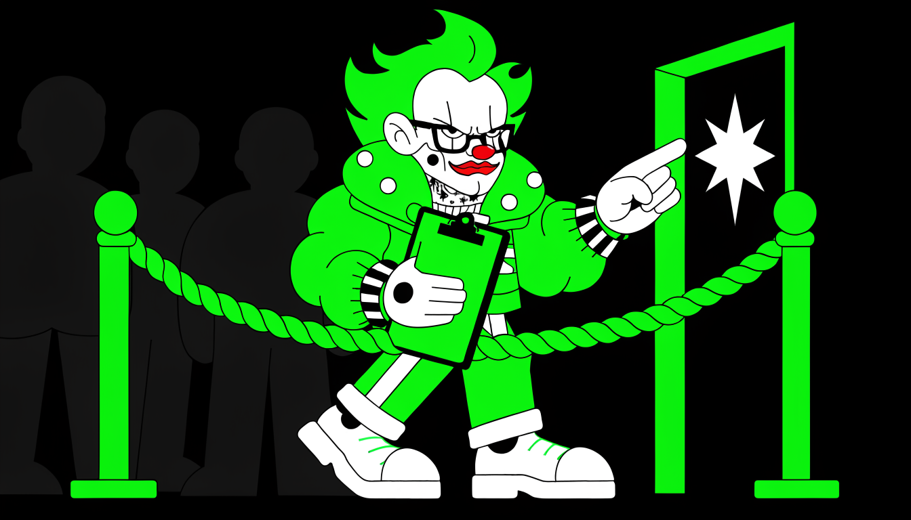

По телефону вам называют одну зарплату, а после собеседования выясняется, что реальная — в два раза меньше. Вы потратили несколько часов на дорогу и само интервью, чтобы в конце услышать о несоответствии условий, и попутно ответили на десяток вопросов HR, смысла которых так и не поняли.

Из таких историй складывается привычное раздражение разработчиков к рекрутерам: обманывают с деньгами, жгут чужое время, задают «глупые» вопросы.

Беда в том, что раздражение ничего не меняет. Пока вы считаете собеседника идиотом и не умеете находить с ним общий язык, вы не пройдёте ни одно собеседование на высокооплачиваемую работу — каким бы сильным специалистом ни были. HR — фильтр между вами и работодателем: без его одобрения вы не дойдёте до технического руководителя, и первый этап валится именно здесь.

Несправедливо, но правила игры такие: понравиться HR-специалисту важнее, чем блеснуть скиллами, а соответствие вакансии по навыкам идёт следом.

Сама система при этом регулярно сбоит. Случай из практики: в одной компании молодые HR-специалистки долго пропускали на собеседования кандидатов без реальных навыков, и руководство не могло понять, почему найм даёт такие плохие результаты.

Оказалось, рекрутёрши **выбирали соискателей исключительно по внешности** — устроили себе «Тиндер» за счёт работодателя. Вскрылось всё случайно: квалифицированному кандидату после технического собеседования заявили, что он сам отказался от предложения, хотя на деле ему написали, что компания не готова его взять. Обман раскрылся — обеих уволили.

Для бизнеса такие перекосы оборачиваются прямыми убытками: в команду попадают люди, которые умеют красиво «втирать» и нравиться HR, а не решать реальные задачи. Особенно часто это происходит в небольших фирмах, где контроль за процессом найма слабее.

Только не стоит делать отсюда вывод, что человеческий фактор на собеседовании можно игнорировать. Умение выстраивать коммуникацию — такой же профессиональный навык, и на карьеру он влияет не меньше технических знаний.

## Софт-скиллы и кейсы: обязательное условие конкурса

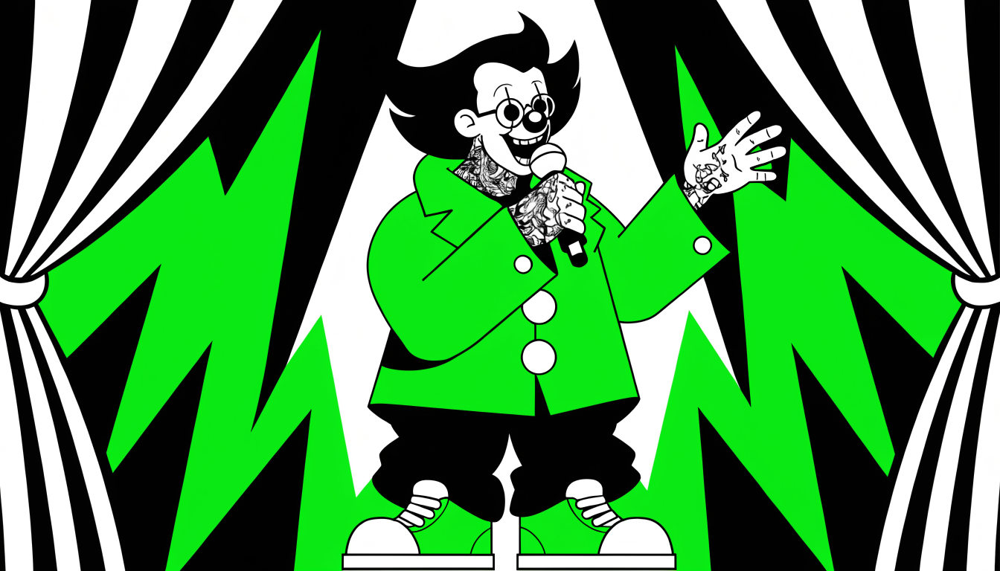

Технических навыков на конкурентном рынке уже недостаточно. Когда за вакансию борются десятки похожих резюме, решает умение качественно себя презентовать: софт-скиллы, показанные через конкретные примеры из практики, убеждают сильнее любых самоописаний.

Кейсы из реального опыта — то, что стоит готовить в первую очередь, ещё до рассылки откликов.

Сам поиск при этом стоит вести как системный проект, а не серию случайных попыток:

- готовьте качественные документы — резюме, сопроводительные письма, портфолио;
- формулируйте гипотезы, где и как искать подходящие вакансии;
- используйте разные источники, не ограничиваясь публичными вакансиями;
- развивайте нетворкинг — задействуйте связи, сообщите друзьям и знакомым о поиске;
- отслеживайте результаты: регулярно разбирайте, что срабатывает, а что нет;
- изучайте рынок — следите за трендами и актуальными материалами.

Если чувствуете, что теряете контроль над процессом, не оставайтесь с проблемой наедине. Поговорите с друзьями и коллегами, которые уже проходили этот путь, проконсультируйтесь со специалистом по карьере, посмотрите свежие вебинары и образовательные материалы.

И не тяните: время здесь самый дорогой ресурс, и чем дольше вы откладываете активные действия или буксуете на одном месте, тем сложнее становится ситуация.

Паниковать при этом не из-за чего. Люди продолжают получать офферы на самых разных позициях — разного уровня, в разных индустриях, с релокациями и переездами. Условия, конечно, изменились: прежних щедрых релокационных бонусов больше нет. Но возможностей всё равно больше, чем кажется со стороны.

Ничего «супер странного» на рынке сейчас не происходит — он предсказуем и понятен. А по предсказуемому рынку можно двигаться проверенными алгоритмами: готовить сильные документы, активно искать, выходить на рынок. Главное — начать делать, а не сидеть в ожидании или в страхе перед конкуренцией.

## STAR-метод на собеседовании

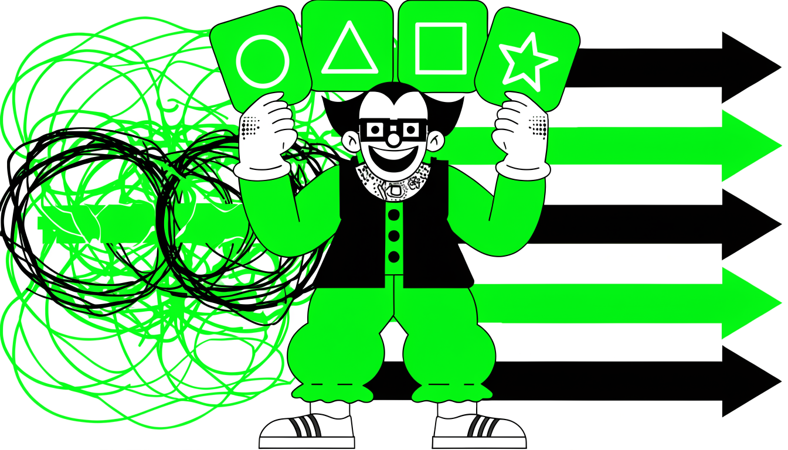

Из 15 кандидатов, отобранных на интервью, 10–12 проваливаются на простом: не могут структурно и системно рассказать о собственном опыте. Теряются в деталях, говорят размыто, перескакивают с темы на тему. И это люди, ради которых рекрутер уже отсеял десятки или сотни откликов: техническое сито к этому моменту пройдено, финалисты валятся не на знаниях, а на подаче.

STAR — структурированный способ этот рассказ построить. Расшифровка: Situation (ситуация), Task (задача), Action (действие), Result (результат). Любой кейс из практики укладывается в четыре шага: в какой ситуации вы оказались, какая задача перед вами стояла, что конкретно вы сделали и какой получили результат — желательно с цифрами.

Работает формат по трём причинам. Он держит фокус: вы не растекаетесь по деталям, а ведёте слушателя от проблемы к решению и результату. Он даёт конкретику: вместо дежурного «я умею работать в команде» рекрутер слышит живой кейс. И он упрощает оценку: когда кандидаты отвечают по единой логике, интервьюеру проще их сравнивать, а сравнение в вашу пользу — и есть цель всего разговора.

Готовиться к такому лучше заранее, а не изобретать истории на ходу. Сначала изучите кейсовый формат интервью — поймёте, какие вопросы задают и чего ждут в ответ. Затем вспомните **3–5 кейсов**: ситуации, где вы решали проблему, вытягивали сложную задачу или добивались измеримого результата.

Каждую историю разложите по четырём буквам STAR — и на самом интервью останется спокойно достать заготовку.

Такая подготовка даёт +100 баллов к вашей оценке. Вы говорите структурно, по делу и с доказательствами — на фоне тех самых десяти-двенадцати из пятнадцати, которые плывут в собственных воспоминаниях.

## Использование ChatGPT и AI на собеседованиях

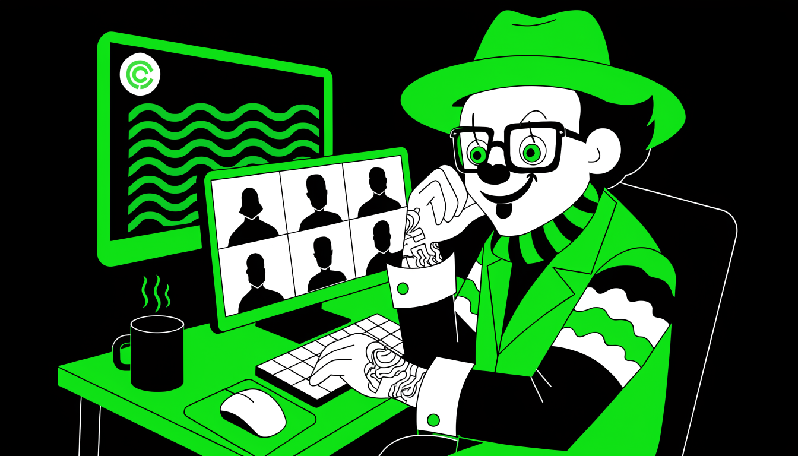

Пользоваться AI на собеседованиях можно — короткий ответ такой. Дальше — контекст и риски.

Когда-то собеседование действительно проверяло знания: вы рассказывали о проектах, показывали опыт. Потом индустрия перешла на теоретические вопросы — как работает хешмапа под капотом, что делает тот или иной оператор. Рынку понравилось: можно не думать, а прогнать кандидата по чек-листу из 15–20 вопросов и получить «объективную» оценку.

Ответом стали списки вопросов (топ-100 по Java, awesome-репозитории), боты для подготовки и конспекты: сложные ответы выписывали в заметки и базы знаний, ведь часть вопросов логикой не выводится — либо знаешь, либо нет. Нейросети сняли и эту заботу: хранить готовые ответы незачем, ChatGPT быстро сформирует ответ.

Поверх нейросетей выросли специализированные решения: голосовые помощники, которые записывают беседу, распознают вопрос и генерируют ответ в реальном времени; скриншот-боты — снимок экрана с задачей уходит в нейронку, обратно приходит решение; связки с двумя мониторами, планшетом перед экраном или помощником на наушнике. Называть конкретные сервисы бессмысленно: они быстро появляются и исчезают, а находятся обычным поиском.

### Риски и техника безопасности

Самый глупый провал — случайно расшарить экран. Потренируйтесь до собеса: убедитесь, что всё работает и вы не палитесь. Некоторые компании просят показать экран — против этого существуют виртуальные машины: шарится «пустой» рабочий стол, а снаружи открыты все нужные окна.

Практика, к слову, не новая — разработчики годами ходят на собесы с открытым конспектом редких вопросов и Ctrl+F. Заодно оплатите ChatGPT хотя бы с базовой подпиской; лайвкодинг могут провести без автокомплита — потренируйтесь писать код в простых редакторах.

Помогает и трезвый взгляд на интервьюера. У него есть основная работа, за интервью доплачивают мало или вовсе ничего; придираться и выжимать из кандидата всё ему незачем — большинство хочет проверить адекватность и закрыть вопрос. Персонажи, которым нравится мучить людей, встречаются, но это исключение.

### Как вести себя на самом интервью

Смещайте фокус на себя: чем больше говорите вы, тем меньше времени остаётся на вопросы, а интервьюер часто и не против. Дали базовый ответ — расширяйте: «А, наверное, вы ещё хотите спросить про это…» — и переводите в практические кейсы: «У нас была интересная задача — если не против, расскажу».

Рассказ, как делали миграцию, выбирали базу данных, сравнивали фреймворки, показывает думающего специалиста, который отвечает за решения, а не теоретика. Хватит даже минуты: время интервью ограничено, и пока говорите вы, новых вопросов нет.

На незнакомом вопросе не гадайте и не бросайте наугад «да» или «нет» — негативный ответ сильно запоминается. Скажите: «Я не знаю точно, но могу порассуждать…» — даже неправильный ответ после рассуждения лучше молчания. И не спорьте, если вас поправили: цель — оффер, а не выигранный спор.

Этично ли всё это — каждый решает сам. Инструменты существуют, многие ими пользуются, а собеседование давно превратилось в формальность, которую можно оптимизировать. Главное — понимать риски и не попасться.

## Техническое интервью 2026: лайвкодинг, алгоритмы, системный дизайн

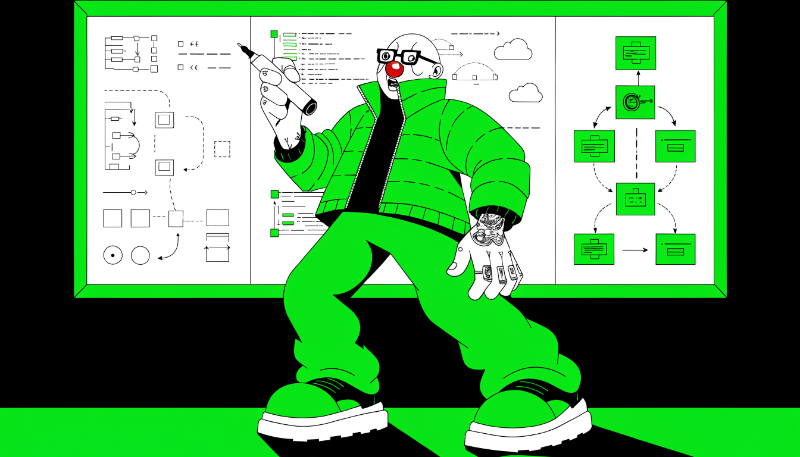

Техническая проверка обычно принимает одну из трёх форм, и готовиться к ним нужно по-разному. Первая — алгоритмические задачи в духе LeetCode. Их до сих пор гоняют в бигтехе, крупных банках и на позициях, где поток кандидатов огромен, а формальный фильтр удобен.

Нравится это мало кому, но если целитесь в такие компании, деваться некуда: прорешать 100–150 типовых задач на структуры данных и сложность — реалистичный минимум, чтобы перестать бояться доски.

Вторая форма — практический лайвкодинг: реальная задача, близкая к работе. Написать CRUD, починить баг, разобрать чужой код. Здесь алгоритмы почти не спрашивают, зато смотрят, как вы рассуждаете вслух, задаёте уточняющие вопросы и двигаетесь к решению.

Молчаливый кандидат, который пишет идеальный код молча, проигрывает тому, кто проговаривает ход мыслей, даже если у второго решение чуть хуже.

Третья — системный дизайн, для мидлов и сеньоров. Вас просят спроектировать сервис: собрать требования, накидать API, продумать хранение данных и поведение под нагрузкой. Готовиться стоит по простому каркасу — уточнить требования, оценить масштаб, набросать компоненты, обсудить узкие места, — и тренироваться проговаривать это, а не держать в голове.

Отдельный нюанс 2026 года — AI на самом собеседовании. Одни компании запрещают его наглухо, другие, наоборот, разрешают «как в реальной работе» и смотрят, умеете ли вы им пользоваться осмысленно. Уточняйте правила заранее. И помните про подвох лайвкодинга с шарингом экрана: копилот-суфлёр в соседнем окне выдаёт себя паузами и неспособностью объяснить собственный код.

Общий знаменатель всех трёх форматов один: оценивают не безупречность решения, а работоспособность и ход мысли. Интервьюеру важнее увидеть, как вы разбираете незнакомую задачу и выходите из тупика, чем получить вылизанный код без единого комментария о том, почему он такой.

## Воронка отбора: как работодатели фильтруют соискателей

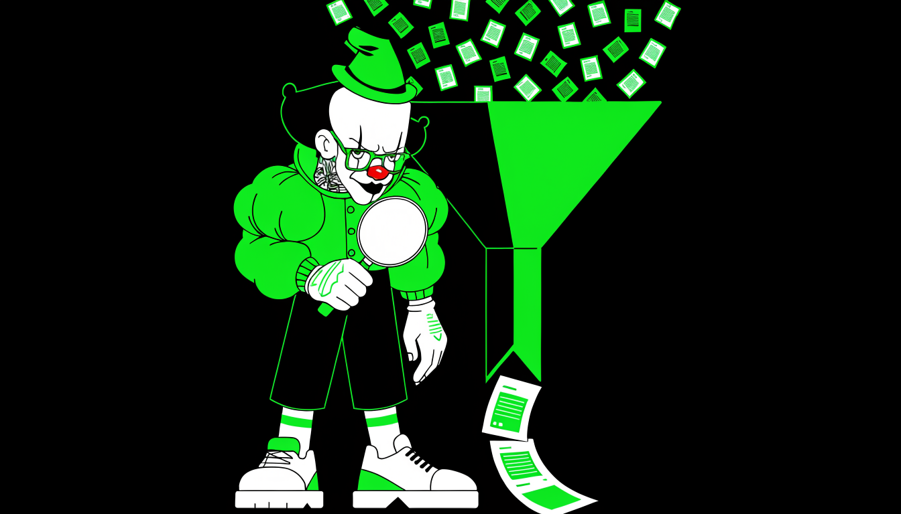

Работодатели тонут в лавине откликов и выстраивают многоступенчатые фильтры, а соискатели в ответ рассылают резюме пачками, опасаясь нарваться на фейковую вакансию. Найм превратился в игру на два фронта, и круг замкнулся: чем больше веерных рассылок, тем жёстче фильтры — и тем сильнее соблазн рассылать ещё шире.

Типичная воронка отбора устроена в несколько этапов. Сначала автоматическая фильтрация через ИИ — первичный отсев по ключевым словам и формальным критериям. Дальше анкеты и тестовые задания: они проверяют реальные навыки и заодно вовлечённость — случайные люди на этом шаге отваливаются сами.

Финал — собеседования с узким кругом дошедших. В одном реальном кейсе из большого потока откликов после двух этапов в финале оказались **всего пять человек**, и из них выбрали идеального сотрудника.

Массовые рассылки соискателей — вынужденная реакция на фейковые вакансии. Многие организации держат вакансии открытыми постоянно, даже когда позиция давно закрыта. Мотивы прозаичные: сформировать резерв кандидатов на будущее, подстраховаться от внезапных изменений — сотрудники могут уйти в любой момент — и заодно высмотреть «неожиданный» талант.

Снаружи живую вакансию от вечной заглушки не отличить, поэтому кандидаты и отправляют отклики десяткам компаний сразу.

У массовости есть обратная сторона. Шаблонные сопроводительные письма и резюме, сгенерированные ИИ без персонализации, отсекаются сразу: если текст можно отправить любой компании без изменений, его пролистают. Копипаст работодатели распознают мгновенно.

Выделяет обратное — осознанность. Пользоваться ИИ можно, хотя бы для структуры, но содержание адаптируйте под конкретную компанию: под её продукт и её задачи. На фоне потока одинаковых откликов уникальные кандидаты буквально бросаются в глаза: та же воронка, что безжалостно режет шаблоны, живого человека подсвечивает.

## Реальный кейс отбора с 200 до 5 кандидатов

Компания открыла вакансию с небольшой зарплатой — и получила около **200 откликов**. Цифра сама по себе говорит о реальных сложностях на рынке труда: желающих полно даже там, где денег немного. Дальше начался отбор, и толпа претендентов растаяла на глазах.

Первым фильтром стала анкета с несколькими простыми вопросами. Заполнили её только **80 человек**. Остальные 120, похоже, рассуждали: «Зачем заполнять анкету, если всё есть в резюме?» Логика понятная, но самоубийственная — тех, кто проигнорировал этот шаг, компания просто не рассматривала. Сто двадцать кандидатов выбыли, не дойдя даже до разговора.

Вторым фильтром шло небольшое тестовое задание. Здесь вскрылось самое показательное: **примерно 90% кандидатов использовали ИИ**, и их работы оказались похожи, будто сделаны по одному шаблону. Это бросалось в глаза сразу. Сам по себе ИИ никого не дисквалифицировал — вопрос в том, как им пользоваться.

Те, кто пользовался им с умом и осознанностью — проявил внимательность, персонализировал свои ответы, — легко выделились на фоне шаблонного потока.

В финал после двух простых этапов вышли всего 5 человек. С ними провели собеседования и выбрали того самого специалиста, который отлично справляется с работой. Воронка «200 → 80 → 5» не потребовала изощрённых методик — хватило анкеты и короткого тестового.

Кейс вписывается в общую картину: между работодателем и соискателем сегодня часто стоит искусственный интеллект. Многие компании отдают ему первичный отсев резюме, и если не понимать, по каким словам и критериям он фильтрует, даже отличное резюме останется незамеченным.

Соискатели ведут себя зеркально: массово рассылают отклики всем подряд, не вникая в требования. Поэтому работодателям и приходится выстраивать воронку отбора — анкеты, тестовые задания, автоматизация. Иначе с огромным потоком откликов не справиться и действительно подходящих кандидатов не найти.

## Тестовые задания: бесплатный труд или проверка?

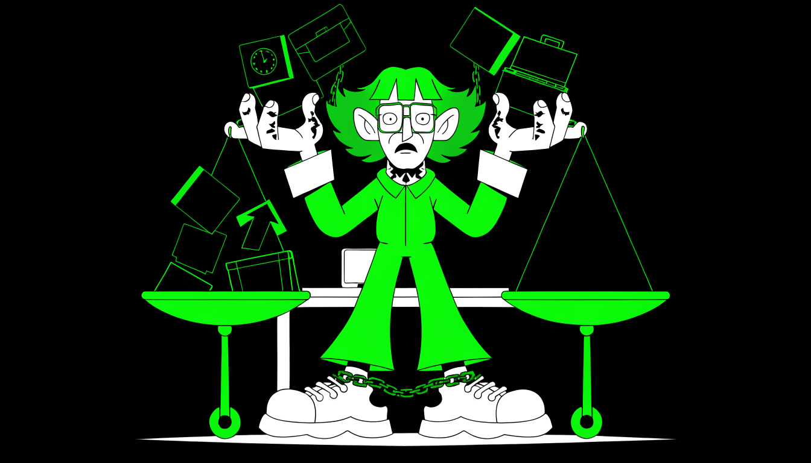

Тестовое тестовому рознь. Желание работодателя проверить реальные навыки, а не строчки в резюме, понятно и законно. Задание на **5–10 минут**, которое быстро показывает базовые компетенции, — адекватная практика: уровень кандидата виден, а времени обе стороны почти не потратили.

Спорить тут не о чем. Спор начинается там, где под видом проверки кандидату продают бесплатный труд.

Признаки эксплуатации узнаваемы:

- задание требует нескольких часов работы, а то и дней;
- в нём легко угадывается реальная бизнес-задача компании, а не учебный кейс;
- после выполнения никто не отвечает — в большинстве случаев происходит именно так;
- обратной связи нет, как и уважения к потраченному времени.

Молчание после сданной работы — отдельный цинизм: вы вложили вечер или выходные, отправили результат — и тишина. А теперь наложите это на арифметику активного поиска. Если вы рассылаете **100+ откликов**, каждое объёмное тестовое — ещё несколько часов труда в никуда, и в сумме выходит бесплатная работа на десятки компаний сразу.

Защищаться можно и нужно. Если тестовое выглядит как полноценный проект, а не быстрая проверка навыков, — смело отклоняйте такое предложение: это не отбор, а попытка получить результат даром. Если работодатель настаивает на большом объёме работы, вы имеете полное право запросить компенсацию за потраченное время: это нормальный деловой разговор, а не наглость, и адекватную компанию такой запрос не отпугнёт.

И предлагайте альтернативы — техническое собеседование, разбор кейсов из прошлого опыта, просмотр портфолио. Компетенции всё это показывает не хуже, чем недельный «проект в стол».

Взаимное уважение работает в обе стороны. Компания, которая игнорирует кандидатов после собеседований и тестовых, не вправе ожидать от соискателей безграничного терпения и бесплатного труда. А кандидат, вежливо отказавшийся от многодневного задания, мало что теряет: там, где эксплуатация начинается ещё до оффера, дальше вряд ли будет лучше.

## Culture Fit и финальное собеседование

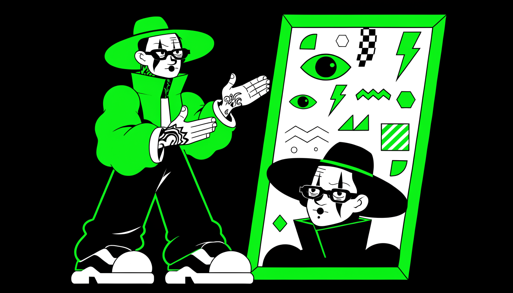

Проверка на culture fit — этап, где смотрят не на хард-скиллы, а на вас как человека: адекватны ли вы и впишетесь ли в команду. Встречается такое собеседование довольно часто, особенно в западных компаниях, и относиться к нему стоит так же серьёзно, как к техническому.

Часть вопросов — личные. Попросят рассказать что-нибудь, чего нет в вашем резюме, описать свои плюсы и минусы, вспомнить, как вы решали конфликты в команде. Могут повторно спросить, почему вы ищете новую работу, — даже если вы уже отвечали на предыдущих этапах. Вторая часть — дотошный разбор рабочих процессов на прошлом месте:

- как у вас построен процесс тестирования;
- как вы понимаете, что в сервисе возникли проблемы;
- как проводите code review;
- как выстроена коммуникация в вашей команде;
- как организован observability;
- как внедряете новые технологии;
- как берутся в работу фичи и баги и как вы их обсуждаете.

Расспрашивают подробно, от начала до конца. Цель одна: понять, насколько ваш опыт совпадает с внутренними процессами компании и сможете ли вы быстро адаптироваться. К вопросам о прошлом опыте удобно готовиться по методологии STAR — структурированному подходу к ответам на поведенческие вопросы.

### Финальное собеседование

Формат финала зависит от типа компании. В стартапе вы, скорее всего, будете разговаривать с CEO или CTO. Команда маленькая, взаимодействовать с этими людьми придётся постоянно, поэтому им важно одно: легко ли с вами общаться. Стартап живёт скоростью — идеи тестируются непрерывно, код может писаться сегодня и выбрасываться завтра, и человек, с которым тяжело разговаривать, тормозит весь конвейер.

В крупных tech-компаниях на финалке вас встречают тимлиды или продакт-менеджеры. Они решают, подходите ли вы конкретно в их команду — по подходу к работе, манере общения, даже внешнему виду. Акцент здесь на софт-скиллах и на том, насколько ваш опыт ложится на их процессы.

Хорошая новость для тех, кто готовится: требования и вопросы на финальных собеседованиях мало изменились за последние 5 лет. То, что спрашивали раньше, спрашивают и сейчас.

## Собеседования в компаниях-прослойках: уровень сложности

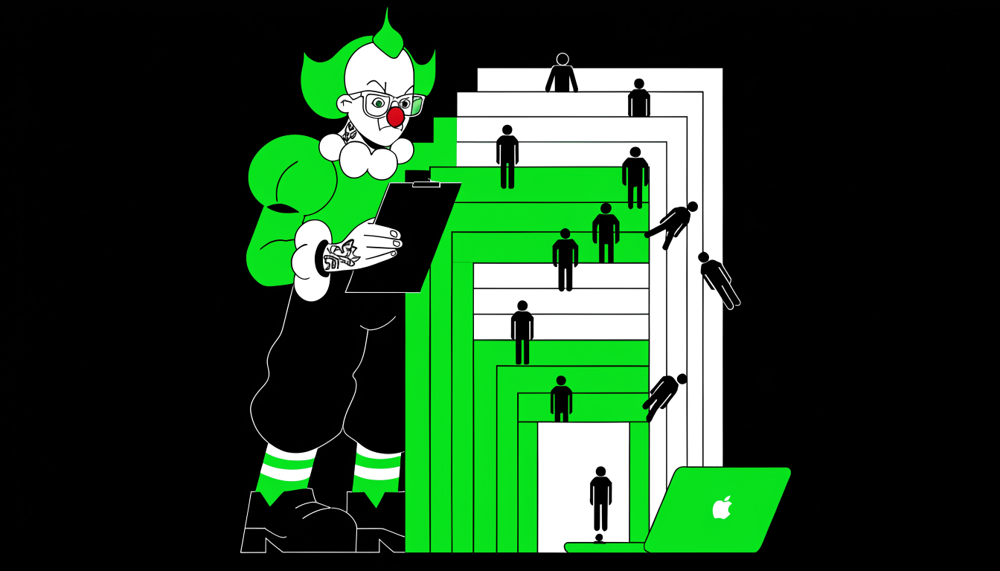

EPAM, Accenture, Tata Consulting, Infosys — классические компании-прослойки: аутстаффинг и консалтинг. Собеседования там одни из самых жёстких в индустрии, и кандидаты недоумевают: зачем такая строгость, если это «всего лишь» посредник?

Затем, что прослойка рискует репутацией перед крупными заказчиками — Google, Apple, банками, госструктурами. Поставит EPAM слабого специалиста в Google — Google накажет EPAM: расторгнет контракт, подаст в суд, перестанет сотрудничать.

Поэтому «всех подряд» здесь не нанимают: каждый кандидат должен быть действительно силён. Собеседование в EPAM, например, может длиться **полтора часа** и охватывать всю теорию проджект-менеджмента. Это фильтр качества, чтобы не «лохануться» перед клиентом. Бонус для выживших: после такого интервью остальные собеседования кажутся проще.

Механика найма у прослоек своя. Отбор идёт по жёстким критериям: глубокие технические и теоретические вопросы, кейсы, проверка soft skills. Оформить могут не в штат конечной компании, а через рекрутинговое агентство — так заказчик снимает с себя риски, background check и безопасность остаются на стороне прослойки.

Испытательный срок работает без сантиментов: не подошли — быстрая замена, всё хорошо — продление или переход в штат. Договоры часто срочные, на полгода–год, под длительность проекта. Работодатель минимизирует риски: если человек «тупит» или не вписывается, его просто меняют.

Для кандидата же это шанс попасть в крупную компанию, пусть и через прослойку, и показать себя.

Отдельный резон присмотреться к прослойкам — удалёнка. Для remote-работы на США и Европу это один из главных каналов найма: такие компании набирают разработчиков, аналитиков и менеджеров за пределами дорогих рынков, чтобы сэкономить и поставить специалистов заказчику.

Ищете remote-позицию на западные компании — смотрите вакансии EPAM, Luxoft, Accenture и подобных, там реально есть возможности.

Только будьте готовы: собеседование будет не легче, чем в Big Tech. Возможно, даже сложнее — прослойка не может позволить себе ошибку.

