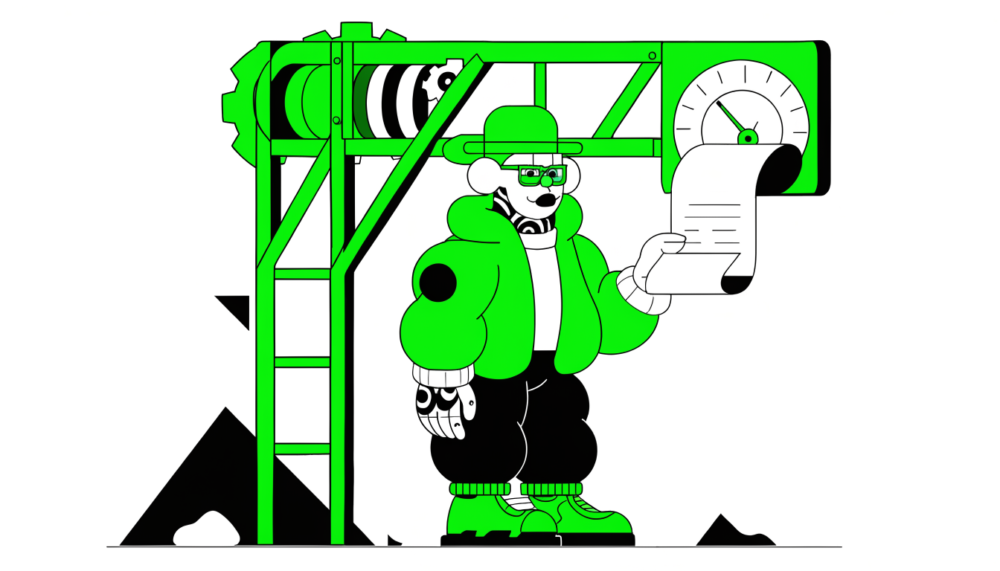

Прежде чем резюме попадёт к живому человеку, его просеет робот — и часто на роботе всё и заканчивается. Здесь про автоматизацию найма на крупнейших рекрутинговых платформах: как работают ATS-фильтры и алгоритмы HeadHunter, почему падает конверсия откликов и какие технические хитрости помогают пройти машинный отбор. Под конец — AI-инструменты для массовых откликов после закрытия официального API.

## Как проходить фильтры HR и ATS при накрутке опыта

HR просит трудовую книжку — и её отдавать нельзя, если опыт в резюме приукрашен. Звучит парадоксально, но в этом вся механика прохождения фильтров при накрутке: не давать то, что запрашивают напрямую, и при этом закрыть запрос так, чтобы у рекрутера не осталось ни вопросов, ни подозрений.

С честным резюме такой проблемы не существует. Когда за плечами реальные десять лет работы и каждая строчка подтверждена записями в трудовой, любую проверку проходишь не задумываясь. Но стоит опыту быть приукрашенным или частично выдуманным — прямая выдача трудовой мгновенно вскроет расхождения с резюме, а расхождения означают отказ.

Поэтому каждое накрученное место работы приходится легализовать. Документы, которые явно противоречат резюме, не показываем. Вместо них выдаём альтернативные подтверждения: рекомендательные письма, справки с мест работы, портфолио, кейсы.

Объяснения строим так, чтобы они звучали логично и не будили в рекрутере желание копнуть глубже. И всё это — в профессиональном тоне: уклоняться от прямого ответа можно, создавать конфликт — нельзя.

Хороший ответ на запрос HR собирается из трёх условий. Он не выдаёт напрямую то, что было запрошено, если это раскроет несоответствия. Он полностью устраивает рекрутера альтернативной информацией. И он не вызывает желания отправить кандидата в отказ.

Провалено любое из трёх — схема сыплется: несостыковки либо всплывают сразу, либо неудовлетворённый рекрутер продолжит запрашивать документы, пока не доберётся до сути.

Например у вас попросили трудовую. Вы отказываетесь ссылаясь на 152-ФЗ о персональных данных.

Хороший ответ? Нет, это прямой конфликт. Вас пошлют, цели вы не достигли.

С автоматикой правило то же самое: ATS — ещё одна линия отбора перед живым человеком, и накрученный опыт должен без сбоев проходить обе. Легализация в итоге — не импровизация по ходу собеседования, а продуманная стратегия под каждое место работы и каждый проект из резюме, выстроенная до того, как улетел первый отклик.

## Рекрутинговые сайты: плюсы и минусы

Один из самых популярных способов искать работу — рекрутинговые сайты: HeadHunter, Работа.ру, SuperJob и похожие ресурсы. У них есть сильные стороны, за которые их любят, и системные болячки, о которых обычно узнаёшь уже в процессе поиска.

Главное достоинство — огромный выбор вакансий. На одной площадке собраны предложения от множества компаний, так что выбирать можно из широкого спектра позиций, а не из трёх случайных объявлений. Поиск настраивается фильтрами под свои требования: формат работы — удалённый, офисный или гибридный, — уровень зарплаты, нужен опыт или подойдёт позиция без него.

Подробная информация о компании тоже доступна прямо в объявлении: заранее видно, кто ищет сотрудника — крупная корпорация или молодой стартап — и решение о том, откликаться ли, принимаешь взвешенно.

Обратная сторона большого выбора — конкуренция. На популярные позиции приходится **300–500 откликов**, а в IT-сфере счёт нередко переваливает за **тысячу кандидатов на одну вакансию**. В такой толпе выделиться сложно даже с сильным резюме.

Вторая беда — устаревшие объявления. Классический сценарий: вы находите идеальную вакансию, откликаетесь, ждёте — а в компании уже идут финальные собеседования с другим кандидатом, или новый человек вообще вышел на испытательный срок. Объявление при этом никто не снимает с публикации, и оно продолжает висеть, как будто место свободно.

Причина прозаичная: компания один раз заплатила за размещение — например, 2000 рублей — и теперь перестраховывается, продолжая собирать отклики. Так у неё копится база кандидатов на случай, если текущий сотрудник не пройдёт испытательный срок или в команду понадобится ещё один человек.

Для работодателя это бесплатная страховка, для вас — потраченное время и ощущение, что откликнулись в пустоту.

Рекрутинговые сайты остаются полезным инструментом, просто не единственным. Используйте их в связке с другими методами поиска работы — так шансов на успех заметно больше.

## HeadHunter: когда работает и когда нет

Мидлу HeadHunter предложит много подходящих вакансий, а директору по маркетингу — либо ничего, либо конкурс из 500 кандидатов на одну позицию. У платформы есть зона, где она работает отлично, и зона, где без других каналов не обойтись.

Где платформа сильна
HeadHunter даёт результат специалистам среднего звена — мидлам и руководителям среднего уровня — и тем, кто только выстраивает карьерный путь. Хорошо отрабатывает целенаправленный поиск: вы точно знаете, какую позицию в какой компании ищете, а не хотите «что-то интересное».

Ещё два условия успеха — резюме, грамотно упакованное под конкретные позиции, и готовность искать дольше недели.

Где нужны другие каналы
Топовые позиции — директор по маркетингу, руководитель направления, head of финансы — через платформу почти не ловятся: здесь решают личные контакты. 70–80% топовых позиций вообще не публикуются открыто — их закрывают через рекомендации или создают под конкретного человека; на HeadHunter такие вакансии либо отсутствуют, либо собирают тот самый конкурс из 500 кандидатов.

Непросто и с редкой экспертизой: с нестандартной комбинацией навыков вы выглядите белой вороной — алгоритмы не понимают, куда вас применить, а рекрутёрам сложно оценить профиль. Смена индустрии или функционала — та же история: переход из банка в e-commerce обернётся пачкой отказов из-за отсутствия индустриального опыта, холодный поиск тут работает плохо.

Наконец, конфиденциальность: если вы не готовы афишировать поиск всему рынку и присматриваетесь к 2–3 конкретным компаниям мечты, публичная платформа не подойдёт.

Что задействовать вместо этого. Корпоративные сайты: к моменту публикации вакансии на HeadHunter компания обычно уже поискала кандидата среди своих сотрудников и через тёплые контакты — холодный поиск запускается в последнюю очередь, ровно как у нас самих.

Составьте список из 20–30 компаний мечты — выбирайте стратегически: где хотите работать, какие компании растут, — заходите в их карьерные разделы каждые 2–3 дня и подпишитесь на их соцсети: многие сначала публикуют вакансии в LinkedIn или Telegram и только потом на сайте.

Один кандидат узнал о вакансии HR-директора из поста генерального директора в LinkedIn, написал ему напрямую и прошёл собеседование до публикации вакансии на HeadHunter. Другой пример: руководитель группы маркетинговых коммуникаций отследил вакансию на сайте IT-компании, быстро нашёл внутри рекомендателя — бывшего коллегу, — и резюме ушло напрямую нанимающему менеджеру и рекрутёру, пока конкурентов почти не было; позицию так нигде больше и не выложили.

И Telegram-каналы: там HR-директора и руководители публикуют вакансии напрямую, зачастую быстрее, чем они появляются на HeadHunter.

Если HeadHunter у вас не работает, а вы не топ-менеджер, разберитесь, что именно вы ищете и как упаковано резюме. Платформа не сломалась — просто изменились правила игры.

## Конверсия откликов на HeadHunter: реалии 2025 года

От 0,5 до 3% — такова конверсия отклика в приглашение на интервью на HeadHunter в 2025 году. Разброс зависит от того, насколько проработано резюме, какой у кандидата опыт и насколько он попадает в вакансию. Если взять среднее значение примерно в 1,5%, арифметика простая: **минимум 100 откликов ради одного приглашения на интервью**.

Дальше воронка сужается. Сколько интервью нужно, чтобы дойти до реального предложения о работе? В худшем случае — от 10 до 20: пока кандидат не разобрался, чего хотят работодатели, первые собеседования уходят на тренировку. Тем, кто уже в контексте и понимает ожидания рынка, хватает 4–6 компаний. Бывает, что требуются все 20, но это скорее исключение.

Перемножаем: 100 откликов на одно интервью, около пяти компаний до оффера — выходит **примерно 500 откликов на весь цикл поиска**. Если к каждому писать индивидуальное сопроводительное письмо, которое повышает шансы выделиться, время на один отклик умножается на 500. Это время и становится главной проблемой ручного поиска.

У рекрутеров своя сторона той же беды. Когда на позицию фронтенд-разработчика за два дня приходит почти 2000 откликов, обработать их все физически невозможно. Просматривается первая страница, из неё выбираются первые 5–10 подходящих кандидатов — остальные до этапа рассмотрения просто не доходят. Даже качественный отклик тонет в массе.

Поэтому рекрутеры вводят дополнительные фильтры: обязательное сопроводительное письмо или кодовое слово в описании вакансии. Если в середине текста написано «если прочитали до конца, начните сопровод со слова "лягушка"», автоматические отклики отсекаются мгновенно: из 2000 остаются 10–15 кандидатов, которые действительно прочитали вакансию и приложили усилия.

Параллельно на рынке идёт война технологий. Одни кандидаты гоняют боты и скрипты для массовых откликов, другие генерируют сопроводительные через AI — рекрутеры в ответ фильтруют такие отклики тоже с помощью AI. Замкнутый круг: автоматизация с обеих сторон не решает проблему качества найма, а только усиливает шум.

Шаблонные письма к тому же выдают себя: когда несколько человек присылают одинаковое начало сопровода, рекрутер понимает, что все пользовались одним инструментом. Спасает либо ручная доводка каждого письма, либо системы с большим разнообразием шаблонов.

Выделяться придётся в любом случае — с автоматизацией или без неё. Работает персонализированное сопроводительное под конкретную вакансию, внимательное чтение описания и следование всем инструкциям, включая кодовые слова, живой интерес к компании и позиции, портфолио и кейсы под требования.

На фоне тысяч однотипных откликов именно это отличает кандидата, которого позовут на интервью.

## Фейковые вакансии — норма рынка

Вы откликаетесь на два-три объявления на HeadHunter — и все они могут оказаться позициями, куда никого не набирают. Компании массово держат открытыми вакансии без живого найма: должность либо уже закрыта, либо брать человека прямо сейчас никто не собирается. Причин две, и обе не имеют отношения к вам.

Первая — деньги и имидж. После повышения ключевой ставки кредиты на развитие стали невыгодны: банки дают займы под высокий процент, а риск банкротства заёмщика вырос. Новые проекты замораживают — запускать их не на что; расширение существующих тоже стоит, потому что под него пришлось бы набирать штат.

Получается застой: нельзя начать новое, нельзя масштабировать старое. Но признать, что открытых позиций нет, компания не может — это удар по статусу и репутации, негативная реакция сообщества и риск попасть в прессу с плохим окрасом.

Фиктивные вакансии закрывают проблему: снаружи выглядит, будто компания растёт и активно набирает людей, хотя фактически не нанимают никого.

Вторая — резервирование кандидатов. Должность укомплектована, а объявление висит: компания ведёт постоянный поиск талантов и собирает резерв. Сотрудник может неожиданно уйти или получить интересное предложение, внутри случаются организационные перестановки, а люди сейчас легко меняют работу, как только появляются условия получше.

Работодателю выгодно всегда оставаться открытым — вдруг придёт выдающийся специалист или внезапно освободится место. Такой отклик не выбрасывают, он уходит в базу «на потом».

Распознать фейк помогают два признака. Первый: вы подходите по всем требованиям, но получаете **отказ без внятных объяснений**. Второй: вакансия висит и не закрывается, хотя отклики на неё явно идут.

Что с этим делать? Раз часть объявлений нереальна, отклики придётся рассылать максимальному числу работодателей — ставка на два-три «идеальных» места не работает. Массовость при этом не оправдывает шаблонность: типовые отклики компании пролистывают. Проваливаются обычно на трёх вещах:

- одно сопроводительное письмо на всех — если текст подходит любой компании, его не читают;
- резюме со стандартными фразами — даже если структуру собрал ИИ, таких резюме сотни;
- несоответствие требованиям — в вакансии нужен менеджер по работе с холодной базой, а вы шлёте письмо о достижениях с тёплыми клиентами.

Под каждую вакансию персонализируйте резюме и сопроводительное: вытаскивайте наверх навыки и достижения, релевантные именно этим требованиям. И не ограничивайтесь агрегаторами. Самый надёжный путь к реальным вакансиям — разделы careers или jobs на официальных сайтах компаний: резюме, отправленное туда напрямую, даёт существенно больше шансов на приглашение на собеседование, чем отклик через агрегатор.

## Типы фейковых вакансий и их признаки

Реальных вакансий на рынке — всего 20–30% от размещённых. Остальные 70–80% — объявления, под которыми никто никого не нанимает, и соискатели тратят на них время впустую. Псевдо-вакансии делятся на три типа, у каждого свои приметы.

Первый тип — вакансии для сбора базы контактов. Компания выставляет привлекательное объявление, и оно висит месяцами, а то и год: цель — накопить резюме и контакты, чтобы использовать их по мере необходимости. Распознать такое можно по трём признакам: объявление долго висит без изменений (это проверяется специальными ботами), к отклику часто прилагается дополнительная анкета, а после отказа компания может через время вернуться с предложением другой позиции.

Схема напоминает риелторскую: привлекли хорошим предложением, собрали данные, потом продают что-то своё.

Второй тип — брендированные вакансии. Хорошо оформленные объявления крупных компаний с указанной зарплатой выглядят очень привлекательно, но существуют ради картинки: показать инвесторам, что компания растёт и нанимает, поддержать репутацию бренда, создать впечатление стабильности.

Бывают случаи, когда компания проводит сокращения — и параллельно выставляет новые вакансии «для галочки».

Третий тип — вакансии для сбора идей и решений. Тестовое задание здесь служит не оценке кандидата: через него компания бесплатно получает решения реальных бизнес-задач — конкурентный анализ, идеи для новых функций продукта, разбор решений конкурентов.

Этим грешат и небольшие фирмы, и крупные. Без опытного наставника или коллеги отличить настоящее тестовое от «выкачивания» идей сложно.

Масштаб проблемы виден по откликам. По данным трудоустроенных выпускников курсов, во второй половине осени и зимой хоть какой-то ответ — приглашение или отказ — получали только **20% откликов**. Остальные 80% проваливались в полную тишину.

Это не сезонная ситуация, а новая реальность рынка труда: значительная часть объявлений, на которые вы откликаетесь, никогда и не предполагала найма.

## HeadHunter для валютной удалёнки

Зарубежные контракты с оплатой в валюте принято искать на LinkedIn, а HeadHunter в этой роли мало кто рассматривает. Зря: на российской площадке такие предложения есть. Русскоязычный рынок привлекает иностранных работодателей дешёвой квалифицированной рабочей силой, и компании с европейскими корнями или юридическим лицом за рубежом размещают вакансии на HeadHunter, чтобы находить специалистов из СНГ.

Кто эти работодатели: русские компании с представительствами в Европе, иностранные рекрутеры в поисках удалённых специалистов, стартапы и продукты среднего размера, аутсорсинговые компании. Иногда валютная удалёнка прячется за обычной русскоязычной вакансией: описание на русском, а зарплата — в долларах или даже в криптовалюте.

Резюме под этот канал делайте на английском. Логика простая: если вашей кандидатурой заинтересуется русская компания, она разберёт английский текст, а вот англоязычный работодатель русское резюме переводить не станет. Заведите вторую версию резюме на английском или замените существующее.

Структура остаётся стандартной: заголовок с должностью и количеством лет опыта (минимум 5), краткое описание About, технический стек, опыт работы с достижениями, образование. Сами достижения подавайте через конкретные цифры и результаты, а не через обязанности: не «разрабатывал фичи», а «ускорил загрузку страниц на 15%».

Валютные удалёнки встречаются на HeadHunter реже, чем на LinkedIn, зато и **конкуренция здесь ниже**: многие специалисты этот канал для международного поиска даже не рассматривают. Чтобы выловить подходящие позиции, работайте с фильтрами и деталями объявлений:

- ищите позиции с пометкой «удалённая работа»;
- обращайте внимание на описания на английском;
- проверяйте, есть ли у компании международные офисы;
- смотрите на валюту в вилке зарплаты.

HeadHunter для валютной удалёнки — работающий канал, который постоянно недооценивают. Пока большинство ищет международные контракты только в LinkedIn, здесь на те же позиции претендует заметно меньше людей — и это ваш шанс.

## Автофильтры на hh.ru: как резюме не доходит до HR

Прежде чем ваше резюме увидит живой HR-специалист, оно проходит автоматические фильтры hh.ru. Система сортирует кандидатов по нескольким параметрам — возрасту, полу, опыту, — и анкета, не прошедшая хотя бы один из них, отсеивается — человек на той стороне о вас даже не узнает.

Главный фильтр — возраст. Стандартный диапазон, который пропускает система, — **21–45 лет**. Не попали в рамки — резюме автоматически улетает в архив. Туда же оно рискует попасть, если возраст вообще не указан: пустое поле гасит отклик на старте, хотя кажется безобидной мелочью.

Дальше пол. Формально дискриминация по половому признаку запрещена законом, но фильтры по этому параметру существуют и спокойно используются — вслух об этом просто никто не говорит.

Третий параметр — опыт работы: система отсеивает по количеству лет. Жёстче всего это бьёт в популярных сферах вроде IT, куда сейчас идёт массовый поток соискателей. HR может настроить фильтры так, что **до 90% резюме** не дойдут до реального человека.

И настраивает: когда лень просматривать кандидатов вручную — а такое случается очень часто, — всю грязную работу отдают системе.

Для новичков это оборачивается замкнутым кругом. Чтобы начать работать, нужен опыт. Чтобы получить опыт, надо пройти автоматические фильтры, которые требуют… опыт. Резюме при этом может быть идеальным: сильные проекты, внятные формулировки, аккуратная структура. Фильтру всё равно — он сверяет цифры в полях анкеты, а не качество кандидата.

В конкурентных областях проблема усугубляется. Когда на одну вакансию приходят сотни откликов, автофильтры перестают быть вспомогательным инструментом и становятся основным барьером между вами и работодателем: ни один HR не станет читать сотни анкет глазами, если машина уже отсеяла девять из десяти.

## ATS-фильтры: почему резюме в Figma не проходят

Applicant Tracking Systems (ATS) — программы, которыми работодатели автоматически обрабатывают входящие резюме. Система парсит документ в текст, ищет в нём ключевые слова — стек технологий, годы опыта, должность, образование — и сопоставляет их с фильтрами вакансии. Не прошли фильтры — рекрутер вашего резюме просто не увидит.

Отсюда проблема красивых резюме из графических редакторов. Кандидат верстает документ в Figma, а **ATS воспринимает его как картинку, а не как текст**: извлечь из изображения навыки и опыт система не может, ключевых слов она физически не видит.

Даже идеальный кандидат отсеивается на автоматическом этапе — и не узнаёт об этом. Хуже всего со старыми или плохо настроенными системами. Современные AI-инструменты вроде GPT-4 умеют распознавать текст со сканов, но такие решения дороги и встречаются редко: большинство работодателей сидит на стандартных ATS, которым нужен текстовый формат.

### Какой формат проходит

Идеальное резюме для ATS — чистый текст. В теории лучший формат — обычный блокнот без картинок, таблиц и графики. На практике базовый документ готовят в Word или Google Docs — без сложных таблиц, фотографий и графических элементов, — а отправляют PDF: он сохраняет форматирование и читается большинством систем.

Дальше решают ключевые слова и простота. Если у вас качественный мастер-файл резюме, адаптация под конкретную вакансию занимает минуты: добавить 5–10 релевантных терминов из описания позиции.

### Как проверить совместимость

Если знаете систему работодателя — её часто видно в URL карьерного сайта (Bamboo, Workday и т. д.), — найдите в Google сервис проверки для этой ATS и загрузите туда резюме. Если система неизвестна, сверьте вручную текст вакансии с текстом резюме: нужные ключевые слова должны присутствовать в обоих.

Работа базовая, но её постоянно игнорируют. Бывает, кандидат рассылает сотню откликов с резюме в Figma и не понимает, почему его не зовут на собеседования, — а причина в том, что документ ни разу не прошёл автоматическую обработку.

Так что не тратьте силы на дизайн в ущерб содержанию: сначала сделайте хорошее текстовое резюме с правильными ключевыми словами и только потом думайте о визуальном оформлении для живого человека.

## Как пройти ATS-фильтр: технические советы

Робот обрабатывает ваше резюме в два приёма. Сначала парсинг: документ разрезается на блоки — опыт, навыки, контакты. Потом скоринг: система выставляет процент соответствия вакансии. Если вышло меньше **70%**, рекрутер ваше резюме даже не увидит — так устроены ATS, системы автоматизации рекрутинга.

Первым делом забудьте про креативные шаблоны. Со сложной вёрсткой дизайнерских резюме искусственный интеллект не справляется: красивые колонки и иконки ломают парсинг, и половина содержимого теряется по дороге. Надёжнее всего максимально простой текстовый формат без изысков.

Второе — формулировки. Робот не понимает синонимов. В вакансии написано «senior backend developer», у вас в заголовке — «ведущий программист»: для человека это одно и то же, для системы совпадения нет, и оценка падает. Поэтому название должности и основные навыки переписывайте строго под текст конкретной вакансии — копируйте формулировки из описания позиции, а не пересказывайте своими словами.

Против ИИ удобно выставить его же. Скопируйте текст вакансии мечты, загрузите в нейросеть — ChatGPT или аналог — вместе со своим резюме и дайте чёткий промпт: «Проанализируй текст вакансии, найди все скрытые маркеры и ключевые слова.

Перепиши блоки моего опыта с учётом этих требований». За 10 минут получите версию, оптимизированную под конкретную позицию.

С тестовыми заданиями этот трюк лучше не повторять: их чаще проверяет живой человек, который распознаёт нейросетевой текст с первой фразы. Здесь придётся включать личный креатив.

И не расслабляйтесь, когда резюме заработало: идеальный документ — только первый шаг, дальше интервью. Заваливают его чаще всего из-за неумения структурно рассказать о своём опыте, поэтому заранее изучите кейсовый формат интервью — как презентовать конкретные примеры из практики — и **STAR-метод**, структурированный способ отвечать на вопросы: Ситуация, Задача, Действие, Результат.

Когда рекрутер отбирает финалистов из кандидатов с похожим опытом, эти техники и дают перевес.

## Роль искусственного интеллекта в найме

Главная российская площадка для найма начала активно использовать ИИ в поиске, ранжировании и анализе кандидатов — для всех участников рынка труда это тектонический сдвиг. Работодатели получили инструменты автоматизации отбора и пользуются ими вовсю: между вами и живым рекрутером теперь стоит алгоритм, который фильтрует резюме до того, как его откроет человек.

Поэтому даже сильный кандидат может не дойти до собеседования — если профиль не прошёл автоматическую проверку, о кандидате никто и не узнает.

Злиться на это бессмысленно, подстроиться — реально. Первый шаг — системный анализ вакансий. Отберите **50 качественных вакансий** по своей профессии и разберите их: какие требования повторяются, что пишут в обязанностях, какие формулировки кочуют из текста в текст.

Распыляться не стоит — сосредоточьтесь на **пяти отраслях**, где больше всего подходящих позиций. Для бизнес-системных аналитиков это, скажем, информационные технологии (IT-компании), финансовые технологии (fintech), ритейл (для бизнес-аналитиков) и ещё две отрасли по вашему профилю.

У каждой специальности набор свой, но принцип общий: копать там, где вакансий много, а не везде понемногу.

Дальше — используйте ИИ в свою пользу. Раз с той стороны вас оценивает искусственный интеллект, логично применить его же для анализа требований. Ищите закономерности в описаниях вакансий своей отрасли: какие слова, навыки и обороты встречаются чаще всего — и говорите с алгоритмом на его языке.

И последнее — трезвый взгляд. Вокруг темы найма густой негативный фон: комментарии, обсуждения, коллективный пессимизм. Не проникайтесь им. Анализируйте ситуацию со стороны, как разведчик: собирайте факты и применяйте конкретные методы, а не настроения из чужих веток.

Изменения произошли, и это данность. Принять новые правила игры — не слабость, а адаптивность. Кто предпочитает их игнорировать, тот сам берёт на себя ответственность за результат.

## Резюме — это электронный пропуск в компанию

Техническое собеседование — это экзамен, а резюме — электронный пропуск к нему. До живого человека документ читает робот: крупнейшая площадка по поиску работы в России внедрила ИИ-алгоритмы в поиск, ранжирование и анализ кандидатов.

Работодателям удобно, вам — нет. Отказ через 30 секунд после отклика — это алгоритм не нашёл совпадений, не человек. Обратная связь приходит лишь на 20–30% откликов, остальное — молчание: резюме не прошло автоматические проверки.

### Что проверяет алгоритм

Максимальный вес — у последней работы: стек технологий, уровень задач, совпадение с требованиями. Нет нужных слов и проектов в последней позиции — резюме уезжает вниз выдачи. Ищутся не отдельные слова, а словосочетания из текста вакансии: технологии, названия процессов, даже структура описания обязанностей.

Считается и отрасль компании: у каждого места работы можно указать до пяти сфер — раньше их игнорировали, теперь это решает. Выбирайте отрасли, где больше всего вакансий по вашей специальности: информационные технологии, финтех, ритейл.

И достижения: если их нет или они водянистые, плашка «обязанности без конкретных результатов» сильно роняет ранжирование. Превращайте каждую функцию в мини-достижение: что сделали, для какого проекта, с каким результатом.

Чего в резюме быть не должно:

- образа ученика: курсы, сертификаты, упоминания обучения — для ИИ сигнал недостаточной квалификации или распыления;
- желания попробовать новое: фразы о смене направления — подозрение, что вы быстро уйдёте;
- джуниорских маркеров: «стажёр», «начинающий», «junior» снижают позиции в выдаче;
- пустых полей: без возраста, английского или готовности к командировкам резюме может не попасть в выборку.

### Как подстроиться

Выберите 5 отраслей с наибольшим числом подходящих позиций, соберите по 25–50 описаний вакансий из каждой, выпишите требования, обязанности и «будет плюсом» — и подстройте описание опыта под каждую отрасль: те же термины, структура, акценты.

Обновляйте анализ каждые **две недели**: новые вакансии — новые формулировки — другое сравнение. Диапазон опыта подгоняйте под требования: просят 3–6 лет — опыт из смежной области не выносите отдельной строкой (ИИ посчитает несовпадением), упомяните в «О себе».

Из технических деталей: город проживания — Москва, даже если вы в регионе, — на удалённых позициях это обходит географические фильтры и поднимает предлагаемую зарплату. Указывайте возраст — без него резюме отсекается, типичный фильтр 21–45 лет.

Английский — B1–B2 по умолчанию для вакансий в российских компаниях: без языка минус в рейтинге. Добавляйте фото — для доверия HR и дополнительных проверок. Разные написания должности и технологий вбивайте в поиск через оператор ИЛИ: работает он нестабильно.

Автоматизация наплодила и нереальных вакансий: фейковые собирают базу контактов, брендированные вешают для инвесторов, разведочные щупают рынок, плюс пустышки. Реальных позиций может быть всего 20–30% от размещённых. HR и сами пишут описания нейросетями — текст может не совпадать с реальными задачами, так что шаблонные формулировки не повод игнорировать вакансию: за ними может стоять хорошая позиция. Цель одна — дойти до живого человека.

## Автоотказы через 30 секунд — работа ИИ

Вы отправляете отклик — и через **30 секунд** получаете отказ. Ни один человек не читает резюме с такой скоростью, так что выдохните: вас отсеял не рекрутер. За молниеносными отказами стоит искусственный интеллект, и понимание этого сильно меняет отношение к таким письмам.

Автоматические фильтры сканируют резюме ещё до того, как документ попадёт к живому HR-специалисту. Алгоритм сравнивает опыт, навыки и формулировки с требованиями вакансии и выносит вердикт за считанные мгновения — быстрее, чем вы успеете закрыть вкладку с откликом.

Работает эта машина на всех этапах отбора: первичный скрининг проверяет соответствие базовым критериям, ранжирование сортирует кандидатов по степени совпадения с вакансией, а несоответствующие резюме отсеиваются мгновенно — тем самым автоматическим отказом.

Причина, по которой работодатели всё это внедрили, прозаична: HR-специалисты физически не успевают обрабатывать **тысячи откликов** вручную. Искусственный интеллект забирает рутину себе и доводит до человека только самых подходящих кандидатов.

Для компании — экономия времени и рук, для вас — дополнительная стена между резюме и людьми, которые принимают решения.

Отсюда главная задача соискателя: сначала пробиться через автоматические фильтры и добраться до живого человека — впечатление будете производить уже на него. Это вопрос точной подстройки резюме под алгоритмы — правильные формулировки, структура документа, слова из описаний вакансий.

Робот не оценивает, хороший ли вы специалист: он сверяет текст с текстом, и если совпадений мало, до оценки по существу дело просто не доходит.

Так что отказ через 30 секунд — не приговор и не вердикт о ваших профессиональных качествах. Это технический сигнал: в нынешнем виде резюме не проходит автоматизированный отбор. Адаптируйте его под требования систем — и тот же самый опыт начнёт проходить фильтры, которые вчера его отбрасывали.

## Указывайте 5 сфер для каждой компании в резюме

Пять сфер деятельности — столько HeadHunter позволяет указать для каждого места работы в резюме. Поле выглядит необязательной мелочью, поэтому многие кандидаты игнорируют его или заполняют частично — одну-две отметки для приличия. Зря: от этой настройки напрямую зависит, увидят ли вас работодатели вообще.

Механика такая. Рекрутеры ищут кандидатов по должностям и навыкам, но вдобавок часто включают автоматические фильтры по отраслям, чтобы видеть только людей с опытом в нужной сфере. Смотрят эти фильтры именно на сферы деятельности, привязанные к компаниям в вашем опыте.

Так же работают автоматические системы подбора, которые собирают кандидатов без участия человека. Не указали релевантные сферы — резюме не попадает в выдачу по отраслевому фильтру, даже если по навыкам и опыту вы подходите идеально.

Работодатель вас не отверг, он вас просто не нашёл. Каждая пустая строчка в этом поле — отраслевой запрос, в котором вашего резюме нет.

Заполнять стоит на полную. Для каждой компании в опыте указывайте **все 5 доступных сфер**: пустые слоты не дают ничего, заполненные умножают число запросов, под которые попадает резюме. Выбирайте направления, максимально релевантные и самой компании, и вашей целевой позиции: сфера должна честно описывать бизнес работодателя и при этом работать на профиль, по которому вы хотите находиться в поиске.

Если компания работает в нескольких областях, перечисляйте все значимые направления, а не одно очевидное. И решите обратную задачу: прикиньте, по каким отраслевым фильтрам потенциальные работодатели могут искать специалистов с вашим профилем, — вот под эти запросы и собирайте набор сфер.

Настройка простая, а шансы попасть в результаты поиска рекрутеров и автоматических систем подбора вырастают существенно — резюме начинает появляться там, куда раньше просто не доходило.

## Переезд в Москву (на бумаге) для прохождения фильтров

Полностью удалённая вакансия — ещё не гарантия, что ваше резюме из региона вообще кто-то увидит. Работодатели часто фильтруют кандидатов по географии автоматически, и настроены такие автофильтры, как правило, на Москву или другие крупные города.

Система отсеивает отклики по прописке на первом же этапе — до живого рекрутера они просто не доходят, и отказ вам выносит алгоритм, который резюме не читал.

Механика такая. ATS и AI-фильтры жёстко привязаны к заданным критериям, и город проживания — один из них. Работодатель может выставить регион обязательным фильтром, даже если физическое присутствие не требуется никому. Добавьте сюда ранжирование: алгоритм сортирует резюме, и кандидаты из «правильного» города получают приоритет в выдаче — их посмотрят первыми, а до хвоста списка руки могут и не дойти.

Решение прозаичное: укажите в резюме Москву или другой целевой город как город проживания. Обманом это не считается — вы указываете город для рабочих целей, что при удалёнке вполне легитимно. Если на собеседовании спросят напрямую, объясните честно: вы ищете удалённую работу, а город поставили, чтобы пройти автоматические фильтры.

Такая прямота обычно снимает вопрос — рекрутеры про жёсткость собственных фильтров знают не хуже вас.

Есть оговорки. Приём работает именно для удалённых позиций: если работа офисная, чужой город указывать не стоит. Перед откликом проверьте, что в описании вакансии действительно заявлена возможность удалённой работы, — иначе фильтр по городу стоит там не зря.

И приготовьте спокойный ответ на вопрос про город заранее: логика на вашей стороне, но озвучить её лучше без запинки.

Смысл приёма один: обойти техническое ограничение системы подбора и довести резюме до человека. Живой рекрутер оценит реальные компетенции, а не формальное совпадение по городу — но сначала резюме должно до него добраться.

## Галочки «готовность к командировкам» и «к переезду»

Отмечайте в резюме на hh.ru и других платформах обе галочки — «готовность к командировкам» и «готовность к переезду», — даже если никуда ездить пока не собираетесь.

Причина в том, как устроен поиск со стороны работодателя. Эти параметры участвуют в фильтрации и ранжировании резюме: без проставленных галочек алгоритмы понижают вашу позицию в поисковой выдаче. Рекрутер может включить у себя фильтр «готов к командировкам» — и система покажет ему только тех, у кого отметка стоит; остальные для него не существуют, какими бы сильными ни были их резюме.

У части компаний такие фильтры обязательные, и резюме без галочки вообще не попадёт им в поле зрения: его никто не отклонял — его никто и не открывал.

Ирония в том, что само требование чаще всего перестраховка. Многие работодатели вписывают готовность к командировкам «на всякий случай»: реально съездить может понадобиться раз в три года или раз в пять лет, а нередко поездки теоретически возможны, но на практике их не случалось ни разу.

Компания страхуется от гипотетической ситуации, а платит за эту страховку кандидат, честно оставивший галочку пустой.

Поэтому проставьте отметки и не вылетайте из поиска по формальному признаку. Ни к чему это вас не обязывает: галочка в профиле — не подписанное обязательство ездить. Реальные условия выясняются на собеседовании: у рекрутера или команды спокойно уточните, насколько часто командировки случаются на самом деле, обязательны ли они для конкретной позиции и есть ли возможность работать удалённо без поездок.

Обмана здесь нет. Вы просто не даёте жёстким программным фильтрам, которые не учитывают нюансов, отсеять вас до разговора с живым человеком. Спор о командировках раз в пять лет разумнее вести голосом на собеседовании, чем молча проигрывать его на этапе автоматического отбора.

## AI-инструменты соискателя 2026: что работает, чем палятся

К 2026 году вокруг поиска работы выросла целая индустрия AI-инструментов, и делятся они на три группы: помощники для подготовки резюме и писем, боты для автоматических откликов и копилоты, подсказывающие ответы прямо на собеседовании. Пользы от них ровно столько, сколько вы понимаете, где проходит граница между «ассистент» и «подмена».

Что реально работает — это использование языковой модели как редактора. Скормить ChatGPT или Claude текст вакансии и своё резюме, попросить подсветить недостающие ключевые слова и переписать блоки опыта под конкретную позицию — экономит часы и повышает шанс пройти ATS.

Сюда же mock-интервью: модель гоняет вас по вопросам, вы репетируете формулировки вслух. Автооткликеры вроде Софии закрывают рутину массовой рассылки на HeadHunter — разумно, если вы всё равно откликаетесь широко.

А вот где палятся. Сопроводительное письмо, целиком сгенерированное ИИ без правок, отсекается мгновенно — если текст можно отправить любой компании не меняя ни слова, его пролистают, потому что HR видит десятки таких в день. Автооткликеры на широких настройках засыпают рекрутеров нерелевантными откликами, и ваше имя начинает вызывать раздражение.

Отдельная история — interview-копилоты, которые в реальном времени подсказывают ответы: на созвоне с шарингом экрана видно бегающие глаза и неестественные паузы, а на техническом лайвкодинге интервьюер быстро ловит несоответствие между «идеальным» решением и неспособностью объяснить свой же код.

Практическая линия проста: ИИ хорош там, где ускоряет вашу собственную работу, и вреден там, где пытается вас заменить. Структуру письма — доверьте, содержание — адаптируйте руками под продукт и задачи компании. Отклики автоматизируйте, но проверяйте релевантность.

На собеседовании опирайтесь на подготовку, а не на суфлёра в соседнем окне: та же осознанность, что выделяет вас в потоке шаблонов, мгновенно теряется, стоит подменить себя нейросетью.
