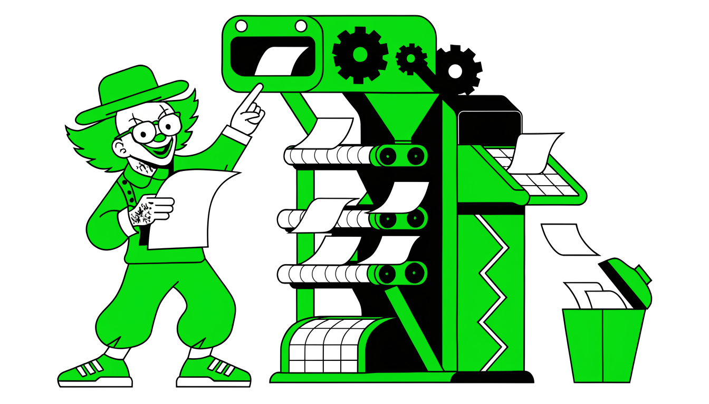

Рынок кандидата в IT закончился: под давлением экономики — от ставки ЦБ до санкций — он превратился в рынок работодателя. Вакансий стало меньше, а конкуренция выросла в разы. Дальше — честный разбор происходящего: путь индустрии от доткомов до нынешнего ИИ-пузыря, реальная статистика 2025 года и сегменты, где до сих пор есть спрос, — и как этим воспользоваться.

Основные факторы которые я хочу подсветить:

- Очень дорогие деньги в РФ и мире
- Давление ИИ на рабочие места и структуру проектов компаний
- Несеметричные законы трудового права и потребительский экстремизм
- Несостоятельность HR'ов и откровенные глупости процедуры найма
- Закономерный ответ кандидатов, волчистость и выгрызание работы любой ценой

## Как ключевая ставка ЦБ убила найм в IT

Зимой 2024-2025 года Центробанк поднял ключевую ставку до максимума — и это решение запустило цепочку, которая к лету практически заморозила найм в IT. Вакансии на специализированных платформах висят, требования прописаны, зарплатные вилки указаны, но нанимать по многим из них никто не собирается: объявление превратилось в формальность.

Механика простая. Ключевая ставка определяет стоимость денег в экономике: растёт ставка — дорожают кредиты для бизнеса. А IT-компании традиционно живут на заёмные средства: под них запускают новые проекты и масштабируют существующие.

Теперь обслуживание долга съедает заметную часть прибыли, и проекты, которые вчера выглядели перспективными, перестают сходиться экономически. Банки со своей стороны осторожничают: они понимают риски и неохотно выдают деньги под высокий процент — вернёт ли их компания, большой вопрос.

Инвесторы тоже остывают: при высокой ставке вложения в IT проигрывают альтернативным инструментам, где доходность сопоставима, а рисков меньше.

Скажем, крупная компания собиралась запустить новое направление на банковское финансирование и нанять под него команду разработчиков. После роста ставки кредит резко дорожает, риск не окупить проект увеличивается — и запуск замораживают.

Команда, которую планировали набирать, больше не нужна. Помножьте эту историю на весь рынок — получите картину лета 2025-го.

И даже ИИ-истерия так сильно не ударила по вакансиям. Если бы ставка сохранялась, то открылось бы много ИИ ориентированных проектов под которые начался бы найм. Ведь кто-то должен делать всех этих "умных" помощников в каждом закоулке.

В итоге отрасль застыла в парализованном состоянии. Денег не хватает ни на новые проекты и найм под них, ни на расширение существующих направлений.

Рынок труда заморожен не потому, что у компаний кончились задачи или отпала потребность в специалистах. Задачи есть, потребность есть — невыгодны сами инвестиции при такой стоимости денег. Компании продолжают работать текущими командами, а расширяться не могут или не хотят: финансовые риски перевешивают любые планы роста.

## Причины кризиса: экономика и налоги

Треть компаний малого бизнеса в России рассматривает закрытие или продажу — такие данные приводят ФОМ и Высшая школа экономики. Причина в том, что два удара пришлись одновременно: новые налоговые условия наложились на падение покупательной способности населения. Платить государству нужно больше, а покупателей стало меньше.

Крупному бизнесу не легче. С начала года ВВП сократился почти на 2% по официальным оценкам, экономика замедляется. В такой ситуации компании заняты не развитием и расширением штата, а выживанием.

Для рынка труда это обернулось двойным давлением. С одной стороны, бывшие предприниматели, руководители и их сотрудники выходят на открытый рынок — люди с реальным опытом, которые создают дополнительную конкуренцию каждому соискателю.

С другой — сами работодатели перешли в режим жёсткой оптимизации. «Строители светлого будущего» им больше не интересны; нужны специалисты, которые могут **закрыть конкретную проблему здесь и сейчас с минимальным бюджетом**. Не «перспективный кандидат с потенциалом», а человек под задачу.

> Искусственные позиции Junior уровня навырост больше не нужны. На рынке, за адекватные деньги теперь можно нанять Middle\Middle+ специалиста.

Традиционный подход к поиску — массовая рассылка резюме и презентация своих достижений — в этих условиях перестал работать. Работодатель читает резюме с одним вопросом: какую его проблему этот человек решит и во сколько это обойдётся.

Соискатели пока не научились адаптировать опыт под эту логику: продолжают рассказывать, чего добились на прошлых местах, вместо того чтобы показывать, какую задачу конкретной компании они закроют.

Какой-то детский конкурс достижений, где кандидату кажется, что он достоин работы потому, что хороший человек. О том, что он один из участников цепочки создания ценности здесь и сейчас пока ещё никто не думает.

Есть и технический фактор, который усиливает всё перечисленное. Поток кандидатов вырос до 50 человек на одну позицию, и HR-отделы массово передают рутинные задачи нейросетям — вручную разгребать такие объёмы никто не будет. Первым ваше резюме всё чаще читает алгоритм, а не человек, и до живого рекрутера доходит малая часть откликов.

Кризис не отменил найм полностью — задачи у бизнеса остались, и под них по-прежнему ищут людей. Но фильтр стал жёстче, конкуренция выше, а старые приёмы поиска работы против него бессильны. Дальше в книге разберём, как под эту реальность подстроиться.

## Мировые IT-циклы: от доткомов до ковидных увольнений

На стыке 1990-х и 2000-х люди массово научились делать сайты — и родился первый большой IT-пузырь. Механика на пальцах: офлайн-магазин шин в Калифорнии с выручкой 200 тысяч долларов в год стоит примерно свою годовую выручку. Владелец делает сайт, добавляет «.com» к названию — и продаёт инвестору 50% компании за 2 миллиона.

Раз половина стоит два, вся компания «стоит» четыре. Инвестор перепродаёт четверть за те же 2 миллиона, возвращает вложения, оставшаяся доля дорожает дальше.

Пузырь живёт, пока находятся новые покупатели, верящие в интернет. Под каждый стартап нанимали разработчиков с улицы: тысяча программистов — это тысяча сайтов, то есть тысяча «компаний» на перепродажу. Когда фиктивных денег стало много, а прибылей по-прежнему мало, всё лопнуло: рухнули кредитные линии банков, обанкротились венчурные фонды.

Второй виток — 2020 год. До ковида вакансии в IT росли плавно, вслед за экономикой. Локдаун заставил бизнес экстренно уходить в онлайн: доставка, платежи, удалённые сервисы. Это была реальная потребность, а не спекуляция, но механика дефицита та же: вакансий стало сильно больше, чем кандидатов, компании начали перекупать людей друг у друга, появились **оклады до миллиона рублей и выше.**

Перегретый найм сломал проверку кандидатов: HR не успевали гонять тесты, резюме перестали валидировать — брали почти не глядя. На этом фоне расцвели курсы 2019–2021 годов. Схема цинична: автор выбирает модную технологию вроде Go, на которой сам никогда не писал, зачитывает на камеру бесплатную книгу и готовит выпускника не к работе, а к собеседованию — с резюме про выдуманные «3 года в ИП» и натаскиванием на типовые вопросы.

Skillbox и похожие платформы штамповали тысячи курсов, где одни и те же преподаватели вели разные направления, часто вообще не работая в отрасли. Работало это только потому, что компании всё равно нанимали почти всех. Качественные курсы тоже существовали — их делали действующие компании силами практиков индустрии, и такие выпускники устраивались без проблем, — но погоды на рынке они не делали.

Потом пандемия закончилась, и пузырь схлопнулся. Десятки тысяч нанятых на хайпе оказались не нужны. Сеньоры с окладами 1–1,5 миллиона стали получать офферы на **250–300 тысяч** и пошли писать в интернет, что «IT умерло».

IT не умерло — умер хайп. Продукты производятся, компании работают, но отбор ужесточился: смотрят на реальные навыки, а не на сертификат. К обиженным сеньорам добавились миллионы выпускников курсов без навыков — конкуренция на входе выросла в разы.

Перегрев, схлопывание, толпа на рынке — и есть отправная точка для всего, что дальше в книге.

## Российский IT: галеры, реклама и внешние удары

Принято считать, что Российское IT такое мощное из-за советсткой физико-математической школы. Потрясающие инженеры и математики сделали наше айти таким, какое мы его знаем.

Реальная история прозаичнее — отрасль началась с аутсорс-«галер». После дефолта рубль обесценился (за 100 долларов, по меркам тех лет, можно было купить квартиру), а квалифицированные инженеры остались, и западному капиталу стало выгодно продавать их труд.

Схема: американский банк заказывает обновление сайта за 10 миллионов долларов у местной компании из Калифорнии. Работа отдаётся в Россию, где обходится в 10 тысяч. Разницу себе в карман.

Логичный вопрос: Ну так же можно делать с любой странной с, кхм, низкой стоимостью труда?

И тут фокус руками.

Второй источник прибыли — сам курс рубля: программист подписывает контракт на 28 тысяч рублей (тогдашняя $1000), его работа продаётся на Запад за $3000–4000, а через пару месяцев та же тысяча долларов — уже 38 тысяч рублей. Прибыль возникает из курсовой разницы, качество никого не волнует — главное нанимать больше людей и продавать часы.

Выстраивается иерархия:

- Крупный подрядчик который получает жирный контракт и продаёт за $50 час программиста у себя в США
- В России появляются мелкие партнёры, которые готовы оказать эту услугу за $25 а программисту заплатить $15
- Этих мелких партнёров обслуживают мелкие команды по 5-10 человек которые выполняют работу за $15 в час для заказчика, а программистам платят $10
- В момент выплаты, из-за ослабевания рубля, программисты уже получают $7-8 так, как контракт их рублёвый, а деньги приходят от заказчика в долларах

Получается что в момент расчётов очень выгодно доллары менять и расплачиваться по рублёвым обязательствам.

Масштаб: к 2010 году в России было около 2300 компаний-разработчиков ПО, из них **1500 занимались экспортом услуг.** Из 250–300 тысяч айтишников (примерно 100 тысяч программистов) собственные продукты делали от силы 5–10 тысяч человек — как команда Дурова или разработчики движка Unigine.

Остальные 90% сидели на галерах либо в веб-студиях на 10–20 человек, бравших на зарубежном фрилансе сайты на WordPress за $5–10 тысяч и делавших их за $500.

Параллельный драйвер — переоценённая реклама.

До 2012–2014 годов сквозной аналитики не существовало, и бизнес переплачивал за интернет-рекламу, не видя отдачи.

Рамблер продавал размещения на главной по цене в сотни долларов за тысячу показов — и умер как крупный игрок, когда рынок это осознал (история разобрана в книге «Как мы купили интернет»).

Яндекс вырос на Директе и РСЯ, через DSP пакуя дешёвые площадки в дорогие пакеты для компаний, которые «денег не считают»; похожим образом собирался Mail.ru, ныне VK.

Если вы смотрели фильм Предел риска или Игра на понижение то механизм очень похож. В рекламной сети Яндекса есть миллионы сайтов партнёров которые крутят рекламу. Есть качественные источники, например какой-нибудь сайт по покупке машин. Пользователь там взрослый и платёжеспособный и все хотят купить там показы рекламы.

Но показов там не бесконечное количество, по этому Яндекс пакует этот сайт в DSP с сайтами похуже, и "как бы" про машины. Где большая часть пользователей школьники или пакистанские школьники.

И продаёт вам это пакетом по цене круто сайта по покупке машин.

Дальше рынок перекраивали внешние удары. Крым-2014 отрасль не убил, а разогнал: рубль снова подешевел, EPAM и другие аутсорсеры резко усилили найм (рублёвые зарплаты индексируются медленнее, чем падает курс), а государство запустило импортозамещение с грантами.

Февраль 2022-го ударил больнее: санкции, отключение от Swift, уход международных аутсорсеров. Но многие просто сменили вывески и работают через посредников в Киргизии; часть вывезла людей в Грузию, Армению и Казахстан, где сотрудник зависимее от работодателя.

Экспорт игр и приложений усложнился: юрисдикции на Кипре, конвертация через киргизский сом, комиссии съели маржу, и аутсорс переориентировался на Центральную Азию и сейчас там пылесосит разработчиков и растёт.

Внутри страны рабочие места заместил госсектор: сегодня **почти 70% разработчиков** заняты в окологосударственных компаниях — структуры РЖД, Почта России, госуслуги, внутренние аутсорсеры Северстали и Газпрома. Ну и конечно же VK, где сын одного из руководителей аппарата президента является Генеральным Директором.

Коммерческая ценность их продукта часто скромна, но государство субсидирует занятость по той же логике, по которой не закрывают АвтоВАЗ: это недорого и покупает социальную стабильность.

## ИИ-пузырь и уроки истории для соискателя

Цепочка пузырей продолжается: доткомы, крипта, теперь ИИ. Механика знакомая. Nvidia росла на чипах для майнинга; когда крипта затормозила, чипы понадобилось куда-то сбывать — теперь их покупают ИИ-фермы и дата-центры. Громче всех о «замене сотен программистов» кричат те, кто продаёт ИИ-решения, чипы и обслуживает инвесторов, — кукушка хвалит петуха.

Компаний, которые реально заменили разработчиков нейросетью и показали продукт, который держит пользовательскую нагрузку и приносит деньги, пока не видно. Вокруг ИИ звучит «я сделал штуку — инвестируйте в меня», но реже «я сделал штуку, которая зарабатывает от пользователей которые ей пользуются».

Что ИИ даёт на самом деле: продуктивность программиста растёт на **10–15%**, рутина и простой код генерируются быстрее, дешёвые арты для игр — тоже. Пострадали в первую очередь слабые художники и слабые программисты: пять простых строчек кода теперь пишет нейросеть.

Из сотни купленных ИИ-подписок в реальной работе выживают примерно две: GPT для исследований и сбора данных и генератор картинок;

Сейчас активно развивается вайб-кодинг и с хорошей подпиской на условный Claude Code код писать руками и правда не надо. Но у разработчика точно такой же рабочий день во время которого он оперирует агентами.

Волшебные промпты и мультиагентные сети пока делают красивые графики и отчёты но на работу не влияют.

Экономика при этом вывернута наизнанку: задачу, которую макрос в Excel решает за условный 1 ватт, ИИ решает за 1000 — и продавцов ресурсов это устраивает, потому что больше потребления означает больше инвестиций и больше проданных чипов. Рынок разработки в целом от ИИ не пострадал: кто работал — тот работает.

Что из всей этой истории следует вам, ищущему работу в 2026-м.

Во-первых, вы выходите на рынок после схлопывания: компании ужесточили отбор, резюме снова валидируют, а конкуренцию создают миллионы выпускников курсов без реальных навыков.

Во-вторых, зарплаты вернулись к рынку: сеньор, пять лет получавший миллион в криптопузыре, объективно стоит **250 тысяч** — и торговаться придётся от этой реальности, а не от воспоминаний о 2021 годе.

В-третьих, «IT умерло» — фоновый шум каждого схлопывания начиная с доткомов; отрасль всякий раз возвращалась к норме, потому что производит реальную ценность, а умирает только хайп.

В-четвёртых, хайповые волны — плохой ориентир для карьеры: кто шёл «в IT за миллионом» по рекламе курсов, первым оказался на улице, а кто умел работать — продолжил работать.

История последних двадцати пяти лет однообразна: пузырь надувается, под него массово нанимают и массово учат, потом рынок трезвеет и оставляет только тех, кто делает нужное бизнесу. Навык, который переживает любой пузырь, один — способность решать реальные задачи.

## Влияние высокой ставки ЦБ и «игры в защиту» компаний

Активный рост 2020–2022 годов закончился: высокая ставка ЦБ и общая неопределённость загнали компании в режим защиты. Эксперименты и вложения в развитие новичков отменяются — бизнесу нужны специалисты, которые приносят результат здесь и сейчас.

Отсюда ужесточение требований. В кризис никто не хочет рисковать: расходы оптимизируют, кандидата ищут максимально под задачи компании, а первичный отбор всё чаще делает ИИ, который реагирует на определённые маркеры в резюме.

Фраза «хотелось бы попробовать новое направление» или упоминание пройденных курсов снижает рейтинг резюме — и в глазах работодателя, и в глазах алгоритма. Компании боятся, что человек будет учиться и ошибаться за их счёт, поэтому образ ученика или искателя нового опыта отсеивают на входе.

Для соискателя вывод простой: формулировки в резюме придётся взвешивать. Не пишите, что проходили обучение или хотите попробовать себя в новом, — в нынешних условиях это читается как слабость. Работает акцент на конкретном опыте работы и достижениях релевантных для компании.

Поменялись и правила игры на платформах для поиска работы. Покупать доступ к базе кандидатов работодателям стало невыгодно — это **десятки и сотни тысяч рублей**. В ответ компании завели собственные базы данных кандидатов, а на площадках расплодились **«фейковые» вакансии**: их вешают для сбора контактов впрок, без реального намерения нанимать сейчас.

Кандидаты честно готовят отклики на пустышки и жгут на это время — поиск от такой практики становится только тяжелее.

Есть и практический ход, который стоит взять на вооружение. Заполняя информацию о компании, в которой вы работали, указывайте до пяти сфер её деятельности — так выше шанс попасть в выдачу по интересующим вакансиям. Это не обман: разные проекты внутри одной компании действительно могут относиться к разным областям — IT, финтех, ритейл и так далее.

Пока рынок играет в защиту, соискателю приходится играть точно и аккуратно: каждая строчка резюме либо работает на вас, либо против.

## Рынок труда в IT: переход к рынку работодателя

К концу 2025 года баланс на IT-рынке труда окончательно сместился в сторону работодателей. Ещё несколько лет назад всё выглядело иначе: компании активно конкурировали за специалистов, перебивая друг друга зарплатами и бонусами, а кандидат выбирал, куда пойти. Этот период закончился.

«Рынок кандидата» превратился в **рынок работодателя**. Теперь не компании борются за таланты, а специалисты конкурируют за позиции: резюме стало значительно больше, чем открытых вакансий, и за каждым приличным местом выстраивается очередь. Работодатель может позволить себе выбирать — и выбирает придирчиво.

Для конкретного специалиста это меняет многое. Сильных технических навыков уже недостаточно. Поиск работы стал отдельным навыком, и владеть им нужно так же уверенно, как своим стеком: правильно презентовать себя, грамотно составлять резюме, проходить собеседования, выстраивать карьерную стратегию. Проигрывает в этой гонке не самый слабый инженер, а самый неподготовленный соискатель.

Тенденция не локальная: она актуальна и для российского, и для международного рынка труда, хотя у каждого направления своя специфика. Логика везде одна — когда предложение специалистов превышает спрос, правила диктует тот, кто платит.

Разница только в деталях: где-то отбор жёстче на этапе резюме, где-то на собеседованиях, но сам перекос в пользу нанимающей стороны общий.

Поэтому вопросы, которые раньше решались на ходу, — как искать работу, как расти в зарплате, как строить команду и остальные профессиональные аспекты — теперь требуют более осознанного и системного подхода, чем раньше. Стратегия «разошлю резюме веером и посмотрю, кто ответит» в новых условиях почти не даёт результата: таких же веерных рассылок у HR перед глазами сотни.

Дальше разберём, из чего системный подход складывается и как перестроить свой поиск под новую реальность.

## Достижения в условиях дефицита ресурсов — ключевой навык 2026

Сотрудник, который работает четыре часа в день, но чётко показывает результат, удержится в компании с большей вероятностью, чем тот, кто сидит на работе сутками без видимого эффекта. Трудолюбие и готовность задерживаться допоздна сами по себе больше не ценятся — работодателю нужна конкретная польза для бизнеса, и измеримые достижения весят больше затраченного времени.

Особенно жёстко это правило работает на руководящих позициях. Там мало перечислить выполненные задачи — нужно показать контекст и трудности, которые вы преодолели. Сравните: «открыл три магазина с хорошими показателями» и **«открыл три магазина при урезанном вдвое бюджете»** — с указанием конкретных методов и инструментов, которые это позволили.

Или: вместо «набрал 10 продавцов» — **«укомплектовал команду из 10 человек за месяц, тогда как обычный срок подбора составлял полгода»**, с объяснением, какие подходы вы применили.

Логика одна: показывайте, как именно вы справились с невыгодными условиями — ограниченным бюджетом, сжатыми сроками, дефицитом персонала, рыночной неопределённостью. Достижение без контекста — просто строчка в резюме. Достижение вопреки обстоятельствам — доказательство вашей цены.

Почему этот навык стал главным именно сейчас? Мир изменился, и старые правила больше не работают. Компании живут в турбулентности: бюджеты режут, а делать приходится больше меньшими силами. В таких реалиях востребованы специалисты, которые получают результат при высокой нагрузке и неопределённости, умеют чётко сформулировать и доказать свою ценность для бизнеса и находят нестандартные решения там, где ресурсов не хватает.

Кто научится и достигать в дефиците, и внятно об этом рассказывать, тот на рынке труда 2026 года будет по-настоящему ценным активом: именно таких людей компании стараются нанять и удержать в первую очередь. Остальным придётся конкурировать количеством отработанных часов — а его, как мы уже выяснили, никто не покупает.

## Статистика рынка труда: цифры и факты

Минус 20% вакансий за один квартал — так, по данным **Суперджоб**, российский рынок труда прошёл первый квартал 2024 года. На длинной дистанции картина не лучше: за последние два года число вакансий снизилось на 12%. Компании экономят жёстко.

Когда сотрудник увольняется, его место часто вообще не закрывают новым наймом: задачи либо автоматизируют, либо раскидывают по оставшимся работникам.

Второй показатель — **индекс HeadHunter**, соотношение резюме к вакансиям. Он превысил 12 пунктов, при том что нормой для здорового рынка считается около 5. Двенадцать — это жёсткий перегрев и высочайшая конкуренция. На позициях уровня middle и выше конкурс доходит до **50 человек на одно место**; эксперты отмечают, что такого напряжённого рынка труда не было последние 10 лет.

На данный момент, для IT он составляет 22, но снижается последние 3 месяца хорошими темпами.

При этом дефицит кадров никуда не исчез — он просто переехал в массовые, менее квалифицированные профессии. Многие оттуда переквалифицировались в другие сферы, требования к кандидатам выросли, а по политическим причинам общее число доступных работников сократилось.

Получается перекос: в массовом сегменте рук не хватает, а высококвалифицированному специалисту найти работу сложнее, чем в 2019–2020 годах.

Откуда взялся этот кризис? Основной удар пришёлся на малый бизнес. С начала года сектор попал под новые жёсткие налоговые условия, и совпало это с падением покупательной способности населения. По данным ФОМ и Высшей школы экономики, около трети компаний малого бизнеса задумываются о закрытии или продаже.

За каждой такой историей стоят бывшие предприниматели, руководители и их сотрудники — все они выходят на рынок труда и ещё сильнее разогревают конкуренцию за оставшиеся вакансии.

Складывается замкнутый круг: вакансий меньше, соискателей больше, и каждый закрывшийся бизнес добавляет рынку новых кандидатов. Цифры говорят одно — рассчитывать на быстрый и лёгкий поиск в таких условиях не стоит, готовиться нужно к марафону.

## Уменьшение реальных вакансий до 20–30%

Из вакансий, которые висят на площадках, реальный наём прямо сейчас стоит лишь за частью — живых позиций остаётся порядка **20–30%**. Остальные размещены для галочки, сбора резюме впрок или мониторинга рынка. Так что рынок труда жёстче, чем кажется по количеству объявлений.

Как так вышло? Работодатели и HR-специалисты массово включили автоматические фильтры и системы отбора. Кандидаты ответили симметрично — скриптами для массовых откликов. В итоге рынок превратился в гонку алгоритмов: множество откликов отсеивается автоматикой, даже не попадая к живому человеку; HR получают сотни нерелевантных откликов от ботов и скриптов; реальные кандидаты тонут в этом информационном шуме.

Когда одна сторона упрощает себе жизнь автоматизацией, она усложняет её другим в десятки раз. Поиск работы становится похож на прохождение лабиринта с невидимыми стенами.

Соблазн ответить той же монетой велик, но не спешите ставить скрипт на отклики по всем подряд вакансиям. Да, это быстро. Но алгоритм зацепится за знакомое слово в вакансии и отправит ваше резюме на позицию разработчика, даже если вы им не являетесь.

Такой ковровый обстрел снижает вашу репутацию в глазах HR, засоряет базы данных и — главное — не повышает шансы на реальное трудоустройство. Вы просто становитесь частью того самого шума, в котором тонете сами.

Работает противоположная стратегия: осознанно и точечно. Выбирайте релевантные вакансии и пишите персонализированные отклики — такие, которые пройдут автоматические фильтры и при этом заинтересуют живого человека, когда до него доберутся.

Когда живых вакансий на рынке 20–30%, каждая осмысленная заявка на настоящую позицию стоит дороже сотни автоматических выстрелов вслепую. Экономьте не время на отклик, а отклики на пустышки — это единственная экономия, которая в нынешних условиях окупается.

## Вакансий стало меньше, кандидатов — больше

До 2020 года IT-бум позволял компаниям набирать команды «про запас»: запускались инвестиционные проекты, нанимался условный «жир». Теперь высокая ключевая ставка и инфляция заставили бизнес играть в защиту — проекты, которые не приносят прибыль, режут, а к совпадению стека технологий и опыта кандидата подходят куда критичнее. По сути рынок вернулся к правилам, действовавшим до 2020 года.

Добавьте сюда снижение текучки. Опытные специалисты держатся за свои места, потому что знают: поиск работы теперь занимает **4–6 месяцев** даже у сильных кандидатов, если те не перестроились под новые правила. Мест освобождается меньше, желающих на каждое — больше.

Вакансий действительно стало меньше, и это не слухи, а картина, которую подтверждают и статистика, и специалисты по найму.

Сильнее всего просели джуниорские позиции. Компании проще доплатить мидлу — или не доплачивать вовсе, а поручить ему базовые задачи с помощью искусственного интеллекта: написание тестов, простые требования. Вакансии для стажёров и джунов исчезают.

Отсюда главный совет начинающим: не пишите в резюме слова «джуниор», «стажёр», «начинающий» — они автоматически ранжируют вас вниз. Конкуренция на джуниорские позиции огромная, на мидл-вакансии — заметно ниже, поэтому откликайтесь на мидл-позиции: если навыки есть и они правильно оформлены в резюме, шансы пройти фильтры искусственного интеллекта и дойти до живого человека гораздо выше.

При этом рынок не умер. Вакансий для бизнес-аналитиков и системных аналитиков по-прежнему **тысячи** — в отличие от некоторых специализаций разработчиков, где счёт идёт на сотни. Работа находится у тех, кто анализирует отрасли, подстраивает резюме и использует современные инструменты, — порой даже быстрее и успешнее, чем раньше. Так что не унывайте и концентрируйтесь на том, что можете изменить.

Это не временные трудности, а структурные изменения рынка, и новые правила игры придётся принять. Опытные и сильные специалисты, которые не адаптировались к текущим правилам найма, проигрывают тем, кто применяет новые методы, — даже если у последних меньше реального опыта.

## Средние сроки поиска работы в IT (2025)

От 4 до 9 месяцев — столько в 2025 году занимает нормальный поиск работы в IT. Это не катастрофа, а новая рыночная норма: IT стал похож на логистику или фарму, где работодатель спокойно выбирает из большого числа кандидатов, гоняет десятки этапов собеседований и раздаёт объёмные тестовые задания.

Уложиться в 6–8 недель реально только в узких сценариях: без релокации, с переходом на аналогичную позицию с тем же грейдом, изредка — при релокации в СНГ или на Кипр. Если хотите переехать в конкретную страну вроде Дании или поднять грейд, в 1,5–2 месяца не уложитесь.

Почему так долго? На рынке парадокс: вакансий много, кандидатов много, но найти друг друга сложно. Конкуренция выросла — пришло много хороших специалистов, плюс активно меняются те, кто уже работает. Работодатели стали требовательнее: когда есть из кого выбирать, процессы найма удлиняются.

И сам рынок непредсказуем — картина меняется каждый квартал и сильно различается по сегментам и профессиям.

### Осень — время дожимать

В последние 6–8 недель года не сдавайтесь. В октябре–ноябре компании торопятся закрыть вакансии из утверждённого бюджета (иначе его могут не одобрить в следующем году), объединяют несколько этапов собеседований в один и быстрее проверяют тестовые. **Много офферов прилетает к католическому Рождеству**, к 20-м числам декабря: компании закрывают план найма текущего года и уже готовятся к следующему.

Продолжайте откликаться, развивайте нетворкинг и трекайте все процессы: воронку откликов, источники, этапы. Откажитесь от джоббордов, где мало подходящих вакансий, и держите фокус на основной цели — если ищете позицию technical product manager, эксперименты с project manager временно отложите.

Лучше сократить источники, чем выгореть и бросить поиск. Реанимируйте старые контакты: пропингуйте всех, кто обещал вернуться с ответом, напишите тем, кто летом или ранней осенью говорил о возможных позициях, — вакансия может быть до сих пор не закрыта, и вы окажетесь вовремя.

И сигнализируйте работодателю о готовности начать быстро: когда обе стороны заинтересованы и торопятся, notice period можно сократить.

### Если работы нет уже сейчас

Это режим выживания.

Освободите время: оставьте только активности для физического и психического здоровья — сон, еду, прогулки, семью, — а всё остальное отдайте поиску, по 4–6 часов в день как второй работе.

Снизьте критерии: по зарплате, по грейду (рассмотрите позицию ниже), по типу компании (работали в стартапах — посмотрите SMB и крупный бизнес, и наоборот), по индустрии и размеру команды.

Не отбрасывайте временные варианты: любая работа или проект, даже в России в рублях или в СНГ, даёт хоть какой-то доход, пока вы параллельно ищете основное место. Средний срок остаётся **4–9 месяцев**, так что готовьтесь к длинной дистанции.

## Скилл «поиск работы» как новая необходимость

Обновили резюме на HeadHunter, откликнулись на 20–30 вакансий — и тишина, в лучшем случае отказы. Ещё недавно такой сценарий казался невозможным: обновил резюме — и за неделю получил несколько собеседований и оффер. Последние два-три года сломали эту привычную парадигму в IT и диджитал-сфере.

Раньше хватало профессиональных компетенций. Проходишь курсы, осваиваешь новые фреймворки, прокачиваешь софт-скиллы вроде переговоров — и этого достаточно, чтобы расти на текущем месте и без проблем находить новое. Сам поиск работы отдельным умением не считался: рынок был настолько голоден до людей, что всё происходило почти автоматически.

С конца 2022 — начала 2023 года ситуация изменилась: поиск работы превратился в самостоятельный навык, который нужно развивать так же осознанно, как технические скиллы. Причин две.

Первая и главная — тектонический сдвиг: **IT и диджитал впервые стали рынком работодателя**. Такого не было никогда. Да, разработчикам, DevOps и SRE по-прежнему проще находить работу, но в целом ряде технических специальностей конкуренция выросла настолько, что предложение кандидатов приближается к спросу или даже превышает его.

Работодатели получили роскошь выбора: можно тщательно перебирать кандидатов из длинного списка, устраивать 25 этапов отбора, давать объёмные тестовые задания. Для логистики или фармацевтики это давняя норма жизни, а IT и диджитал проходят через такое в первый раз — поэтому специалисты так болезненно перестраиваются на новую реальность.

Вторая причина — резко выросшая конкуренция. Много людей меняет работу одновременно, плюс на рынок вышло большое количество хороших специалистов. Всё это создало перенасыщение IT-рынка: на многих направлениях кандидатов ощутимо больше, чем открытых позиций.

Что из этого следует? Осознанные усилия там, где раньше всё делалось само. Умение упаковать резюме, выстроить отклики, вести свою воронку и переговоры — теперь такая же компетенция, как знание фреймворков. Кто развивает только профессиональные навыки и ждёт, что работа найдётся по-старому, проигрывает менее опытным, но лучше подготовленным к самому процессу поиска конкурентам.

## AI в найме: обязательный скилл, но не угроза профессиям

Рекрутеры уже вовсю работают с ИИ-инструментами, кандидаты тоже — и работодатели начали проверять это на входе. Знакомство с AI превратилось в обязательный пункт для прохождения начальных этапов отбора: если в резюме или на собеседовании нет ни слова об использовании ИИ-инструментов, это может насторожить. Получился своеобразный скрининг, через который теперь проходят все.

На практике это значит, что владение AI-инструментами стало таким же базовым навыком, как уверенное пользование офисными программами. При прочих равных предпочтение отдадут тому, кто умеет работать с современными технологиями. Хорошая новость: глубокая экспертиза не требуется — достаточно демонстрировать осведомлённость и готовность использовать инструменты в работе.

Планка входа невысока, но не перешагнуть её — значит проиграть кандидатам с ровно теми же профессиональными навыками.

А вот паника вокруг «ИИ заберёт профессии» пока не подтверждается. Массовых увольнений из-за внедрения ИИ не происходит: искусственный интеллект скорее меняет характер работы, чем замещает специалистов. В большинстве компаний AI используется как вспомогательный инструмент — автоматизирует рутинные задачи и повышает эффективность.

Сложные задачи, где нужны контекст, креативность и принятие решений, остаются за людьми, а компании инвестируют в обучение сотрудников работе с AI, а не в их замену.

Как разыграть эту карту в поиске работы. В резюме и на собеседованиях упоминайте конкретные AI-инструменты, с которыми вы работали, — общие слова «интересуюсь нейросетями» здесь не работают так, как названный инструмент и задача. Показывайте, как использование ИИ помогло решить рабочие задачи эффективнее: сэкономленное время и снятая рутина убедительнее любых деклараций.

И демонстрируйте готовность осваивать новые технологии — это и есть та осведомлённость, которую ждут на скрининге.

Только не переигрывайте. Кандидат, у которого весь опыт сводится к «спросил у чат-бота», вызывает больше вопросов, чем тот, кто про ИИ вообще молчит. Работодатели ищут специалистов, которые умеют думать и принимать решения, используя ИИ как один из инструментов, а не полагаясь на него полностью.

## Уплощение структур и универсальные специалисты

Компании режут издержки, и главный инструмент здесь — объединение ролей и уплощение структуры. Классические вертикальные иерархии уступают место плоским моделям, где один специалист закрывает функционал, который раньше требовал нескольких человек.

Отсюда рост гибридных позиций: technical project manager, data project manager, product analyst. Это закономерный результат сокращения ставок и бюджетов, а не модная тенденция.

Работодателю нужен человек, который совмещает техническую экспертизу с управленческими навыками, понимает продукт, умеет работать с данными и сам закрывает смежные задачи, не передавая эстафету между отделами. Широта компетенций стала конкурентным преимуществом: узкий специалист сейчас востребован меньше, чем тот, кто переключается между контекстами и берёт на себя разнородные функции.

Из этого следует утешительная вещь: сокращение перестало быть личным провалом. Когда компания убирает целую позицию или роль, дело не в вашей квалификации — это стратегическое решение бизнеса. Поэтому на собеседованиях о лей-оффе можно и нужно говорить открыто:

- спокойно объяснить, что сократили ставку, а не вас;
- рассказать, чему научились в компании и с каким результатом уходите;
- сохранить позитивный тон о бывшем работодателе;
- показать, что изучаете сейчас и какие у вас планы на следующий этап карьеры.

Попытка скрыть причину увольнения или придумать альтернативную историю только вредит — опытный рекрутер почувствует недосказанность и сделает выводы сам, скорее всего не в вашу пользу.

Как адаптироваться к эпохе универсалов? Расширяйте набор навыков в смежные области — аналитика, управление проектами, техническая экспертиза. Если претендуете на разные гибридные роли, готовьте под каждую отдельную версию резюме.

Прокачивайте личный бренд и активно используйте LinkedIn. Развивайте нетворк — особенно ради директорских позиций, куда в холодную почти не берут: туда заходят через людей. Для международных компаний учите языки — в Испании, скажем, без испанского тяжело.

И задействуйте максимум инструментов сразу: джоббординги, прямые отклики, нетворкинг виртуальный и реальный, скрытый рынок через знакомых. Чем шире охват, тем выше шанс найти подходящую позицию в новых условиях рынка.

## Как изменился найм в IT в 2025 году

Четыре-шесть месяцев — столько теперь может тянуться поиск работы даже у специалиста с опытом. Привычные подходы перестают работать, а игнорирование новых правил игры оборачивается чередой отказов, причину которых кандидат не понимает.

Экономические факторы вроде ключевой ставки — лишь часть объяснения. В 2025 году произошла фундаментальная трансформация самих процессов найма: компании массово внедрили автоматизированные системы отбора, и правила для соискателей поменялись радикально.

Первичный отбор резюме теперь проводят алгоритмы, а не живые HR-специалисты, — значит, требования к оформлению и структуре документа совсем другие. Кандидат, который этого не учитывает, отсеивается на первом этапе и до реального рекрутера просто не доходит. Фильтры настроены на конкретные критерии, и обойти их старыми методами почти невозможно.

Поменялись и сами вакансии. Работодатели стали требовательнее к оформлению опыта, формулировкам в резюме и соответствию профиля конкретной позиции. Универсальное резюме больше не работает: каждый отклик приходится адаптировать под вакансию, и касается это в равной мере новичков и специалистов с многолетним стажем.

При этом многие опытные люди продолжают отправлять резюме по старинке, рассчитывая на послужной список. Подход «я профессионал, меня и так возьмут» больше не актуален: релевантный опыт нужно ещё правильно преподнести — с оглядкой и на автоматические фильтры, и на ожидания конкретного работодателя.

Что делать на практике:

- переработать резюме под требования автоматических фильтров;
- адаптировать каждый отклик под конкретную вакансию;
- изучить новые стратегии публикации профиля на площадках;
- разобраться, как работают алгоритмы отбора со стороны работодателей;
- правильно структурировать информацию об опыте и компетенциях.

Кто подходит к поиску системно и учитывает современные реалии рынка, получает результат заметно быстрее тех, кто полагается только на опыт и прежние методы. Принять новые правила игры неприятно, но дешевле, чем полгода собирать отказы.

### Где искать стабильность

Адекватнее всего ведут себя компании среднего размера — **от 300 до 2000 человек**: подросшие стартапы и SMB-сегмент. Они набирают взвешенно, меньше копят «жирок» и неэффективность, реже устраивают массовые увольнения.

Менее стабильны крайности: совсем маленькие стартапы и огромный big tech, который может уволить тысячу человек и «не заметить».

Есть и недооценённый вариант — компании, где ИТ не основной бизнес, а вспомогательная функция.

Они активно набирают, редко сокращают ИТ-подразделения, и нужны там и проджект-менеджеры, и продакт-менеджеры, и другие специалисты — при том что «айтишными» в классическом понимании такие компании не считаются.

## Поиск работы в 2026: два круга ада

Завышенные требования и неадекватные ожидания работодателей — только первый круг ада, через который проходит соискатель в 2026 году. Есть и второй, о котором говорят реже: сам фильтр в лице HR.

Исторически у кадровых специалистов был понятный набор функций: подготовить документацию при приёме на работу, презентовать компанию кандидату, помочь новому сотруднику с адаптацией — онбордингом. Роль сервисная и полезная: человек приходит в компанию, и его встречают, оформляют, вводят в курс дела.

Современные HR-специалисты часто отходят от этих базовых обязанностей. Вместо профессиональной оценки кандидатов и создания комфортных условий для входа в компанию акценты смещаются в сторону субъективных критериев отбора.

Решение о том, кто пройдёт дальше, принимается на основе личных предпочтений, а не профессиональных компетенций: выбор между кандидатами может делаться по гендерному признаку или другим факторам, никак не связанным с квалификацией. Для талантливых специалистов это дополнительный барьер, который не преодолеть навыками: можно идеально совпадать с вакансией по стеку и опыту — и не пройти, потому что не подошёл под неформальные критерии конкретного рекрутера.

Так процесс поиска работы превращается в лотерею, где успех зависит не от того, что вы умеете, а от того, на кого попали. И это меняет отношение к отказам: отказ на этапе HR-скрининга далеко не всегда говорит о вашей квалификации. Иногда он говорит только о человеке по ту сторону процесса.

Второй круг ада проходят не самые сильные кандидаты, а самые настойчивые — те, кто продолжает откликаться, зная, что часть отказов объясняется не резюме и не собеседованием, а субъективностью фильтра. Чем больше попыток (но только не бестолковых веерных), тем меньше власть у отдельно взятой лотереи над вашим результатом.

## Позитивные факты: адаптация даёт преимущество

Пока большинство кандидатов действует по старинке, те, кто успел перестроиться под новые условия — ИИ в найме, изменённые алгоритмы ранжирования резюме, новые требования работодателей, — находят работу быстрее и на лучших условиях, чем раньше. Причина простая: конкуренты ещё не перестроились.

Многие специалисты, даже опытные, игнорируют изменения в процессе найма. Пишут резюме так, как это работало 3–5 лет назад, не учитывают ИИ-фильтры, не адаптируют формулировки под конкретные отрасли. Их резюме оседают на дне ранжирования, отклики остаются без ответа.

Те же, кто освоил подстройку под алгоритмы, анализ вакансий через ИИ и правильное оформление достижений, обходят даже более опытных, но не адаптировавшихся кандидатов.

Хорошая новость: адаптация — это система с конкретными проверенными шагами, а не угадывание. Анализ вакансий по отраслям, подстройка резюме под фразы из вакансии (именно фразы, а не отдельные слова), достижения в каждой строке обязанностей, правильно указанные город, возраст, уровень английского. Эти шаги проверены на практике — они работают.

Работодатели тем временем играют в защиту: в условиях высоких ставок и экономической неопределённости им нужны специалисты, максимально точно совпадающие по стеку, опыту и сферам, а ИИ-фильтры настроены жёстко. Если вы знаете, как подстроиться, вы проходите туда, куда другие даже не попадают.

Результаты у адаптировавшихся измеримые. Больше технических собеседований — резюме доходит до людей, а не отсекается автоматически. Меньше времени на поиск — точечные отклики срабатывают быстрее массовой рассылки по старинке. Точнее попадание — приглашения приходят именно оттуда, куда хотелось.

Некоторые находили работу даже в несезон, под конец года и в новогодние праздники, причём на хорошую зарплату — потому что действовали правильно, пока остальные ждали «лучших времён».

Сейчас идеальный момент. Большинство кандидатов жалуется, что «найм сломался», «ИИ всё испортил», «опыт не ценят», — а рынок просто изменился. Вакансий в ИТ по-прежнему тысячи: у бизнес- и системных аналитиков — **больше 9–10 тысяч**.

Да, среди них есть фейковые, разведочные и брендированные, но есть и реальные — адаптировавшиеся умеют их находить и проходить через фильтры. Со временем подстроятся все. Пока этого не произошло, у тех, кто действует правильно, есть фора. Используйте её.

## Стабильные сегменты: SMB и не IT-компании

Пока BigTech увольняет тысячу человек «как чихнуть», средний сегмент ведёт себя на удивление ровно. И на международном, и на российском рынке компании **от 300 до 2000 человек** и организации, где IT — не основной бизнес, заметно стабильнее гигантов. Это касается и найма, и сокращений.

Подросшие стартапы и компании среднего размера ведут себя адекватнее и совсем маленьких стартапов, и грандов индустрии. Причина в структуре: они меньше раздувают штат, не копят «жирок» — и потому реже устраивают масштабные лейоффы.

На волне хайпа такие компании не набирали избыточный персонал, сильных специалистов стараются удерживать, структуры уплощают, чтобы команды не разрастались, и ищут людей, способных закрывать 2–3 позиции одновременно.

Отдельная категория — организации, где айти лишь вспомогательное направление, а не core-бизнес. Такие работодатели активно нанимают IT-специалистов и **практически не проводят сокращений** в технических отделах. Проджект-менеджеры, продакты и другие роли нужны им постоянно, а рабочая среда заметно спокойнее, чем в чистом IT.

Так что если ищете стабильность, смотрите на компании размером 300–2000 человек и на традиционные индустрии за пределами классического IT. Да, это не самые громкие имена для резюме, зато шанс, что через полгода вас выведут за дверь вместе с половиной отдела, ощутимо ниже. Там реально найти хорошие условия, набраться опыта и работать в предсказуемой обстановке.

Общий фон это подтверждает: рынок стал более вязким. Движение есть, вакансии публикуются, но процессы идут медленнее, чем раньше, — осторожничают и работодатели, и кандидаты. Крупные компании могут позволить себе жёсткие условия найма: желающих всё равно хватит.

Средний сегмент такой роскоши лишён — потому и остаётся самым гибким и адекватным местом на этом вязком рынке.

Зарплаты растут, но темпы существенно замедлились. В «золотые» 2017-2019 годы рыночная стоимость специалиста могла вырасти так, что работодатели не успевали за трендами: **DevOps-инженер дорожал на 100 тысяч за полгода**. Сейчас инфляция и рост стоимости жизни съедают прибавки, а многие работодатели вообще не повышают компенсации, пользуясь высокой конкуренцией среди кандидатов.

## Remote, гибрид, офис: текущий расклад

Впервые за долгое время IT и диджитал — рынок работодателя: компании выбирают из множества кандидатов, могут устроить хоть 25 этапов собеседований, хоть объёмные тестовые. В 2021–2022 обновлённое резюме приносило несколько собеседований за 3–7 дней; теперь **средний срок поиска — 4–9 месяцев**, и тяжелее стало даже дефицитным разработчикам, DevOps и SRE.

Парадокс: вакансий много, кандидатов много, а люди не находят друг друга. Зарплаты ползут медленно, часто не покрывая инфляцию; высоких окладов немного, «безумные» предложения — в отдельных нишах. Расклад меняется ежеквартально.

Самый популярный формат — **гибрид, 2–3 дня в офисе**. BigTech настойчиво тянет людей обратно, но полностью офисную модель внедрил только Amazon. Full remote после просадки конца 2023-го немного подрос в 2024–2025, однако остаётся нишевым: удалёнку ищут целенаправленно, через remote-first компании, их отдельные джобборды и каналы.

Многое решает страна: Великобритания — преимущественно гибрид, Эмираты — в основном офис (иногда пятница удалённо), Европа в среднем — гибрид. И вчитывайтесь в условия: full remote бывает «в рамках страны», «в рамках города» — с явкой в локацию ради документов — и лишь иногда действительно свободным географически.

## Парадокс дефицита кадров: кого не хватает

Доступный кадровый резерв в России сократился почти вдвое — **с 7 до 4 миллионов человек**, фиксируют исследования. Официальная статистика говорит об историческом дефиците кадров, и при таком раскладе соискатели должны бы диктовать условия работодателям. На практике происходит обратное: люди месяцами не могут найти работу.

Цифры с другой стороны воронки отрезвляют. Количество резюме впервые превысило количество вакансий. Отклик на отправленное резюме получают меньше трети кандидатов. До тестового задания доходят единицы, а интервью с живым HR-специалистом, а не с нейросетью, достаётся считанным соискателям.

Выглядит это так: миллионы квалифицированных специалистов штурмуют HeadHunter и другие площадки, рассылая десятки и сотни откликов, а массовые сокращения обострили конкуренцию ещё сильнее. На одну вакансию работодателю падают сотни резюме — многие сопроводительные письма даже не открывают.

Один из случаев: кандидат на позицию графического дизайнера искала работу 5 месяцев, и на очередном собеседовании в Zoom оказалось **более 50 претендентов одновременно** — каждого просили поднять виртуальную руку и кратко рассказать о себе.

Сам парадокс умещается в две фразы: экономика утверждает, что людей не хватает; люди говорят, что их никто не берёт. Разгадка — в структурном несоответствии. Дефицит кадров существует в определённых сегментах и профессиях, но не там, где ищет работу большинство соискателей. Статистическая нехватка людей не означает, что любой специалист легко найдёт позицию.

Для соискателя из этого следует неприятное: зависеть от одной зарплаты опасно. Сегодня у вас стабильная работа, завтра рынок разворачивается, компании режут расходы — и вы конкурируете с сотнями кандидатов за одну вакансию. Запас прочности и несколько источников дохода перестали быть роскошью: это страховка, которую рынок уже потребовал предъявить.

## Разделение рынка: рабочие vs белые воротнички

Попробуйте найти опытного сварщика 6-го разряда — на весь регион их несколько человек, и все уже заняты. Со швеями та же история. Владельцы производств, заводов и швейных цехов сталкиваются с острой нехваткой рук: на вакансию сварщика приходятся буквально десятки кандидатов на всю страну.

В этом сегменте кадры диктуют условия — требуют высокие зарплаты, гибкий график, бесплатное питание, а компании переманивают специалистов друг у друга бонусами и деньгами. Конкуренция идёт за каждого работника.

У офисных специалистов — маркетологов, продакт-менеджеров, журналистов, финансистов, юристов — картина обратная. Индекс HeadHunter в этих категориях улетел **за 12 пунктов**: экономика перегрета рабочими профессиями, а в секторе интеллектуального труда — жесточайший кризис перепроизводства.

Рынок труда раскололся надвое, и работодатели прекрасно понимают, что за дверью стоит очередь. Зачем платить больше и соблюдать Трудовой кодекс, если можно выбирать из сотен кандидатов?

На HR при этом обрушивается шквал откликов: **50 человек на место — норма**. Рутину эйчары перекладывают на искусственный интеллект — автоматические фильтры по возрасту, местоположению, опыту, точным словам в тексте. Сами площадки вроде HeadHunter предлагают инструменты автоотсева, лишь бы сократить поток.

Алгоритм при этом смотрит на конкретные слова в резюме: не адаптировали документ под каждую вакансию, не вписали точные формулировки — робот выкинет вас из воронки в первую же секунду, каким бы гениальным профессионалом вы ни были.

Опытные рекрутеры признают: многое при скрининге держится на насмотренности и интуиции, и обучить этому ИИ качественно — большой вопрос. Даже живые HR порой ошибаются, отправляя в отказ подходящих кандидатов.

Атмосфера соответствующая. Рекрутеры рассказывают, что каждое второе собеседование — история про банкротство или сокращение: рынок полон расстроенных, обиженных, недовольных соискателей. Бывает, кандидат не получает ответа на резюме в течение пяти минут — и срывается на мат, обзывает эйчара, удаляет переписку.

Найти в этом потоке позитивного специалиста, который всё ещё готов конструктивно общаться, стало для HR отдельной задачей.

## Спрос на Go-разработчиков: 2015–2025

Рынок Go прошёл за десять лет полный цикл — от тишины через золотую лихорадку к жёсткой норме. В 2015–2017 годах язык только набирал популярность: разработчиков было мало, активного найма практически не велось, и те немногие, кто уже писал на Go, не сталкивались с массовым потоком предложений о работе.

Золотой век наступил в 2020–2021. Компании массово переходили на микросервисную архитектуру, где Go стал языком выбора, рынок буквально взорвался — разработчики получали офигенные офферы каждый месяц.

В 2023–2025 спрос стабилизировался: по сравнению с пиковыми годами он немного снизился, но драматического падения не произошло. Осенью 2025 года рынок стал жёстче, и особенно это заметно в России: даже ради зарплаты в **300–350 тысяч рублей** приходится постараться — компании требуют больше хардов, а платят меньше.

Парадокс в том, что при этой стабилизации компании жалуются на нехватку хороших гоферов. Чешская компания с оффером в **7000 евро** прямо озвучила проблему на интервью с кандидатом. Объяснение простое: спрос сместился от количества к качеству.

Нужны опытные разработчики с сильными хардами — Docker, Kubernetes, Terraform, микросервисы; одного знания синтаксиса языка рынку давно мало.

Рынки при этом живут по-разному. Европейский дистанционный сегмент стабильнее: собеседования три года назад и сейчас принципиально не отличаются, фокус держится на практических задачах. Скажем, CRM-компания попросит спроектировать такую систему, а не копаться во внутренностях Mutex, Scheduler или Garbage Collector.

Российский рынок ужесточился сильнее: требования выросли, а зарплатные ожидания приходится корректировать вниз.

Go никуда не делся, и офферы не испарились. Просто закончилась эпоха, когда они приходили сами: теперь оффер приносят связка языка с инфраструктурными инструментами и умение проектировать системы — это проверяют и в Европе, и в России, разница лишь в жёсткости условий.

## Вакансии в тестировании: реальность банковского сектора

Крупный московский банк — показательный случай. Проверка сайта этого банка не обнаружила **ни одной открытой вакансии по тестированию**. Ни по мануальному направлению, ни по автоматизации — ни единой позиции, хотя ещё недавно здесь шёл стабильный набор.

Для организации такого масштаба картина неожиданная, и тем показательнее, что она не случайна.

Нагрузочное тестирование заслуживает отдельного разговора. Направление более нишевое, и по привычной логике узкая специализация должна защищать от конкуренции — но вакансий нет и здесь. При этом сам вход в нагрузку устроен мучительно.

Требуются специфические знания, а единого стандарта обучения не существует: на собеседованиях в разных компаниях спрашивают совершенно разные вещи, и то, что в одной считается обязательной базой, в другой даже не всплывает. Подготовка превращается в лотерею.

Найти структурированное обучение, которое реально доведёт до прохождения собеседования, крайне сложно. Получается двойной тупик: учиться толком негде, а выучившись — некуда приходить.

Работы в тестировании практически нет. Это не преувеличение и не временная ситуация — рынок реально сузился. Даже крупные финансовые организации, которые традиционно нанимали тестировщиков в больших количествах и годами оставались для профессии самым предсказуемым работодателем, сейчас закрыли набор.

Когда останавливаются игроки такого масштаба, дело не в трудностях отдельной компании — меняется тренд.

Один банк здесь только иллюстрация: та же тенденция видна по всему российскому IT-рынку в направлении тестирования. Для тех, кто строит карьеру в QA, вывод практический — проверять реальный набор в конкретных компаниях и планировать поиск с поправкой на сузившийся рынок.

Пять минут на карьерном сайте работодателя дают более честную картину, чем общие представления о том, где тестировщики якобы нужны всегда.

Но есть надежда. ИИ порождает миллионы стартапов в малых бизнесах которые регулярно выстреливают. И все эти стартапы нужно безостановочно тестировать. Первым шагом ИИ и правда убила много вакансий, но взамен, как мне кажется, она породит в десятки раз больше рабочих мест.

## Возрастные барьеры в России и Европе

После 45 лет российский рынок труда проверяет не резюме, а записную книжку. Без развитой сети контактов найти работу в России в этом возрасте значительно сложнее: одно дело, когда вопрос трудоустройства решается двумя-тремя звонками, и совсем другое — когда его решать нечем.

Особенно барьер ощутим для тех, кто привык к открытым каналам — резюме на HeadHunter и откликам на вакансии: там предвзятость к возрасту заметнее всего, если только речь не идёт о топовых экспертных позициях.

В развитых странах Европы и США картина кардинально другая. Возраст 45+ считается нормой и даже преимуществом для специалистов экспертного уровня. Быть middle или senior разработчиком в 45 лет — абсолютно нормально, лишних вопросов никто не задаёт.

Основной пик карьерного развития приходится на период **после 30 и до 55 лет**, а оставаться экспертом в своей области всю жизнь воспринимается позитивно. Отчасти это культурная разница: европейцы входят в профессию медленнее — в России принято работать с первого курса, — поэтому к 30 годам они находятся на другой карьерной ступени.

Одно правило работает на любом рынке. Тем, кто строит вертикальную управленческую карьеру, после 45 лет не обойтись без профессионального нетворкинга, работы над личным брендом и сильной сети контактов в индустрии. Без этих компонентов карьерный рост будет затруднён что в России, что в Европе.

В России при этом возрастные барьеры постепенно смягчаются: компании охотнее принимают специалистов **35+ и 40+** на экспертные позиции. Причины прозаичны. Квалифицированных экспертов не хватает; младшее поколение выбирает другие форматы занятости — фриланс, блогинг, нежелание работать в офисе; работодатели осознают ценность опыта и стабильности.

Для управленческих позиций правило прежнее: без сильной сети контактов продвижение крайне затруднено, а альтернативами становятся консалтинг или собственный бизнес.

Строить профессиональную сеть нужно было «вчера» — независимо от того, планируете вы вертикальную или горизонтальную карьеру, работу по найму или собственный бизнес. Развитый нетворкинг упрощает решение профессиональных задач на любом этапе карьеры.

## Возраст и опыт кандидата: парадоксы оценки

Молодость в связке с большим стажем настораживает работодателей — особенно американских. Кандидата 20-22 лет с внушительным опытом начинают проверять с пристрастием: успел ли человек полноценно учиться и была ли это работа full-time или разрозненные проекты.

Такой стаж рекрутеры нередко считают «разбавленным» — part-time, стартапы на ранних стадиях.

Отсюда практический ход. Если у вас 6 лет опыта в 22 года, но часть работы была неполной занятостью или собственными проектами, корректнее указать 3-4 года full-time опыта. Стажа в резюме станет меньше, зато он перестанет вызывать сомнения: скептицизм снижается, и вы не вылетаете на первых этапах отбора из-за красивой, но подозрительной цифры.

На другом конце шкалы — предубеждение против кандидатов 40+, и практики считают его заблуждением. **40-45 лет — это «самый сок»**, расцвет профессиональных сил: солидный опыт уже накоплен, энергии ещё достаточно, а отвлекающих факторов меньше — дети подросли и стали самостоятельнее.

Для работодателя это идеальный баланс опыта и продуктивности. Возрастным кандидатом честнее называть специалиста 60-65+, а не сорокалетнего профессионала.

Оба перекоса бьют по деньгам, и на удалённом рынке это ощущается в полный рост. Молодые вынуждены занижать количество лет опыта — и автоматически ослабляют переговорную позицию. Зрелые упираются в возрастные предубеждения, хотя объективно находятся в лучшей форме.

В итоге давление на зарплатные ожидания испытывают оба сегмента: рынок сам создаёт перекосы в оценке кандидатов, а потом сам же на обеих группах экономит.

Граница допустимого при этом жёсткая: никогда не врите о возрасте или образовании — любая проверка background check легко вскроет несоответствия. Корректировать можно формулировки опыта, убрав сомнительные или part-time периоды, но не факты биографии.

## Валютная удалёнка без оформления или релокация

Деньги приходят в криптовалюте или просто переводом на счёт, официального оформления нет, контракта нет — на таких условиях до сих пор держится немало «валютной удалёнки» у российских специалистов. Долгое время подобная занятость считалась манной небесной. Реальность подводит эту схему по обоим пунктам — и по деньгам, и по надёжности.

С деньгами так: зарплаты в валюте не были существенно выше местных — особенно у тестировщиков и многих других специальностей. В пересчёте на доллары разница оказывалась незначительной, так что миф о сказочных заграничных доходах — во многом именно миф.

С надёжностью хуже. Перевод без официального оформления — рискованная схема, в которой вас могут «кинуть» в любой момент: ни договора, ни статуса, ни рычагов влияния на работодателя. Совсем другое дело — полноценный релокейт с легализацией и подписанием контракта: там за вами стоят документы, а не устные договорённости.

Фон, на котором приходится выбирать, тоже изменился радикально. Российский IT-рынок сейчас в крайне сложном состоянии: **работы практически нет**, причём по всем направлениям сразу — тестирование лишь одно из них. Разработчики ищут позиции **по полгода и дольше**.

Специалисты, которые ещё недавно требовали удалёнку и высокие зарплаты, соглашаются на гибрид и офис. Крупные компании, включая банковский сектор, сократили наём.

В таких условиях имеет смысл рассматривать полноценный релокейт, а не удалённую работу на неофициальных условиях: неопределённость с будущим российского IT-рынка делает переезд более разумным решением, чем ожидание, что ситуация внутри страны выправится.

Многие специалисты уже жалеют, что не переехали раньше, — масштаб проблем оказался куда серьёзнее ожидаемого. Их опыт — предупреждение всем, кто сейчас откладывает решение «до прояснения обстановки».

## Стоит ли увольняться в 2026 году: когда терпеть, когда бежать

Год в токсичной компании порой оборачивается двумя годами восстановления: бывает, что человек после такой обстановки **два года приходит в себя** физически и морально. Эта арифметика однозначно решает крайние случаи. Если работа превратилась в настоящий ад — компания целенаправленно выжимает сотрудников, самооценка упала ниже плинтуса, каждый день даётся через силу, — уходите, не ждите ни минуты.

Последствия такой жизни куда серьёзнее долгого поиска новой работы, и никакая стабильность не стоит угробленного здоровья и веры в себя.

Совсем другая история, когда в целом всё нормально: работа стабильная, коллектив адекватный, условия терпимые, а не устраивают лишь отдельные моменты. Рубить сгоряча и увольняться «в никуда» отсюда не стоит. Поиск работы в 2026-м объективно занимает больше времени: это полноценный проект, а не разовая акция на пару недель.

Им нужно заниматься регулярно, вкладывать силы и время — и не ждать результатов через месяц-два.

Для терпимой ситуации разумных сценариев два. Первый — искать параллельно: не увольняйтесь, пока не нашли достойную альтернативу, выделяйте время на поиск ежедневно и подходите к делу осознанно. Второй — попробовать улучшить то, что есть, ведь иногда проблема решается проще, чем кажется.

Раздражает коллега — поищите к ней подход. Упёрлись в потолок роста — поговорите с руководством о возможностях развития. Далеко не каждый неприятный момент требует смены работы.

Решение об увольнении принимайте исходя из вашего конкретного контекста, а не под влиянием паники и информационного шума вокруг рынка труда. Взвешивайте реальные риски. Токсичная среда разрушает быстрее, чем долгий поиск работы, — из неё уходят сразу.

А уход «в никуда» из просто некомфортной, но терпимой ситуации — не выход: паника всегда была плохим карьерным советчиком.

