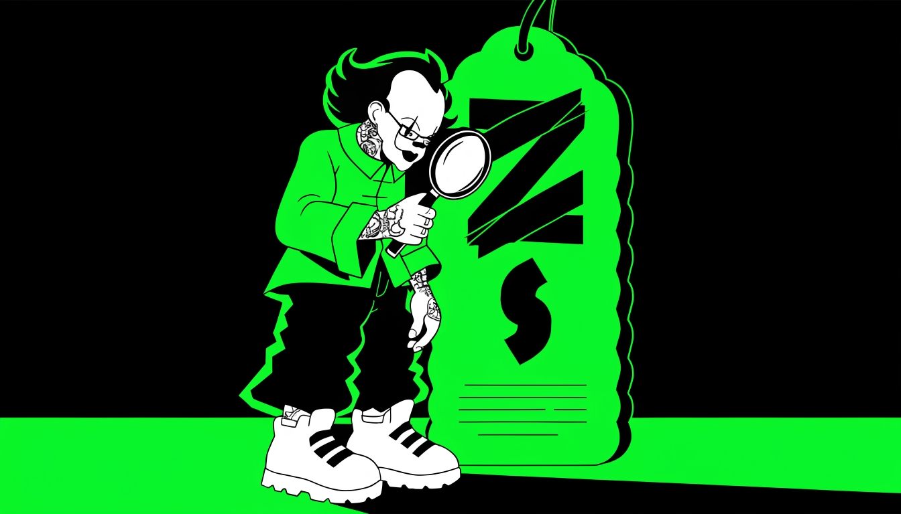
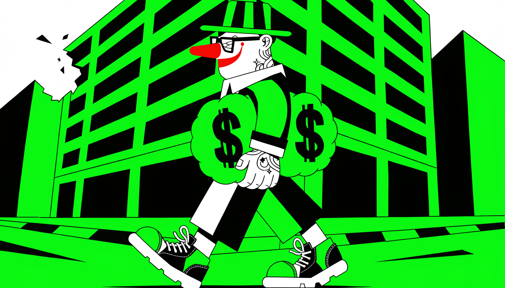
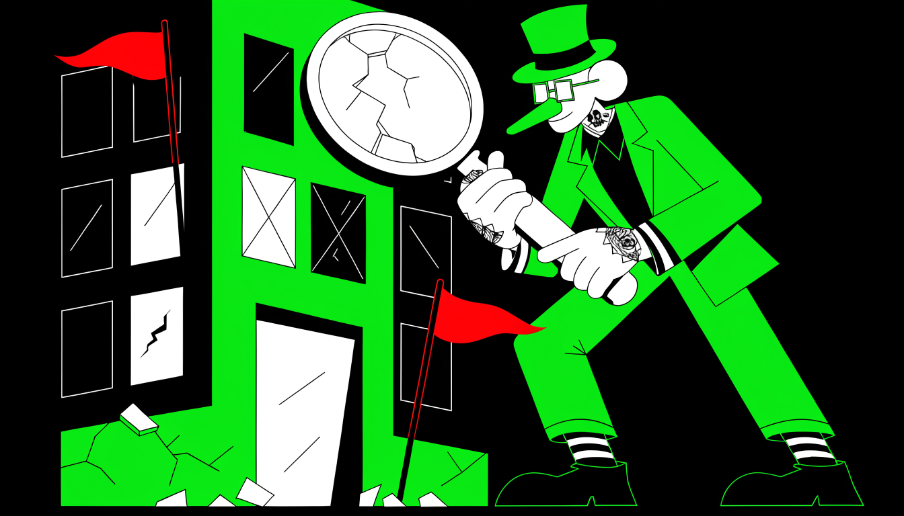
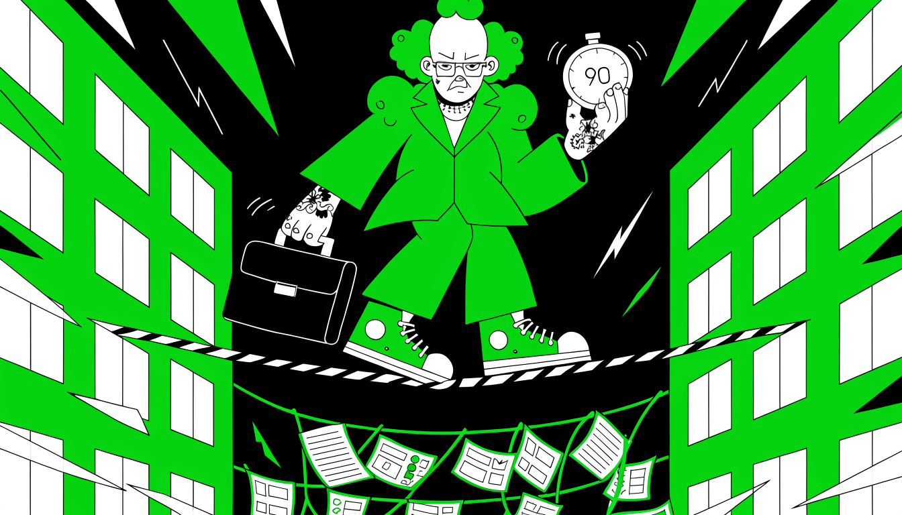

Разговор о деньгах: как устроены зарплатные вилки в IT, чем удалёнка отличается от офиса, какие цифры предлагают в разных странах и как торговаться за оффер. Пройдёмся по трендам 2024 года и ловушкам в вакансиях. Финальный вопрос — BigTech или стартап — будем решать, опираясь на реальные данные, а не на мечты.

## Обман в вакансиях: зарплатные вилки и скрытые условия

По статистике, **81% соискателей сталкиваются с обманом** при указании зарплаты в объявлениях о работе. Вторая цифра ещё показательнее: 60% кандидатов готовы согласиться на условия ниже заявленного минимума вилки. Работодатели об этом прекрасно знают — и пользуются.

Классическая схема выглядит так. В вакансии стоит привлекательный диапазон — **от 80 до 150 тысяч рублей**. На деле стартовый оклад — это минимум вилки, те самые 80 тысяч. Верхняя планка — теоретическая возможность, которую «один раз в 2016 году одна девчонка получила».

Достижение максимума обещают «со временем» — через год, два или три, «всё зависит от вас».

Вторая схема — умолчание. На первичном контакте HR-специалист делает акцент на максимуме вилки и прячет низкий базовый оклад, не раскрывает критерии достижения верхней планки, а неудобные вопросы уводит в разговор о «карьерном росте» вместо конкретики.

Третья — подмена условий на финальном этапе. По телефону называют привлекательную цифру, кандидат тратит время на дорогу и собеседование, а в конце встречи выясняется: «зарплатная вилка на сайте устарела, сейчас платим в два раза меньше». Несколько часов жизни соискателя потрачены — и потрачены намеренно.

Защититься помогают прямые вопросы при первом же контакте:

- какой точный стартовый оклад на испытательном сроке;
- из чего складывается верхняя планка вилки — оклад, бонусы, переменная часть;
- какие конкретные условия нужно выполнить, чтобы дойти до максимума;
- сколько времени в среднем занимает рост до верхней планки.

Перед очной встречей отдельно уточните, что условия вакансии не изменились с момента публикации, — один этот вопрос отсекает трюк с «устаревшей вилкой» и экономит вам несколько часов дороги и разговоров.

И даже поймав компанию на обмане, держите себя в руках. Грубость и пренебрежение к HR-специалисту закрывают двери к высокооплачиваемым позициям. Рынок труда узок, репутация имеет значение — и расходится она по рынку быстрее, чем резюме.

## Вилки зарплат на валютной удалёнке: middle–senior

Проще всего стартовать в валютной удалёнке через рекрутинговые агентства-прослойки. Базовый диапазон для middle-разработчика на этом пути — **от 2 000 до 5 000 $** в месяц, и для многих это уже заметно выше, чем 100 000 рублей в российских компаниях.

Прослойка берёт на себя всю организационную работу: вы получаете оффер — остальное делают они. Помогают с документами, вплоть до того, что не потребуют справку о налоговом резидентстве, если не хотите заморачиваться. Организуют созвоны в удобное время, ведут переговоры с клиентом, рекламируют вас перед заказчиком, поддерживают на всех этапах собеседований.

За этот сервис агентство закладывает комиссию 15–20% сверху от вашей ставки: хотите 500 $ в день — клиенту вас продадут примерно за 600 $. То есть свою ставку вы получаете целиком, наценка посредника ложится на заказчика.

Дальше цифры растут вместе с уровнем. Middle+ с сильным английским и умением презентовать себя выходит на **7 000–8 000 $** в месяц — как через прослойки, так и по прямым контрактам, зависит от конкретной ситуации. Для senior-разработчиков диапазон расширяется до **8 000–16 000 $**, а в горячих нишах вроде блокчейна и AI потолок достигает 50 000 $ в месяц.

Спрос на разработчиков остаётся стабильным, хотя и немного ниже золотого периода 2020–2021 годов, когда офферы приходили буквально каждый месяц. Компании активно ищут людей, особенно в дефицитных стеках вроде Go, но планку требований не опускают.

Решают четыре вещи: грамотно оформленный профиль, хороший английский, умение продать свой опыт на скрининге и способность чётко описать свои достижения.

С джунами история отдельная: чистых новичков на контрактную работу практически не берут, минимальный порог входа начинается с уровня middle. До этой отметки остаётся набирать опыт и подтягивать английский к будущим скринингам.

## Сравнение зарплат по странам: Европа и Ближний Восток

Одна и та же удалённая позиция стоит по-разному в зависимости от того, в какой стране сидит работодатель. Лидер по ставкам — Англия: сказывается фунт стерлингов, самая дорогая валюта среди европейских. Когда HR из Великобритании спрашивает о желаемой ставке, можно сразу называть цифру в фунтах — это воспринимается нормально.

Европейские рекрутеры работают в евро, российские — в рублях, поэтому полезно заранее понимать, в какой валюте думает собеседник, и называть цифры на его языке.

Восточная Европа — другая история. Компании из Чехии, Румынии и Польши традиционно предлагают более скромные условия: страны бывшего социалистического блока сохранили особенность платить меньше, а требовать больше. На собеседовании в польскую компанию готовьтесь к глубокой проверке знаний Go — гонять будут всерьёз.

При этом оффер, скорее всего, окажется в диапазоне **6–7 тысяч евро** в месяц для senior-разработчика. Строгость отбора и щедрость оффера, как выясняется, вещи независимые.

Западная Европа щедрее: ставки здесь ближе к **10 тысячам** в месяц. Разница с восточными соседями заметная, поэтому страну работодателя имеет смысл выяснять так же рано, как стек и грейд.

Ближний Восток добавляет картине разнообразия. Опыт работы с компаниями региона, включая Израиль, показывает самые разные предложения: отдельные израильские стартапы, особенно в нишах вроде блокчейна, готовы платить до **15 тысяч евро** в месяц. Это специфические кейсы, а не средняя температура по региону — но они случаются.

Отсюда практический совет: не отсекайте страны из списка заранее. Опыт работы более чем с 10 странами показывает, что интересные предложения приходят откуда угодно — и из дорогой Британии, и из «скромной» Восточной Европы, и от ближневосточных стартапов.

Флаг компании подсказывает вероятную вилку, но не решает за вас, где окажется лучший оффер.

## Оффер на 700 тысяч рублей: реальные цифры валютных удаленок

Оффер на **700 тысяч рублей** — реальная цифра с рынка валютных удалёнок, и пришла она из беттинга, то есть gambling-индустрии. Эта сфера традиционно предлагает удалёнщикам самые высокие зарплаты, так что самые громкие суммы стоит искать именно там.

Ориентиры по нишам для опытных специалистов выглядят так. Самая массовая ниша среди работодателей с валютными удалёнками — финтех: таких компаний на рынке больше всего, поэтому и вероятность получить оффер именно оттуда выше. Распространённый уровень в финтехе — **6–7 тысяч EUR** в месяц с учётом налогов.

Беттинг и смежные области начинаются от **7 тысяч USD** и идут выше. Встречаются и другие направления — скажем, ad-tech, рекламные технологии, — но их доля заметно меньше. Ниша сама по себе двигает вилку: беттинг платит больше, чем классический продуктовый стартап, за те же ваши навыки.

Высокие предложения не появляются случайно — за ними стоят три вещи. Накопленный опыт и навыки: годы прокачки нужного стека и есть фундамент сильного оффера, без него разговор о больших цифрах не начнётся. Открытость новым возможностям: активное присутствие в профессиональной среде, нетворкинг, готовность откликаться на предложения.

На практике это означает профиль, по которому вас легко найти, живые контакты в индустрии и привычку отвечать на входящие даже тогда, когда на текущем месте всё устраивает. И ниша работодателя, о которой выше: выбирая индустрию, вы во многом выбираете и вилку.

Можно сказать, что свою роль играет удача, — и она действительно играет. Но приходит удача к подготовленным: не будь нужных компетенций и активной позиции, воспользоваться высоким оффером просто не получилось бы. Так что рецепт скучный: прокачивать стек, держать профиль живым и не прятаться от рекрутёров — а удача подтянется.

## Финансовая подушка как основа уверенности

Посреди собеседования вам меняют условия: обещали оклад, а на столе оказывается ГПХ без фиксированной части. Или потенциальный начальник с первых минут общается свысока, а то и откровенно хамит. Или вы просто чувствуете, что предложенные условия неприемлемы.

В каждой из этих ситуаций у вас есть право встать и уйти — но реально воспользуетесь вы им только тогда, когда за спиной лежит **запас денег минимум на несколько месяцев жизни**.

Финансовая подушка безопасности — реальный инструмент, который меняет вашу позицию на рынке труда. С ней вы перестаёте быть просителем с дрожащими руками и становитесь равным партнёром на переговорах — человеком, у которого есть выбор.

Разница видна ещё до всяких конфликтов: кандидат с запасом спокойно задаёт неудобные вопросы, берёт паузу на подумать и сравнивает предложения между собой. Кандидат без запаса кивает на всё подряд — горящие сроки заставят согласиться на что угодно.

Терпеть хамство и переигранные на ходу условия в надежде «может, притрусь» — плохая ставка. Не притрётесь: потеряете здоровье, нервы и время, а приобретёте только разочарование. Смелость подняться и выйти посреди интервью не берётся из характера.

Ей нужен железобетонный фундамент за спиной — та самая личная подушка. Это единственное противоядие от необходимости хвататься за первое попавшееся предложение.

Понятно, что здесь замкнутый круг: запас прочности есть не у всех, а чтобы его накопить, как раз и нужно найти работу. Круг разрывается в одном месте — начать откладывать с той работы, которая уже есть или которую вы возьмёте сейчас, даже если она не идеальна.

Создание капитала — это ваш фундамент. Он даёт свободу выбора и превращает поиск работы из отчаянной гонки в осознанный выбор лучших условий: вы выбираете компанию так же, как она выбирает вас.

## Торг за зарплату после оффера

Получив оффер, можно попытаться улучшить условия — но подход зависит от вашей ситуации. Если работа нужна срочно и предложение страшно потерять, торгуйтесь осторожно и только по мелким деталям вроде валюты: скажем, «ошиблись» и указали доллары вместо евро.

Если же вы уже работаете и просто рассматриваете альтернативы, можно действовать смелее. Успех торга зависит от того, насколько сильно вы прошли собеседование. Бывали случаи, когда изначальный запрос в **500 долларов поднимался до 700 евро в день** — но только потому, что кандидат был готов отказаться, если условия не устроят.

На российском рынке торг может восприниматься как нелояльность. Компании настороженно относятся к кандидатам, которые после оффера начинают задавать много вопросов о дежурствах, графике или компенсациях при увольнении, — для них это красный флаг.

Офферы из-за попыток поторговаться реально теряют: российским работодателям важно видеть готовность работать на любых условиях.

Один из случаев: ученик получил оффер на **300 тысяч рублей** в серьёзную компанию. Он был свитчером — переходил из другого стека, — и это был единственный оффер после полутора месяцев собеседований. Решили не рисковать и принять условия как есть: набрать опыт, а через год-два выйти на рынок с чистой трудовой и выбирать уже из нескольких предложений.

### Что проверяют после оффера

При работе по контрактам (аналог ИП в России) подтверждение опыта — background check — запрашивают редко. Чаще это compliance-проверка: компания смотрит наличие ИП или ООО и запрашивает паспорт, документы компании, ВНЖ (редко) или договор аренды жилья за рубежом, а также профессиональную страховку.

Некоторые платформы, например Deal, требуют договор аренды, чтобы подтвердить, что вы находитесь не в России. За 100 долларов такой документ можно получить для Грузии или Армении.

### Профессиональная страховка

Последние 3–4 года компании стали чаще требовать профессиональную страховку разработчика. Формально она нужна, чтобы при падении продакшна по вашей вине компенсацию требовали не с вас, а со страховой; на практике даже при инцидентах выплат обычно не требуют.

Оформляется страховка в той же стране, где зарегистрирована ваша компания, и стоит от 1000 до 2000 долларов в зависимости от страны. Глубоко опыт страховые не проверяют — достаточно заполнить анкету и показать контракт с работодателем.

Для мидлов и джунов это существенная статья расходов, поэтому некоторые делают поддельные страховки — но это риск.

Иногда до проверок дело вообще не доходит: отказывают по формальным критериям. HR японской компании может отклонить кандидата, который на последних пяти местах работал меньше двух лет, — в их глазах это нелояльность к работодателю.

## Выбор первого оффера: BigTech vs стартап

Российский BigTech на старте обычно платит больше, чем зарубежная команда или стартап — особенно если эта команда сама работает с российскими клиентами. Для джуна, который выбирает между крупной российской IT-компанией и зарубежной командой, деньги — первый критерий сравнения, но далеко не единственный.

Второе, на что стоит смотреть, — зрелость процессов. В крупных технологических компаниях разработка, найм и адаптация выстроены и отлажены: новичка есть кому встретить и вести. В стартапах и небольших зарубежных командах процессы нередко «на костылях» — мало формализации, многое ещё только складывается.

Для опытного инженера такая свобода бывает плюсом, для джуна это риск: учиться придётся без опоры, и рядом может не оказаться никого, кто покажет, как надо.

Третий фактор — стабильность и легальность. Российский BigTech даёт официальное трудоустройство и стабильную работу на территории России. У зарубежных команд, даже работающих с российскими клиентами, юридическая структура бывает куда менее очевидной: кто и откуда вам платит, по какому договору и что будет в случае спора — вопросы, с которыми разбираться придётся вам самим.

Если сложить всё вместе, рекомендация для старта получается довольно определённой: на первой позиции junior-разработчика российский BigTech часто оказывается более выгодным выбором. Зарплата выше, процессы обучения и адаптации выстроены, карьерная траектория понятна, юридически всё прозрачно.

Для человека, который делает первые шаги в профессии, каждый из этих пунктов снимает по отдельной головной боли — и позволяет тратить силы на рост, а не на борьбу с хаосом вокруг.

Стартапы и зарубежные команды при этом из картины не исчезают. К ним имеет смысл присмотреться позже, когда появится опыт и вы либо сможете самостоятельно выстраивать процессы, либо захотите получить принципиально другой опыт работы.

К тому моменту сырые процессы будут для вас не ловушкой, а условиями задачи, которые вы принимаете сознательно.

## Проверка работодателя перед оффером: красные флаги

Собеседуют не только вас — вы тоже собеседуете компанию, и полчаса проверки перед подписью экономят месяцы работы в плохом месте. Начните с отзывов: Dream Job, Хабр Карьера, для зарубежных — Glassdoor. Один злой отзыв ничего не значит, а вот повторяющиеся жалобы на задержки зарплаты, текучку и самодурство руководства — это система, а не эмоции уволенного.

Дальше — юрлицо. По российской компании пробейте ЕГРЮЛ через Контур.Фокус или аналог: возраст компании, судебные дела, налоговые задолженности, не висит ли на директоре десяток фирм-однодневок. Компания, зарегистрированная три месяца назад и уже нанимающая сеньоров на большие деньги, — повод задавать вопросы, а не радоваться офферу.

Красные флаги видны ещё до проверки реестров. Вечная вакансия, которая висит месяцами и открывается снова через неделю после закрытия, часто означает, что позицию держат для резерва, а не для найма. Тестовое задание на три дня, подозрительно похожее на реальный модуль их продукта, — это попытка получить бесплатную работу.

Давление «оффер сгорит завтра, решайте сейчас» — приём, чтобы вы не успели подумать и проверить. Нежелание обсуждать деньги и условия на созвоне, уход от прямых вопросов про переработки и оформление — всё это считывается заранее.

Для валютной удалёнки добавляется своя проверка: кто именно вам платит и по какому договору. У зарубежных команд, особенно у компаний-прослоек, юридическая структура бывает намеренно мутной — разбираться, что будет в случае спора, придётся вам, и лучше до подписи, а не после.

Правило простое: чем сильнее вас торопят и чем расплывчатее отвечают на конкретные вопросы, тем внимательнее смотрите. Хороший работодатель спокойно переживёт вашу проверку и ответит по делу. Тот, кто нервничает от вопроса про юрлицо и график, показывает вам будущее заранее — грех не посмотреть.

## Контроффер: как реагировать на удержание

Вы приносите заявление, а руководитель вдруг находит и деньги, и повышение, и обещание, что «теперь всё будет по-другому». Это контроффер, и относиться к нему стоит трезво. Наблюдение, которое из года в год подтверждается на рынке: большинство принявших контроффер всё равно уходят в течение полугода-года — просто теперь по инициативе работодателя или на своих условиях, но позже и с осадком.

Почему контроффер опасен. Если деньги «вдруг нашлись» под угрозой вашего ухода, значит, вам недоплачивали ровно до этого момента — и запомнят это не вам в плюс. В глазах компании вы теперь человек, который одной ногой за дверью: в следующую волну оптимизации ваше имя всплывёт одним из первых.

И главное — если вы уходили не только из-за денег, а из-за задач, роста или конкретного руководителя, прибавка к зарплате эту причину не лечит. Через три месяца вернётся всё то же самое, только уже без запасного оффера в кармане.

Есть узкий случай, когда контроффер можно рассмотреть: вас в компании устраивает вообще всё, кроме зарплаты, прибавку зафиксировали письменно, а не пообещали на словах, и вы верите, что после этого разговора к вам не изменится отношение. Даже тогда взвешивайте осадок от того, что нормальные деньги пришлось выбивать ультиматумом.

И тактическая деталь: не используйте чужой оффер как блеф, чтобы выбить прибавку на текущем месте, если уходить на самом деле не готовы. Иногда в ответ спокойно принимают вашу отставку — и вы остаётесь без обеих позиций. Если пошли с заявлением, будьте готовы, что его подпишут.

## Испытательный срок: первые 90 дней

Оффер — не финиш, а старт нового отбора. По Трудовому кодексу испытательный срок в России — до трёх месяцев (до шести для руководителей), уволить в этот период проще: достаточно уведомить за три дня. При этом оплата на испытательном должна быть полной — занижать её незаконно, хотя некоторые компании этим грешат.

И работает этот срок в обе стороны: не только вас проверяют, но и вы проверяете, туда ли пришли.

Что делать в первые 90 дней. Первым делом договоритесь с руководителем, что будет считаться успехом к концу срока, — без этого вас оценят по неизвестным вам критериям. Дальше ищите быстрые видимые победы: небольшая, но доведённая до конца задача в первые недели говорит о вас больше, чем месяц молчаливого погружения.

Не сидите на блокерах в одиночку из страха показаться глупым — вопрос вовремя ценится выше, чем тихий простой. И знакомьтесь с командой и смежниками: связи внутри компании потом решают не меньше, чем код.

Одновременно смотрите по сторонам. Испытательный срок — законное время оценить работодателя без больших потерь. Если обещания с собеседования разошлись с реальностью, вокруг хаос или токсичность, уйти сейчас проще и дешевле, чем через год с записью в трудовой. Расхождение слов и дела в первый месяц редко исправляется само.

Для валютной удалёнки и работы по контракту испытательный период тоже есть, но юридической защиты у вас меньше: расторгнуть договор подрядчика обычно можно быстрее и с меньшими обязательствами сторон. Тем важнее в первые недели зафиксировать ожидания письменно и не расслабляться, приняв оффер за победу. Настоящая работа начинается здесь, а не в день, когда вы подписали предложение.
