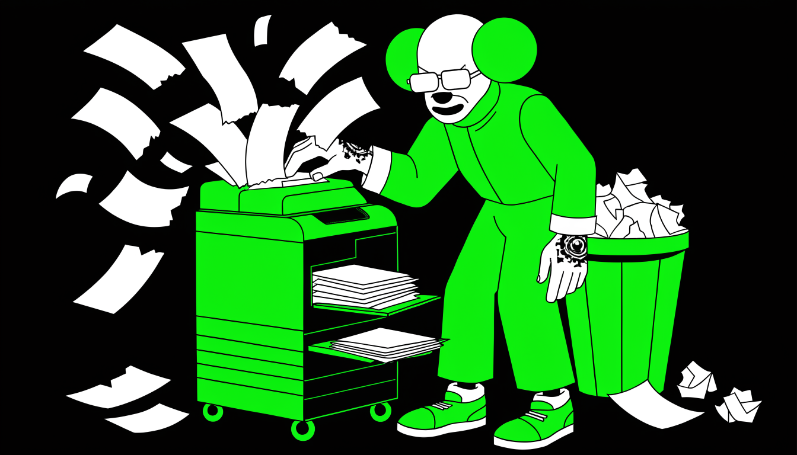

На старте поиска всё упирается в резюме — это ваш главный инструмент. Внутри — как собрать документ, который зацепит рекрутера: структура и длина, персонализация под конкретную вакансию, правила безопасности при публикации. Отдельно — типичные ошибки и тонкости позиционирования, чтобы опыт работал на вас, а не против.

## Структура идеального резюме: 1-2 страницы, результаты наверху

Работодатель добирается до резюме не сразу: сначала он оценивает сопроводительное письмо и смотрит, готов ли соискатель выполнить первичные действия — заполнить анкету, ответить на вопросы, сделать тестовое. Зато дальше резюме становится первым серьёзным фильтром отбора, и вот его читают уже всерьёз.

Поэтому документ должен быть ёмким и содержательным: каждая строка либо работает на вас, либо занимает место.

Сначала об объёме. Даже если опыт богатый, не разворачивайте «портянку» на 10 страниц. Идеал — **одна страница**, максимум две. Текста по минимуму: оставляйте только самое важное, остальное режьте — рекрутер должен ухватить суть с одного прохода по странице.

Теперь о типовой ошибке, которую совершает большинство кандидатов, — перечислении должностных обязанностей. Рекрутеры на них внимания не обращают: список функций просто «проскальзывает взглядом», это стандартная информация, которая мало говорит о вас как о специалисте. Обязанности у людей на одной должности примерно одинаковые — отличают вас результаты.

Конкретные результаты на последних должностях — самая свежая и актуальная информация о вас, и её место наверху резюме; обязанности можно кратко упомянуть ниже. Описывайте достижения максимально фактично: каких итогов достигли, за какие сроки, какую пользу принесли компании.

Хорошо работает сравнение «до и после»: что было в компании, когда вы пришли, и что стало после вашей работы — скажем, через два года. И если можете показать, кому именно помогли ваши действия, — покажите: адресный результат убедительнее безадресного.

Отдельная валюта на нынешнем рынке — стабильность в сложных условиях. Работодатели особенно ценят кандидатов, которые выдавали ровный результат при высокой нагрузке, в ситуации неопределённости, при дефиците ресурсов, во время изменений в компании.

Есть такой опыт — обязательно отразите его в резюме: сейчас для работодателей это очень важно.

## Целевой диапазон лет опыта: держитесь в рамках

Скажем, вакансия требует 3–6 лет опыта мидл-специалиста — тогда ровно этот период и должен быть отражён в основном разделе вашего резюме, не больше и не меньше. Грамотно распределить опыт между основным разделом и блоком «О себе» — один из самых важных советов по составлению резюме вообще: такая структура обходит множество технических фильтров и заметно повышает шансы на отклик.

Логика простая. В основной раздел опыта включайте только ту работу, которая точно попадает в целевой диапазон лет, соответствует требуемому стеку технологий, относится к нужной сфере деятельности и напрямую связана с обязанностями из описания вакансии.

Четыре условия, и все обязательные: что мимо хотя бы одного — из основного раздела убирайте.

Убирайте в блок «О себе». Туда уходит опыт, который выходит за рамки целевого диапазона — слишком ранний или, наоборот, слишком поздний, — связан с другим технологическим стеком, относится к смежным, но не целевым проектам или получен в компаниях не той специализации.

Хватит коротких формулировок вроде «работал над проектами в другом стеке» или «участвовал в разработке для банковской сферы». Туда же отправляется весь дополнительный опыт, который сыграет плюсом, — работа в банке, знакомство с определённой отраслью. Он не пропадает: рекрутер его увидит, просто основному разделу он не мешает.

Смысл этой хирургии в том, что резюме сначала проходит автоматические фильтры систем подбора, и лишние годы или чужой стек в основном разделе легко превращаются в отсев из-за «несоответствия» стажа — машине не объяснишь, что десять лет опыта для вилки 3–6 лет не порок. Правильно распределённый опыт проходит фильтры, показывает соответствие конкретным требованиям вакансии и выделяет вас среди других кандидатов: резюме читается как точный ответ на вакансию, а не как полная биография.

## Проблема позиционирования: одно резюме vs. несколько ролей

Сегодня вы проектный менеджер, завтра продакт, послезавтра аналитик — и всё это в одном документе. Нанимающий менеджер открывает такое CV и не понимает, кого видит перед собой. Универсальность убивает позиционирование: кажется, что широкий профиль расширяет воронку откликов, а на деле резюме превращается в кашу.

Проблем здесь три. Первая — размытый фокус: когда в резюме смешаны разные роли, рекрутер не может быстро определить, подходите ли вы под конкретную вакансию, а разбираться подолгу никто не станет. Вторая — конкуренция: плотность кандидатов на рынке сейчас высокая, и приоритет получают те, кто чётко заявляет свою экспертизу; пока универсал объясняет, кто он такой, узкий специалист уже забирает приглашение.

Третья — софт-скиллы: мало обладать навыками, нужно уметь показать их на интервью. Если вы готовили только технические кейсы, а про решение конфликтов молчите, другие кандидаты вас обойдут.

Лечится это разделением. Создавайте отдельные резюме под каждую роль: одно для позиций проджекта, другое для продакта, третье для аналитики. В каждом подчёркивайте релевантный опыт, достижения и скиллы — та же карьера, просто повёрнутая к вакансии нужной стороной.

Один и тот же проект для проджекта раскрывается через сроки и управление командой, для продакта — через эффект для продукта.

Параллельно готовьте кейсы — и хардовые, и софтовые. Заранее напишите истории о том, как вы разруливали конфликты, управляли изменениями, договаривались со стейкхолдерами: в условиях жёсткой конкуренции такие рассказы стали обязательным условием, и сочинять их на ходу посреди интервью поздно.

И работайте над личным брендом и нетворком, особенно если планируете вертикальный рост. Резюме, даже идеально сфокусированное, доводит до определённого карьерного этапа — дальше без репутации и связей двигаться будет сложно, наверх выводят люди, которые вас знают.

## Обязательно добавьте фотографию для доверия

Когда HR листает десятки откликов подряд, резюме без фото выглядит на общем фоне менее живым и будит сомнения: вдруг это дубликат, накрутка или неполная версия профиля? Фотография в резюме — инструмент повышения доверия, и срабатывает он раньше, чем рекрутер дочитает первую строку про ваш опыт.

Разграничим сразу: на алгоритмы роботов-парсеров фото не влияет никак — машина сверяет теги и стаж. Решающим снимок становится на следующем шаге, когда отклик попадает к живому человеку. Человеческое лицо психологически успокаивает рекрутера и создаёт ощущение открытости кандидата.

Дело не во внешности: фото сигналит о готовности быть публичным и контактным, а это качество текстом показать почти нечем.

Особенно критична фотография для ролей с внешним общением — бизнес-аналитиков, системных аналитиков, продакт-менеджеров. Эти специалисты выступают мостом между разработкой и заказчиками, представляют лицо компании перед внешними клиентами, участвуют в продажах решений и переговорах.

Нанимая человека на такую позицию, компания хочет заранее видеть, кого посадит напротив клиента, — и пустой квадрат вместо лица здесь играет против кандидата: работа состоит из встреч и переговоров, прятаться на этапе резюме поздно.

Требований к самому снимку немного, но они жёсткие: профессиональный портрет — не селфи и не вырезка из группового фото. Фотография должна быть актуальной, чтобы при встрече вас узнали, и соответствовать позиции, на которую откликаетесь: рекрутер невольно примеряет снимок к роли.

И циничное наблюдение напоследок: даже если вы «подкручиваете» опыт в резюме, фото добавляет профилю человечности и снижает подозрения. Слегка приукрашенный опыт с живым лицом рядом вызывает меньше вопросов, чем анонимный профиль с безупречной карьерой.

Для ролей, где работа строится на коммуникации, фотография — базовый элемент доверия, такой же обязательный, как контакты.

## Резюме на английском: структура и правила

В английском резюме всё держится на двух разделах — About и Skills.

### Блок About

About («О себе») — сжатое резюме всего опыта в два абзаца. Задача — показать рекрутеру, что вы закроете типовые задачи рынка: фичи, спринты, релизы, баги, работу в команде. Пишите нетехническим языком, понятным эйчару, чтобы он сматчил вашу задачу с вакансией.

Упомяните крупные проекты и компании, знание полного цикла разработки (Agile, Scrum), автономность и ответственность. Перечислять весь стек через «and» не надо — скиллы опишете позже в отдельном разделе.

Хорошо заходят хайповые задачи вашей ниши. Backend — поддержка highload, балансировка, распил монолита на микросервисы, оркестрация, немного DevOps. Frontend — ускорение загрузки, улучшение UX, компонентные системы, модуляризация. iOS — следование гайдлайнам Apple, миграция API, SwiftUI, работа над Crash Free Rate, новые фичи iOS.

QA — сложные тест-кейсы, общение с продактом, автотесты, настройка регресса. Не знаете, что сейчас на хайпе, — загляните в технические чаты сообщества или чат «ОМ-резюме», посмотрите чужие примеры.

Дальше — T-shape, смежные навыки: бэкенду, фронтенду и iOS — понимание CI/CD и автоматизация релизов, фронтендеру — ещё и базовая работа с Figma в помощь дизайнеру, любой роли — общение с заказчиком, сбор требований, формирование бэклога.

Пусть читатель видит: вы не «кнопкодав» и способны подменить смежные роли. Сюда же профессиональные хобби: победы в хакатонах, выступления с докладами, участие в конкурсах (например, от Telegram), контрибуты в Open Source, технический блог.

Проверять никто не будет — блог реально поднять за 5 дней из шаблона и наполнить статьями, пусть и сгенерированными. И командность: работа с командами любого размера, от соло до большой, менторство джунов, эффективное общение, страсть к IT, постоянное развитие, амбиции.

У читателя должно сложиться ощущение: вы живёте IT, обожаете работу и готовы брать ответственность за продукт.

Чему в About не место: локации, желаемой зарплате и требованию remote — обсудите их позже на собесе. Однородным эпитетам вроде «коммуникабельный, инициативный» — вместо них конкретные кейсы: «менторил 2 джунов», «предложил миграцию → метрика выросла на X%».

И сложному техническому языку. ChatGPT — редактор, а не автор: причешет английский и найдёт ошибки, но целиком сгенерированный текст палится сразу — размытый, раздутый буллшит.

### Раздел Skills

Это облако тегов для автопарсера и рекрутера. Указывайте технологии по убыванию важности, от фреймворков до утилит. Лучше больше, чем меньше: даже устаревшие Objective-C или Java могут всплыть в поиске. Добавьте архитектуры и паттерны (MVVM, MVI, TCA для iOS) и популярные библиотеки — не те, что собрали 3 звезды на GitHub.

Мало места — впишите теги белым шрифтом размера 1: парсер их считает, рекрутер не видит. Имена крупных компаний (Apple, Google) можно спрятать в метаданные PDF.

## Анализ вакансий по отраслям: метод подготовки резюме

Возьмите пять отраслей, где больше всего вакансий по вашей специальности: две основные индустрии с максимальной концентрацией предложений плюс три под компании, где вам самим хотелось бы работать. У системных аналитиков топ почти всегда возглавляют информационные технологии и финтех, у бизнес-аналитиков на второе место обычно выходит ритейл.

Дальше — сбор материала. По каждой отрасли откройте раздел вакансий на площадках поиска работы и соберите минимум 25 объявлений. Выписывайте в заметки детали: формулировки требований и обязанностей — это сырьё для будущего резюме.

И обновляйте анализ каждые две недели: за такой срок появляются свежие вакансии с новыми формулировками, под которые настроены ИИ-фильтры работодателей, и без актуализации ваше резюме начнёт автоматически отсеиваться алгоритмами.

С приходом ИИ-отбора поменялась сама механика адаптации. Раньше резюме насыщали отдельными словами-маркерами из вакансий. Сейчас алгоритмы ищут целые словосочетания и фразы, поэтому из объявлений нужно собирать устойчивые формулировки и встраивать их в описание своих проектов — теми же фразами, которыми работодатели пишут объявления.

Помогают специальные промпты для ChatGPT: они переформулируют ваш опыт в нужных терминах. Поиск по резюме стал менее точным, зато алгоритмы лучше распознают крупные смысловые блоки — и доступ к ИИ для подготовки материалов теперь есть у соискателей тоже.

Отдельно проработайте последнее место работы: в алгоритмах отбора последнему опыту присвоен максимальный вес, поэтому его описание стоит вычитывать тщательнее всего. Здесь два требования. Первое — максимальная сложность технологий: для системного аналитика это очереди сообщений (Kafka, RabbitMQ), асинхронное взаимодействие, микросервисная архитектура, кэширование и другие продвинутые подходы.

Второе — полный стек: перечислите все релевантные инструменты, с которыми работали. Проверить, насколько резюме попадает в требования, можно вручную или теми же специальными промптами для ИИ.

## Правило подстройки описания работы под вакансии

До 2020 года IT-рынок был снисходительнее: компании могли позволить себе инвестиционные проекты и дополнительные команды, а к кандидатам присматривались без особой придирчивости. Потом случился бум цифровизации, следом — высокие кредитные ставки и инфляция, и бизнес перешёл в режим оптимизации.

Проекты, не приносящие прибыль, сокращают, кандидатов оценивают жёстче. По требовательности рынок вернулся к стандартам, существовавшим до 2020 года: нужно максимально точное соответствие опыта требованиям конкретной позиции.

Первичный отбор при этом делают AI-алгоритмы, и читают они резюме неравномерно: особое внимание достаётся описанию последней должности. Оценивают три вещи. Технологический стек — конкретные инструменты, которыми вы владеете; для системного аналитика это очереди сообщений (Kafka, RabbitMQ), асинхронное взаимодействие, микросервисная архитектура, механизмы кэширования.

Сложность задач — уровень технической экспертизы, продемонстрированный на последнем месте работы. И совпадение со стеком вакансии — насколько ваши технологии и опыт ложатся на требования конкретной позиции.

Отсюда принцип подстройки: описание последней работы должно максимально совпадать с вакансией и по технологическому стеку, и по конкретным задачам. Компании ищут специалистов с точечным опытом под конкретные проекты, а не «сильных вообще».

Если в вакансии стоят микросервисы и Kafka, а у вас в резюме абстрактное «участвовал в разработке систем», алгоритм совпадения не увидит — и до человека вы не дойдёте.

Проверить соответствие можно двумя способами. Первый — вручную: положите резюме рядом с текстом вакансии и сверьте, какие технологии и задачи из требований отражены в вашем описании, а какие потерялись. Второй — отдать ChatGPT: он разберёт, насколько ваш опыт попадает в требования конкретной позиции, и сделает это быстрее.

В любом случае перед началом активного поиска резюме должно пройти три стадии проверки — и только после этого имеет смысл выходить на рынок с откликами.

## Как персонализировать резюме под конкретную вакансию

Компания ищет менеджера для работы с холодной базой клиентов, а вы отправляете стандартное письмо про успехи с тёплой базой. Работодатель видит несоответствие мгновенно: кандидат не понял, какую задачу нужно решить, и не объяснил, чем именно будет полезен. Это главная ошибка при отправке резюме — один и тот же шаблон на все вакансии.

Стандартное сопроводительное без привязки к конкретной позиции выдаёт массовую рассылку: человек нажимает «отправить» сотни раз, не вникая в суть вакансии. Работодатель распознаёт такой подход по первому же абзацу — и даже если вам кажется, что вы стараетесь и честно работаете над откликами, это трата времени впустую: такие письма просто игнорируют, сколько бы их ни было.

Бороться работодатели готовы за других кандидатов — за тех, кто чётко формулирует конкретный результат для компании. Такой кандидат знает собственные показатели и метрики, внятно отвечает, как именно повысит прибыль, и понимает, на чём способен минимизировать затраты. Результат для бизнеса измеряется деньгами: либо вы их приносите, либо экономите.

Механика персонализации простая. В резюме — достижения с цифрами и фактами. В сопроводительном письме — те результаты из вашего опыта, которые напрямую закрывают боли компании, названные в описании вакансии: не весь послужной список, а прицельная выборка под конкретную позицию.

Скажем, ищут бизнес-тренера, чтобы построить обучение продавцов розничной сети и поднять их продажи, — возьмите из резюме конкретный факт о похожем опыте: как вы с нуля выстроили систему обучения и на сколько процентов после этого выросли продажи.

Один такой факт, попавший в задачу компании, работает сильнее целой страницы общих регалий.

Такой отклик читается совсем иначе: вы точечно откликаетесь на позицию, где действительно можете принести максимальную пользу, — и работодатель считывает это уже с первых строк письма.

## Ошибки в сопроводительных письмах: копипаст вместо персонализации

Если ваше сопроводительное письмо можно без единой правки отправить в любую компанию — его, скорее всего, пролистают. Отсутствие привязки к конкретному работодателю читается уже с первых строк и хоронит отклик раньше, чем рекрутер вообще доберётся до сути. Рассылать одинаковые письма всем подряд — одна из главных ошибок соискателя.

Универсальный шаблон виден сразу — особенно если письмо ещё и сгенерировано искусственным интеллектом: одинаковые обороты, одинаковая структура, ноль конкретики. Таких резюме и писем рекрутеру приходят сотни, и шаблонные тонут в общем потоке: глазу не за что зацепиться, ничто в тексте не говорит «этот человек писал именно нам, а не всем сразу». Отвечать на такое письмо нет ни повода, ни желания.

Классический провал выглядит так. Компания ищет менеджера по продажам для работы с холодной базой клиентов, а кандидат присылает стандартное письмо о достижениях в работе с тёплой базой. Вывод работодателя очевиден: человек не разобрался в требованиях вакансии и гонит массовую рассылку по принципу «скопировал-вставил-отправил». Такое резюме, скорее всего, даже не откроют.

Лекарство одно — персонализация каждого письма под конкретную компанию и должность. Изучите требования вакансии и подстройте описание навыков и достижений именно под них: если в объявлении названа конкретная задача, письмо должно отвечать на неё, а не на абстрактную «работу мечты».

Покажите, что понимаете специфику компании и можете принести конкретную пользу на этой позиции. И вычистите универсальные фразы, которые подошли бы любому работодателю, — именно они первыми выдают копипаст, даже когда всё остальное написано аккуратно.

Пара деталей, взятых из текста вакансии и вплетённых в письмо, уже выделяет его из потока.

Да, персонализация требует времени: осмысленный отклик пишется дольше шаблонного. Зато шансы получить ответ вырастают многократно — компании ценят кандидатов, которые осознанно выбрали именно их, а не разослали резюме сотнями.

## Сопроводительное письмо и накрутка опыта

Писать сопроводительное письмо при отклике через LinkedIn, особенно кнопкой Easy Apply, — пустая трата времени. Резюме всё равно упадёт в общую кучу, где его могут и не прочитать. Cover letter оправдан в двух случаях: компания явно требует его через форму на своём сайте, или вы пишете напрямую тимлиду либо менеджеру — тогда короткое личное сообщение в LinkedIn работает как мини-презентация.

Кастомизировать резюме под каждую вакансию — бред: отправляйте стандартное и двигайтесь дальше. И если AI от LinkedIn или очередной инструмент предлагает «приукрасить опыт под вакансию» — игнорируйте. Одно сильное резюме, разосланное массово, бьёт любую подгонку под конкретную компанию.

### Приукрашивать опыт можно — с умом

Добавляйте в профиль недостающие скиллы, если они часто мелькают в вакансиях: опыт доставки приложений в App Store, работа с конкретными технологиями. В формах LinkedIn отвечайте уверенно: «до хера лет опыта», «разрешение на работу есть», «очень хочу у вас работать» — многие вопросы там автоматические, и ваша задача — пройти фильтр.

Трогали технологию хотя бы пару месяцев — это уже опыт, не стесняйтесь выглядеть экспертом.

Граница проходит там, где начинается прямое враньё. Выдуманные проекты и компании вылезут на техническом собеседовании моментально. Десять лет опыта со Swift при языке, которому девять, — абсурд. Навыки, в которых вы не разбираетесь вообще, — верный способ провалить собес и потерять доверие.

### Накрутка и её легализация

Тактик накрутки существует около десяти, у каждой свои риски: от относительно безопасного переформулирования обязанностей ради усиления экспертности до завышения сроков работы на прошлых позициях и добавления функционала, которого фактически не было.

К каждой тактике прилагается вопрос легализации — как подтвердить написанное, когда за резюме возьмутся служба безопасности или HR. Совпадает резюме с трудовой книжкой — проверка пройдёт без сложностей. Расходится — объяснение и подтверждение продумывайте заранее.

Особенно это касается выпускников курсов, только входящих в IT, специалистов, меняющих направление, кандидатов с перерывами в стаже и фрилансеров, работавших без официального оформления.

Ваши данные давно не ваша собственность — они и так везде раскиданы. Поэтому не бойтесь светиться в комментариях под постами рекрутеров, откликаться на вакансии и писать людям. Конверсия откликов низкая: **на тысячу — 2–3 ответа**, так что решает не количество приукрашиваний, а количество касаний с живыми людьми.

Остальное — ремесло: оформить резюме под автоматические фильтры, выстроить общение с HR, подготовиться к проверкам и подать опыт максимально выгодно, оставаясь в рамках проверяемых данных.

## Накрутка опыта: не ложь, а градиент преувеличений

Накрутка опыта почти никогда не бывает выдуманной с нуля биографией. Обычно это градиент преувеличений поверх реального опыта: раздутые должности, дорисованный стек, метрики из воздуха, учебные проекты, поданные как коммерческие. Тактик такого приукрашивания около десяти — от безобидного переформулирования обязанностей ради усиления экспертности до завышения сроков на прошлых местах и функционала, которого фактически не было.

Понимать это стоит по одной причине: палится не отдельная слабость резюме, а их скопление. Карьерный пробел, фриланс, самозанятость, смена профессии, отсутствие GitHub, «слишком гладкое» резюме — каждый из этих признаков по отдельности не значит ничего.

У любого есть невинное объяснение, и опытный проверяющий сначала перебирает эти объяснения, а не хватается за подозрение. Заметным всё становится, когда рядом оказываются два-три независимых признака из разных плоскостей — особенно если жёсткая логическая нестыковка соседствует с общими, обтекаемыми формулировками.

Второй закон жанра — проверяемость решает больше, чем громкость. Заявление, к которому вы можете дать историю измерения, деталь процесса или артефакт, работает на вас. Заявление из воздуха — потенциальный вопрос, даже если звучит внушительно.

Скромное «сократил сборку с 40 до 12 минут» вызывает больше доверия, чем эффектное «ускорил всё в десять раз», которое невозможно проверить.

Дальше — как это устроено изнутри: сначала приёмы, на которых спотыкаются первыми, потом — способы замаскировать формат опыта, затем сигнатура правдоподобного резюме и то, как всё это проверяется на интервью. Полезно с обеих сторон стола: чтобы приукрашивать в рамках проверяемого и чтобы понимать, что именно у вас будут уточнять.

## На чём палятся первыми: даты, грейд, стек, метрики

Первая группа приёмов касается логики и содержания резюме — и спотыкаются на ней чаще всего.

Нестыковки в датах вскрываются простой арифметикой. Пересекающиеся full-time роли без объяснения, периоды, которые не дают заявленного суммарного стажа, «размытые» месяцы, прячущие короткие места, нереальное число крупных проектов за короткий срок.

Первое, что делает внимательный проверяющий, — складывает периоды и сверяет с цифрой стажа в шапке.

Грейд без подтверждения задачами — вторая классика. Senior, lead или architect в заголовке, а в описании исполнительские задачи: ни постановки задач, ни архитектурных решений, ни code review, ни менторинга, ни ответственности за production. Отдельно бросается в глаза джун-позиция, за которой сразу идёт «тимлид» без переходного этапа.

Раздутый стек выдаёт себя тем, что технологии перечислены, но ни в одном проекте не применяются. Маркеры — глаголы «использовал», «работал с», «участвовал» вместо конкретных задач, и стек, резко меняющийся между местами работы без переходного контекста.

Пустые формулировки — «высоконагруженные сервисы», «оптимизировал производительность», «улучшил процессы» — без масштаба, ограничений, команды и trade-offs. Такой текст похож на описание вакансии, а не на прожитый опыт.

Сомнительные метрики закрывают пятёрку: проценты без базы, периода и метода измерения, командный или продуктовый результат, присвоенный лично себе, подозрительно круглые и одинаковые цифры на всех местах работы.

Ни один из этих приёмов в одиночку резюме не топит. Но два-три из разных пунктов уже складываются в заметную картину, и на интервью по ним пойдут прицельные вопросы.

## Как маскируют формат опыта и подгоняют под вакансию

Вторая половина приёмов — про то, чем опыт является на самом деле и под что он причёсан.

Маскировка формата выглядит так. Непроверяемый работодатель: компанию нельзя идентифицировать — ни сайта, ни юрлица, ни публичного следа, а самый ценный опыт спрятан «под NDA» без даже обезличенного описания задач и масштаба.

Учебный проект под видом коммерческого: буткемп, пет-проект или стажировка поданы в разделе «опыт работы», хотя нет ни работодателя, ни заказчика, ни живых пользователей, ни команды с ревью — а за участие человек платил, а не получал оплату. Фриланс, склеенный в штат: разовые заказы выданы за непрерывный full-time, статус размыт, один заказчик оформлен как постоянный работодатель.

Подгонка под цель — отдельная группа. Домен под вакансию: заявлен финтех, медицина или e-commerce, но в тексте нет доменной терминологии, регуляторики и типичных интеграций — только универсальные CRUD-задачи. Резюме-эхо: слова из вакансии перенесены в резюме без подтверждения на уровне проектов, а summary — переформулированное описание позиции.

Расхождение с внешними следами: разные даты и должности в одной компании на разных площадках, опыт, которого не было в прошлой версии резюме, GitHub, созданный на днях, но поданный как многолетний. И отсутствие артефактов там, где они обязаны быть: заявленный open-source-вклад без репозиториев, публичные продукты без названий и роли.

Общий знаменатель у этой группы простой: маскировка почти всегда оставляет след сразу в нескольких пунктах. Стажировка, названная стажировкой, вызывает меньше вопросов, чем стажировка, переодетая в сеньорскую позицию, — потому что переодевание тянет за собой то непроверяемого работодателя, то дыру в датах, то пустой стек.

## Как выглядит правдоподобное резюме

У резюме, которому верят, есть узнаваемая сигнатура, и держаться её выгоднее, чем изображать скромность. Конкретные, проверяемые названия продуктов, команд, ролей и ограничений. Понятный карьерный рост без скачка «джун → лид за одну строчку».

Стек, привязанный к проектам и датам, а не сваленный в общий список. Ссылки на публичные артефакты: продукты, репозитории, доклады, статьи. И честное разделение форматов: штат, контракт, фриланс, стажировка, пет-проект, курс — каждый назван своим именем.

Отдельно про достижения. Работает формула «база сравнения плюс метод измерения плюс реалистичная зона влияния»: «сократил время сборки с 40 до 12 минут» вместо «ускорил всё в десять раз». И вот неочевидное: конкретика снижает подозрения, даже когда цифры скромные.

Честное «с 8 до 3 секунд» или «поднял покрытие тестами до 60%» вызывает больше доверия, чем «прирост производительности в разы» без единой опоры. Проверяемая деталь работает на вас; красивая, но висящая в воздухе цифра — против, потому что её нельзя подтвердить.

Отсюда рабочая логика для тех, кто приукрашивает опыт. Усиливать резюме нужно не громкостью заявлений, а их проверяемостью. У каждой строчки, за которой стоит история измерения, деталь процесса или артефакт, есть шанс пройти и автоматический фильтр, и живого собеседника.

Каждая строчка «из воздуха» — слабое место, которое всплывёт ровно в тот момент, когда вас попросят её раскрыть.

Практический ориентир: приукрашивание, которое держится на реальном фундаменте и подано конкретно, почти неотличимо от честного резюме — потому что по всем внешним признакам оно и есть проверяемое.

## На чём палится накрутка и как её проверяют

Подозрение вызывает не одиночный признак, а их кластер — два и больше из разных плоскостей: спорные даты рядом с грейдом без подтверждения, пустой стек рядом с непроверяемым работодателем. Одиночный сигнал грамотный проверяющий списывает на невинное объяснение; кластер он отрабатывает вопросами.

И отработка эта случается не на этапе резюме, а на интервью — поэтому к типовым приёмам проверки полезно подготовиться заранее.

Первый и главный — вопрос про метрику: как измеряли, какая была база, за какой период, какова именно ваша зона влияния. Человек с реальным опытом отвечает деталями процесса и компромиссами; тот, кто цифру дорисовал, — общими словами.

Если в резюме стоит «плюс 40% к производительности», история этого измерения должна быть готова заранее, иначе цифру лучше убрать до отправки.

Дальше по нарастающей: live-кейс или work sample по заявленному стеку вместо разговоров о нём; просьба нарисовать обезличенную схему архитектуры NDA-проекта — реальный автор системы делает это легко, без единого имени и секрета; контакт рекомендателя с конкретными вопросами о роли и вкладе; сверка дат по трудовой или справкам — с вашего согласия.

Есть и то, чего проверяющий делать не вправе: скрытый сбор данных, лазанье по закрытым соцсетям без согласия, вопросы про возраст, семью, национальность и здоровье. Столкнулись с таким — это уже сигнал в сторону работодателя.

Перед отправкой прогоните резюме по короткому чек-листу: стаж сходится арифметически, пересечений и размытых дат нет; грейд подтверждён задачами, а не словом в заголовке; у каждой заявленной технологии есть проект; у метрик есть база и период; работодателей можно идентифицировать, NDA-опыт описан обезличенно; учебное, фриланс и штат разделены честно.

Два и больше провала из разных пунктов — тот самый кластер, по которому пойдут вопросы. Лучше, если ответы вы придумаете раньше, чем их придумает собеседник.

## Последняя работа: максимальная сложность стека

Опытный специалист добавляет в резюме свежий курс — «основы SQL» или курс по требованиям для бизнес-аналитика — и его позиции в выдаче падают. Логика систем отбора, особенно построенных на алгоритмах и искусственном интеллекте, устроена так: последнее место работы — главный показатель, по которому ранжируется кандидат.

Актуальность опыта машина оценивает по самой свежей позиции, и базовый курс рядом с серьёзным стажем выглядит для неё противоречием. ИИ решает, что кандидат либо распыляется, либо пробует сменить направление и может «соскочить», — и снижает рейтинг такого резюме.

Человек-рекрутер, возможно, понял бы контекст: специалист углублял знания в смежной области. Искусственный интеллект интерпретирует это иначе, и резюме опускается в списке.

Отдельная история — репутация самих курсов. Агрессивные образовательные программы с завышенными обещаниями годами выпускали людей с одинаковыми резюме, малым набором реальных навыков и нереалистичными ожиданиями. Работодатели это запомнили, и сложилось негласное предубеждение: раньше упоминание курсов было плюсом, сейчас даже базовые программы обучения могут сигнализировать системе о неопытности или смене профиля.

Для опытных кандидатов это бьёт особенно больно — чем солиднее стаж, тем страннее смотрится рядом с ним вводный курс.

Отсюда три правила. Первое: убирайте из резюме упоминания курсов, включая сертификаты. Всё, что освоили на обучении, показывайте как навыки, полученные на работе. Второе: насыщайте последнюю позицию — именно в ней должны стоять самые сложные технологии, инструменты и проекты из тех, что соответствуют желаемой вакансии, потому что по ней алгоритм судит обо всей карьере.

Третье: избегайте образа ученика. Резюме должно транслировать уверенность и актуальный практический опыт, а не поиск нового направления.

Системы отбора стали строже, но адаптироваться к ним реально — если понимать логику их работы.

## Укажите английский B1/B2 по умолчанию

Пустая графа «английский» читается автоматикой однозначно: «не владеет». Не «не важно для этой роли» и не «забыл заполнить» — именно «не владеет». Многие кандидаты считают уровень языка необязательной строкой, если роль не требует активного общения, и это дорогая ошибка: без указанного английского B1 или B2 резюме отсекается автоматическими фильтрами ещё до просмотра человеком.

Механика простая. Крупные компании и рекрутинговые платформы гоняют кандидатов через автоматизированные системы отбора, и **фильтры по уровню английского там стоят по умолчанию**. Нет языка в резюме или уровень ниже порога — система исключает вас из выборки, и работодатель просто не увидит резюме, даже если по остальным критериям вы подходите идеально.

Поэтому ставьте английский B1–B2 по умолчанию — в том числе для вакансий в российских компаниях, где язык нужен лишь для чтения технической документации. Это не обман. Машинный перевод и ChatGPT давно позволяют работать с англоязычными материалами без свободного владения, а B1/B2 в резюме сообщает ровно то, что требуется: вы способны читать документацию и разбираться в терминологии.

Понимаете техдоки, читаете со словарём — этого достаточно, чтобы честно указать такой уровень.

Опасение «а вдруг попросят говорить» снимается просто. Если компании действительно нужен разговорный английский — например, для международных проектов, — это выяснится на собеседовании, но первичный отбор вы к тому моменту уже пройдёте, а он и был задачей.

Хуже обратная ситуация: сильный кандидат с пустой графой языка не доходит даже до звонка рекрутера.

Даже если английский давно не практиковали, освежить базовые навыки для прохождения собеседования реально за 1–2 недели. Сначала нужно на это собеседование попасть — а без указанного B1/B2 в резюме шансы на это заметно ниже.

## Правила безопасности при обновлении резюме

Платформы для поиска работы запоминают каждую правку вашего резюме. Историю изменений профиля отслеживают и алгоритмы, и HR-специалисты, поэтому резкие движения обходятся дорого: профиль, который меняется кардинально и часто, ИИ расценивает как подозрительную активность.

Такое резюме понижается в выдаче, а то и попадает в базу «проблемных» кандидатов — тех, кто внезапно меняет опыт и компетенции без видимых причин.

Три сценария особенно опасны. Резкая смена должностей или опыта — скажем, добавление нескольких лет стажа за один раз. Кардинальная замена технологий и навыков — для системы это выглядит как попытка обмануть фильтры. И частые правки уже опубликованного резюме — их алгоритм читает как сигнал нестабильности или неуверенности кандидата.

Рабочая схема другая: всё готовится в черновике. Соберите описания проектов, достижений и технологий, проанализируйте вакансии в целевых отраслях — и только затем аккуратно публикуйте обновлённую версию. Ориентир по объёму анализа: **минимум 25–30 вакансий в каждой из 3–5 главных для вас отраслей**.

Выпишите из них требуемые навыки, технологии и формулировки обязанностей, подстройте резюме под эти данные — и лишь после этого выкладывайте.

Опубликованное резюме тоже можно трогать, но по мелочи: дополнить раздел достижений, уточнить описание проектов без изменения сути, постепенно добавить новые навыки и технологии. Чего делать не стоит, так это править «на горячую», сразу после размещения, — дайте системе время на индексацию.

Придерживайтесь правила «без резких движений»: лучше один раз качественно подготовить резюме, чем без конца вносить правки. Каждое изменение фиксируется и влияет на видимость профиля в поисковой выдаче работодателей. Черновик, вдумчивая подготовка, разовая публикация — при таком подходе рейтинг резюме в глазах алгоритмов остаётся высоким.

## Насыщение резюме достижениями в каждой функции

Если отказ прилетел через 30 секунд после отклика, его писал не человек. Это алгоритм мгновенно просканировал резюме и не нашёл того, что искал: структурированных достижений, слов-маркеров из вакансии, измеримых результатов. Системы отбора кандидатов работают на искусственном интеллекте и оценивают резюме по множеству параметров, но одно требование жёстче остальных: конкретные достижения в каждой описанной функции. Без них автоматическую фильтрацию не пройти.

У достижения три обязательных элемента. Действие — что именно вы делали. Цель — зачем это было нужно и какую задачу решали. Измеримый результат — цифры, проценты, сроки. Нет этой связки — ИИ не распознаёт функцию как значимую, и резюме получает низкий рейтинг в ранжировании.

Цена вопроса видна по срокам. Раньше поиск работы с правильно оформленным резюме занимал 1–1,5 месяца при интенсивных откликах, сейчас — **2–2,5 месяца**: большинство резюме отсеивается автоматикой на первом же этапе. По проверенным данным, хоть какой-то ответ приходит **только на 20% откликов** — даже у специалистов с опытом.

Разброс при этом огромный: один кандидат собирает 5 приглашений на техническое собеседование за неделю, другой ждёт первого отклика 1–2 недели, хотя методики у обоих одни и те же. Вся разница — в том, насколько резюме адаптировано под алгоритмы.

Резюме сегодня работает как электронный пропуск: сначала автоматическая проверка, и только потом — живой HR-специалист.

В этом же и возможность. Пока большинство кандидатов не адаптировалось, грамотно структурированное резюме с достижениями выделяется на фоне тысяч других, а те, кто освоил принципы работы с AI-системами отбора, находят работу быстрее и зачастую на лучших условиях, чем раньше.

Для бизнес- и системных аналитиков открыто несколько тысяч вакансий, и конкуренция высока именно из-за массы «книжных» резюме без конкретики. Покажите измеримую ценность в каждой функции — и алгоритм сам поставит вас в топ выдачи для рекрутера.

## Точные проценты достижений — только если докажете

«Увеличил конверсию», «ускорил процесс», «оптимизировал работу команды» — у рекрутера к таким строчкам один естественный вопрос: насколько именно? Конкретные проценты и метрики делают резюме убедительнее, спору нет. Но у каждой цифры есть цена: указывать её стоит только тогда, когда вы готовы её обосновать.

Обосновать — значит выдержать разбор на собеседовании. Вас могут попросить объяснить методику расчёта, показать, от какой базы вы считали прирост, рассказать про контекст и условия измерения, назвать инструменты аналитики, которыми пользовались.

Написали «повысил продажи на 40%» — будьте готовы рассказать, как именно измеряли результат, какой период брали для сравнения и какие факторы учитывали. Интервьюеру хватит двух-трёх уточняющих вопросов, чтобы понять, стоит ли за цифрой реальная работа или она нарисована для красоты.

Метрики безопасно указывать в четырёх случаях. У вас есть доступ к аналитическим системам или отчётам. Вы лично отслеживали показатели в процессе работы, а не узнали итог задним числом. Цифру можно проиллюстрировать конкретным кейсом.

Результат зафиксирован в корпоративных документах — на такие данные ссылаться спокойнее всего. Чем больше пунктов из этого списка про вас, тем увереннее можно писать проценты.

Если точных данных нет, достижение выбрасывать из резюме не нужно. Работают качественные формулировки: «существенно сократил время обработки заявок», «заметно улучшил показатели команды», «оптимизировал процесс, что позволило снизить нагрузку».

Такие фразы остаются честными и не создают ложных ожиданий, а детали вы расскажете на собеседовании своими словами — без риска попасть в ловушку собственной статистики.

Лучше написать без цифр, чем указать проценты, которые не сможете подтвердить. Провал на проверке одной-единственной цифры бросает тень на всё резюме: раз 40% взяты с потолка, доверие к остальным строчкам тоже обнуляется. Это вопрос профессиональной репутации, а репутацию проще не терять, чем восстанавливать.

## Количество достижений по базовым функциям

На hh.ru есть метка «Обязанности без конкретных достижений». Её видят работодатели, а резюме с ней сильно проседает в поисковой выдаче: без переработанных функций вы не попадёте в топ результатов, даже если по навыкам подходите идеально.

Так что превращение обязанностей в достижения — не украшательство, а условие, при котором вас вообще покажут работодателю.

Сколько функций перерабатывать — зависит от роли. Бизнес- и системным аналитикам желательно переработать **10–15 функций**, добавив к каждой описание достижения. Разработчикам достаточно **5–10 переработанных функций** с результатами.

Это ориентир, а не догма, но ниже него резюме выглядит списком должностных обязанностей, а не рассказом о специалисте.

Сама переработка — это дополнение голой обязанности контекстом: где вы это делали (в каком проекте или его части), что именно сделали, зачем и каким способом, что от этого улучшилось для проекта или компании. Скажем, вместо «Выявление требований, работа с API, моделирование BPM» пишете: «Систематизировал требования к интеграции с платёжной системой, описал API взаимодействия и построил BPM-модель процесса, что сократило время согласования технического задания с 2 недель до 3 дней».

Первая версия — набор слов из должностной инструкции, одинаковый у сотни кандидатов. Вторая — короткая история, из которой видны масштаб задачи, ваша роль и польза для бизнеса. Начинать проще с функций, которые ближе всего к целевой вакансии: именно их работодатель ищет в резюме в первую очередь.

С цифрами есть оговорка: точные проценты улучшений указывайте только тогда, когда сможете подтвердить их на собеседовании или документально. Если точных данных нет, описывайте результат качественно — «упростил процесс», «ускорил разработку», «снизил количество ошибок».

Сдержанная, но честная формулировка работает лучше, чем эффектная цифра, которая рассыплется на первом уточняющем вопросе: проверять вас будут по строчкам, которые вы написали сами.

## Двойные стандарты в резюме: приукрашивание vs обман работодателя

Честно опишешь опыт — отсеют: правда не работает. Приукрасишь — тоже не пройдёшь: ложь не работает. Подбор персонала местами напоминает игру в угадайку, где кандидату нужно попасть в невидимую мишень, а HR-специалисты предъявляют противоречивые требования и создают безвыходные ситуации.

Двойные стандарты ждут кандидата на каждом шагу. Часто менял работу — плохо, значит нестабильный. Долго работал на одном месте — снова плохо, отстал от рынка. Держишься неуверенно — «не боевая единица», не подходит. Держишься уверенно — высокомерный и неприятный.

Какой вариант ни возьми, встречная претензия уже заготовлена. Остаётся угадывать настроение рекрутера и давать ответ, который он хочет услышать именно сегодня. Не угадал — «мы вам перезвоним». Спойлер: нет.

Особенно раздражают шаблонные вопросы из американских книжек нулевых годов: «Расскажите про ваши слабые стороны», «Продайте мне эту ручку». Рекрутеры объясняют, что проверяют так «адекватность, способность учиться и открытость к конструктивному диалогу».

На практике выходит ритуальный танец, где оценивают не реальные компетенции, а умение играть в корпоративный театр: дальше проходит не самый сильный специалист, а тот, кто лучше выучил ожидаемые реплики.

Отдельный сюжет — ответственность. Специалист долго работал в одной компании, рынок за это время ушёл вперёд, человек не успел за трендами. Рекрутер мог бы рассказать ему про специфику вакансии, нюансы работы и требуемые компетенции — за это, собственно, рекрутер и получает зарплату.

Но проще отсеять кандидата как «неподходящего»: разрыв между ним и рынком удобно объявить его личной проблемой.

В итоге складывается впечатление, что система найма построена не на поиске подходящих людей, а на искусственных барьерах и противоречивых критериях оценки. Знание это правил игры не отменяет, но экономит нервы: отказ в такой системе нередко говорит о самой системе больше, чем о вашем уровне.

## Образование vs курсы: что важнее в резюме

Высшее образование всегда важнее любых курсов — даже если диплом не по профилю и не из топового вуза. Работодатели ценят фундаментальное образование, а к сертификатам с онлайн-платформ относятся прохладно. Во многих компаниях наличие степени — обязательное условие найма, и стопкой курсов его не закрыть.

Курсы вы проходите исключительно для себя. Работодатели практически не обращают на них внимания, и страница «дипломчиков» с онлайн-платформ впечатления не производит. Есть люди, которые ходят с курса на курс, собирают сертификаты и хвастаются ими — для карьеры это не работает. Хотите — оставьте список пройденных курсов для LinkedIn, но в резюме ему делать нечего.

В резюме имеют вес три вещи: образование — самое важное, опыт работы — само собой, и сертификации. Именно сертификации, а не сертификаты курсов; разница принципиальная. Сертификация — это когда вы долго учитесь и сдаёте официально признанные экзамены: PMP (Project Management Professional), Scrum-сертификации для продуктовых менеджеров, профессиональные сертификации юристов и аналитиков, AWS, Google Cloud и другие облачные платформы.

Сертификат курса — бумажка о прохождении «навыков переговоров» на Coursera или похожей платформе. Веса она не имеет.

Отдельный вопрос — российский диплом за рубежом. Если у вас есть высшее образование — любое — обязательно указывайте его: образование лучше, чем его отсутствие. Да, американское образование в Америке будет цениться выше омского. Но раз у вас диплом из Омска — указывайте диплом из Омска.

Для американского или европейского рынка название вуза стоит упростить. Сложные советские конструкции типа «Сталинлитейный институт» иностранец прочитать не в состоянии. Попросите ChatGPT «американизировать» или «европеизировать» название — сделать его простым и читаемым, чтобы сразу было понятно: технический это вуз или нет, государственный или частный, какого профиля.

Степень бакалавра, магистра или их аналоги — инвестиция в себя, которая окупается в долгосрочной перспективе. Курсы устаревают и забываются, а строчка с высшим образованием работает на вас всю карьеру.

## Никакого образа «хочу попробовать новое»

Учиться за счёт компании — план, который работодатели распознают в резюме мгновенно и реагируют одинаково: отказом. Специалиста нанимают под конкретные задачи, а не для экспериментов с карьерой, и кандидат, пришедший «попробовать», в эту схему не вписывается.

Отсюда запрет на целый класс формулировок в резюме и сопроводительных письмах: «хочу попробовать себя в новом направлении», упоминания о желании получить опыт в незнакомой сфере, признания, что вы только начинаете разбираться в этой области. Звучит искренне и даже подкупающе, но работает как стоп-сигнал: такие фразы сразу отсекают вас от рассмотрения.

Логика работодателя простая. Кандидат, который «пробует новое», — двойной риск. Сначала он тратит время команды на собственное обучение: кто-то отвечает на его вопросы, проверяет работу, страхует от ошибок. Потом, разобравшись, он может решить, что это «не его», и уйти — вместе со всеми вложенными в него часами. Инвестиция сгорела, задача не решена, вакансия снова открыта.

Что делать вместо этого? Подавать себя как специалиста, готового решать задачи. Даже если опыта в конкретном направлении пока мало, стройте рассказ вокруг переносимых навыков и релевантных проектов: покажите, что из уже сделанного вами напрямую пригодится на этой позиции.

Дайте понять, что в тему вы погрузились самостоятельно и готовы приносить пользу с первых дней — не «хочу разобраться», а «разобрался, вот что умею».

Компания инвестирует в каждого нанятого время и деньги. Ваша задача в резюме — убедить, что эта инвестиция окупится быстро, а не превратится в затянувшийся процесс обучения новичка. Желание пробовать новое — нормальное желание, просто резюме для него не место: этот документ продаёт то, что вы готовы дать, а не перечисляет то, что хотите получить.

## Санкционные компании в резюме

Строчки с санкционной компанией в резюме разработчики боятся куда сильнее, чем зарубежные рекрутеры, которые это резюме читают. Переживание понятное: вдруг имя прошлого работодателя перечеркнёт весь поиск работы за границей. На практике всё спокойнее, чем кажется.

Зарубежные рекрутеры, особенно из стран с большим рынком труда, редко вообще знают о санкционном статусе российских компаний. Они не отслеживают санкционные списки при просмотре резюме и не блокируют кандидатов только из-за прошлого работодателя: место работы — не ваш паспорт и не характеристика.

Рекрутер, через которого в день проходят десятки откликов, не занимается расследованиями о компаниях из чужой страны — у него другая работа.

Смотрит он на другое: технические навыки и опыт, соответствие требованиям позиции, возможность легально работать в их юрисдикции. Последний пункт — про вашу визовую ситуацию и разрешения, а не про биографию бывшего работодателя. Если с правом на работу у вас порядок, тема закрыта — дальше смотрят только на профессиональное.

Поэтому энергию, которая уходит на тревогу о названии в разделе с опытом, разумнее вложить в то, что рекрутер действительно читает: качественное описание проектов и достижений, технологический стек и результаты работы, портфолио, демонстрирующее навыки.

Эти разделы открывают в первую очередь — и по ним же сравнивают вас с другими кандидатами. Прятать же или вычищать сильный опыт из страха перед словом «санкции» — самое слабое решение: пробел в стаже вызовет куда больше вопросов, чем название компании, о статусе которой читатель, скорее всего, и не слышал.

Рекрутеры оценивают вашу ценность как специалиста, а не политический контекст прошлых работодателей. Если вы решали реальные бизнес-задачи и обладаете нужными компетенциями, опыт в любой российской компании будет плюсом, а не минусом. Сложные задачи остаются сложными задачами, где бы вы их ни решали.

## Портфолио, GitHub и пет-проекты: что реально смотрят

Ссылку на GitHub в резюме открывают заметно реже, чем принято думать. У рекрутера на первичном скрининге нет ни времени, ни компетенций читать ваш код, а нанимающий менеджер заглянет в репозиторий только если резюме уже зацепило и осталось развеять сомнения.

Из этого следует простое правило: пустой или стыдный GitHub-профиль лучше не указывать вообще — ссылка на заброшенные форки и туториалы работает против вас.

Когда до кода всё же доходят, смотрят не на звёзды и не на зелёный график коммитов. Зелень легко нарисовать, и все это знают. Смотрят на один-два закреплённых проекта: есть ли внятный README, запускается ли это, похожа ли история коммитов на живую работу, а не на единоразовый заливок всего разом. Один доведённый до конца маленький проект бьёт десять начатых и брошенных.

Пет-проекты по-настоящему важны в двух случаях: вы джун без коммерческого опыта или свитчер, который меняет стек. Тогда проект — единственное доказательство, что вы умеете доводить до работающего результата, а не только проходить курсы.

Для всех остальных коммерческий опыт важнее любых сайд-проектов, и закапываться в них в ущерб поиску не стоит.

Для фронтенда и мобильной разработки живая ссылка на задеплоенное демо ценнее ссылки на репозиторий: работодатель за десять секунд видит результат, а не листает файлы. Задеплойте на бесплатный хостинг, проверьте, что открывается с телефона, и ведите ссылкой именно туда. Дизайнерам нужен собранный портфолио-сайт или Behance, а не архив с макетами.

Здравый смысл в приоритетах такой: сначала доводите до ума резюме и текстовое представление опыта, а портфолио подтягивайте под конкретные роли, где его действительно смотрят. Ссылку давайте только на то, что вам не стыдно показать.
